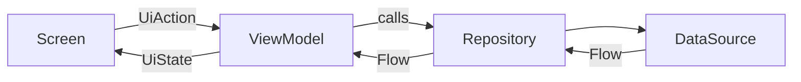

<!--
FEATURE PAGE TEMPLATE. Copy to architecture/features/<name>.md. Reference implementation: 20-feature-template.md
and 05-presentation-udf.md. Point to code (path + symbol), do not paste code. Verify with codegraph_explore.
Doc status (DRAFT | VERIFIED | NEEDS_REFRESH) and test status (NOT_RUN | TESTED | FAILED | BLOCKED) are separate
fields with the legends in architecture/modules/TEMPLATE.md. TESTED/FAILED require an evidence path under reports/.
-->

# FEATURE: <name>
Status: DRAFT | VERIFIED | NEEDS_REFRESH
Verified commit: <SHA or UNKNOWN>
Last source audit: <YYYY-MM-DD or NOT_RUN>
Test status: NOT_RUN | TESTED | FAILED | BLOCKED (evidence: reports/...)

## 1. Identity and scope
- Package / owning module: <e.g. `com.dc.android.foundation.<name>` in `:app`>
- Purpose (1 line) and non-goals:
- Role: reference | showcase | production feature

## 2. Presentation contract (UDF — UI-01/UI-02)
- Route composable (stateful entry, collects state):
- Screen composable (stateless; state down, actions up):
- ViewModel (`@HiltViewModel`; no `BaseViewModel`, UI-03):
- UiState (durable, includes user messages):
- UiAction (sealed; every user intent):
- UiEffect (only immediate one-shot UI integration; or `none`):

## 3. DI and ownership
- Constructor dependencies (interfaces from which module):
- Hilt module / bindings and scope (DI-01, DI-02):
- State owner for any persisted/shared state (CFG-02):

## 4. Data flow
<!-- Mermaid: Screen -> Action -> ViewModel -> Repository -> DataSource -> back as UiState. Name real symbols. -->

- Error mapping (infrastructure exception -> `AppError` -> user message; ERR-01/INV-07):
- Threading (`DispatcherProvider`; THR-02):

## 5. Navigation entry
- `Destination` entry, route registration point (NAV-01), arguments, deep links:

## 6. Design system usage
- `DcTheme` and `Dc*` components used; any raw token/literal exceptions (DS-01/DS-03):

## 7. Tests and evidence
- ViewModel unit test (TST-01) and Compose UI test (TST-02): path, test status per legend.
- Commands:
- Test status: NOT_RUN (evidence: reports/baseline-verification.md)

## 8. Known debt / decisions
<!-- KD-xx / DEC-xx links only. -->

## 9. AI playbook
- Read → Graph → Propose → Edit → Test → Update docs → Handover.
- Files to read first; `codegraph_explore` query to start with; how to add an action/field safely; DoD.
- Generator: `createFeature` scaffold (`architecture/20-feature-template.md`) if creating a sibling feature.
