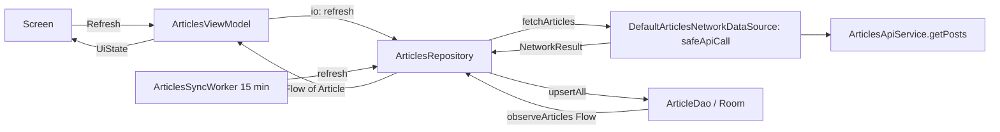

# FEATURE: articles
Status: DRAFT
Verified commit: UNKNOWN (source read at HEAD 2c0ae05b670964686e09dbc7cde7fee4e19f5de7 plus uncommitted docs; no VERIFIED claim)
Last source audit: 2026-10-27
Test status: NOT_RUN (evidence: reports/baseline-verification.md)

## 1. Identity and scope
- Package / owning module: `com.dc.android.foundation.articles` in `:app` (`app/src/main/java/com/dc/android/foundation/articles/`)
- Purpose: offline-first article list (Room as source of truth, JSONPlaceholder `/posts` refresh, periodic background sync, optional completion notification). Non-goals: pagination, detail view, auth, real backend (DEC-04).
- Role: reference (Master Plan 6.1 Flow A; real instance of DAT-CACHE-01, BG-01, PERM-01, DAT-NET-01, DAT-ROOM-01)

## 2. Presentation contract (UDF — UI-01/UI-02)
- Route: `ArticlesRoute` (`ArticlesRoute.kt:32`); `hiltViewModel()`, collects state and `effects`, owns `rememberLauncherForActivityResult(RequestPermission)` (only Route touches the OS permission API, PERM-01), hosts `DcScaffold`
- Screen: `ArticlesScreen(state, onAction, modifier)` (`ArticlesScreen.kt:26`); `DcContentState` + `LazyColumn` of `DcCard`; previews default and stale
- ViewModel: `ArticlesViewModel` (`@HiltViewModel`, extends `ViewModel()`)
- UiState: `ArticlesUiState(articles: List<Article>, isRefreshing, isShowingStaleData, userMessage: String?, notificationPermissionState: PermissionState = NotRequested)`
- UiAction: sealed `ArticlesUiAction` = `Refresh`, `RequestNotificationPermission`, `UserMessageShown`, `UpdateNotificationPermissionState(state)`
- UiEffect: `ArticlesUiEffect.LaunchNotificationPermissionRequest` (BUFFERED `Channel`, `receiveAsFlow`); the only effect, Route-owned framework integration (UI-02)

## 3. DI and ownership
- VM deps: `ArticlesRepository` (feature), `DispatcherProvider` (`:runtime:concurrency`), `Logger` + `AnalyticsTracker` (`:observability`), `SavedStateHandle` (injected but not read in `ArticlesViewModel` source).
- Repository deps: `ArticlesNetworkDataSource` (feature iface), `ArticleDao` (`:data:database`), `CrashReporter` (`:observability`).
- Hilt: `ArticlesModule` (`@InstallIn(SingletonComponent)`, `@Binds DefaultArticlesNetworkDataSource -> ArticlesNetworkDataSource`; DI-02). Cross-module providers in `app/.../di/`: `NetworkModule` (`@Singleton` OkHttpClient/Retrofit via `NetworkClientFactory`, `ArticlesApiService`; base URL `AppEnvironmentProvider.ARTICLES_BASE_URL`), `DatabaseModule` (`DcDatabase`, `ArticleDao`). `ArticlesSyncWorker` is `@HiltWorker`/`@AssistedInject`; `DcApplication` supplies `HiltWorkerFactory` as `Configuration.Provider`.
- State owner: Room `ArticleDao` table is the single owner of article data; `ArticlesViewModel` holds only transient UI flags. Permission state is Route-reported into UiState.

## 4. Data flow

- Flow: VM `init` collects `observeArticles()` (Room emits cached rows immediately). `Refresh`: `isRefreshing=true`, `withContext(io){repo.refresh()}`, then sets `isShowingStaleData=!succeeded` and a message ("Refreshed" / "Refresh failed, showing cached data"); success also tracks analytics `articles_refreshed`. Success upserts `ArticleDto.toEntity()` rows, Room re-emits; no separate apply step.
- Worker: `DcApplication.onCreate` schedules `articles-sync` every 15 min, `DcConstraints.Network`, via `AndroidDcScheduler` (`:runtime:scheduling`). `run()` -> `repo.refresh()`; true -> best-effort notification (needs `PermissionState.Granted`, channel `articles_sync`) + `DcJobResult.Success`; false -> `Retry`; other `Throwable` -> `Failure(AppError.Unknown)`; `CancellationException` rethrown.
- Error mapping (ERR-01/INV-07): `safeApiCall` maps IO/HTTP exceptions to `NetworkResult.Failure(AppError)` in `:data:network`. `ArticlesRepository` collapses it to `Boolean` (stale cache kept) and sends `error.cause` to `CrashReporter`; the UI sees only the stale flag and a message, never `AppError`. A Room exception from `upsertAll` is not caught in the VM (propagates in `viewModelScope`); the worker maps it to `AppError.Unknown`.
- Threading (THR-02): VM wraps refresh in `dispatcherProvider.io`; worker calls `refresh()` directly in `DcWorker`. Mapping `ArticleDto -> ArticleEntity -> Article` stays inside the repository (DAT-01).

## 5. Navigation entry
- `Destination.Articles` (`:platform:navigation`); registered in `MainActivity.kt` `DcNavHost`: `composable<Destination.Articles> { ArticlesRoute() }` (NAV-01). Reached via nav-suite item id `"articles"` (`navigate(Destination.Articles)` with `popUpTo` start, `saveState/restoreState`). No arguments, no deep links.

## 6. Design system usage
- `DcScaffold`, `DcSnackbarEffect`, `DcButton`, `DcContentState`, `DcCard`, `DcText`, `LocalDcSpacing`. No raw `.dp` (DS-03). Hard-coded English strings in Screen/VM/worker (not `stringResource`).

## 7. Tests and evidence
- ViewModel unit test (TST-01): `app/src/test/java/com/dc/android/foundation/articles/ArticlesViewModelTest.kt` - 8 tests: cached initial state, refresh success upserts + clears stale, analytics event, failure records crash exception, keeps cache + stale flag, message until ack, permission effect, permission state update. Fakes: in-file `FakeArticleDao`, `FakeArticlesNetworkDataSource`; `:testing` `RecordingAnalyticsTracker`, `RecordingCrashReporter`, `FakeDispatcherProvider`. Test status: NOT_RUN.
- Compose UI test (TST-02): none for `ArticlesScreen`/`ArticlesRoute`. No tests for `ArticlesRepository`, `ArticlesSyncWorker`, retry/worker overlap, or transaction failure (CodeGraph: no tests within 3 hops).
- Commands (not run): `./gradlew :app:testDebugUnitTest --tests '*ArticlesViewModelTest'`.
- Test status: NOT_RUN (evidence: reports/baseline-verification.md)

## 8. Known debt / decisions
- DEC-04 (why `articles` exists). KD-02 (boundaries unenforced). KD-05 (analytics/crash use local no-op backends).
- Unverified: no `INTERNET` permission found in any `AndroidManifest.xml` (only `POST_NOTIFICATIONS`); merged manifest not inspected, build NOT_RUN. Reported in R1.2 drift.

## 9. AI playbook
- Read -> Graph -> Propose -> Edit -> Test -> Update docs -> Handover.
- Read first: `ArticlesRepository.kt`, `ArticlesViewModel.kt`, `13-permissions.md` (PERM-01), `14-background-work.md` (BG-01), `10-data/`. Start query: `codegraph_explore "ArticlesRoute ArticlesViewModel ArticlesRepository ArticlesNetworkDataSource ArticlesSyncWorker ArticlesApiService ArticlesModule"`.
- Add an action/field: extend `ArticlesUiAction` + `ArticlesUiState`, handle in `onAction`, keep OS APIs in Route, add VM tests. Keep DTO/entity out of UiState. Never log article content (SEC-01).
- DoD: compiles, VM tests green, new data behaviour tested at repository level, docs updated.
