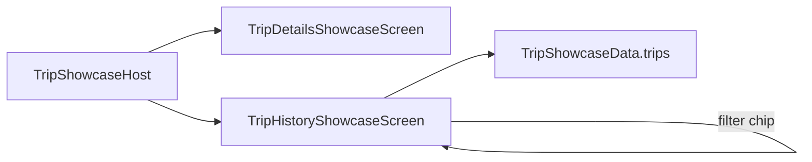

# FEATURE: showcase
Status: DRAFT
Verified commit: UNKNOWN (source read at HEAD 2c0ae05b670964686e09dbc7cde7fee4e19f5de7 plus uncommitted docs; no VERIFIED claim)
Last source audit: 2026-10-27
Test status: NOT_RUN (evidence: reports/baseline-verification.md)

## 1. Identity and scope
- Package / owning module: `com.dc.android.foundation.showcase.trip` in `:app` (`app/src/main/java/com/dc/android/foundation/showcase/trip/`); the context-map package `...showcase` is the parent of this single `trip` subpackage.
- Purpose: debug-gated (runtime check, still compiled into release; KD-06) demo of common screen patterns (detail summary, record list with filter + status) built from design-system parts. Non-goals: real feature, data source, ViewModel, persistence, navigation destination.
- Role: showcase (developer-facing; not a template for stateful features)

## 2. Presentation contract (UDF — UI-01/UI-02)
- Route: none. Entry `TripShowcaseHost` (`TripShowcaseHost.kt:19`), a stateless-looking public composable with local `rememberSaveable` selection (tabs `home/history/report/more` through a nested `DcNavigationSuite`)
- Screens: `TripDetailsShowcaseScreen(onNavigateBack)` (internal; `rememberSaveable` confirm-dialog flag), `TripHistoryShowcaseScreen` (internal; `rememberSaveable` filter chip All/Completed/Pending/Cancelled)
- ViewModel / UiState / UiAction / UiEffect: none. Fixed in-file data `TripShowcaseData.trips` (`internal object`), `TripShowcaseItem`, `TripStatus` (enum, `toTone()` maps to `DcStatusTone`). UI-01/UI-02/UI-03 apply to production features and are not exercised here; the generic UDF contract is deliberately absent.

## 3. DI and ownership
- No constructor deps, no Hilt module, no bindings (DI-02/DI-03 trivially held). State owner: Compose-local saveable state only; nothing persisted or shared (CFG-02 n/a).

## 4. Data flow

- Error mapping: none (no I/O, no `AppError`). Threading: none (main thread composition only).

## 5. Navigation entry
- Not a `Destination`. `MainActivity.kt` `DcNavHost` registers the plain string route `"trip-showcase"` (`TRIP_SHOWCASE_ROUTE`) only when `AppEnvironmentProvider.current == AppEnvironment.DEBUG`; nav-suite item id `"showcase"` (`R.string.nav_showcase`) is also debug-only. NAV-01 holds (no `androidx.navigation` in the showcase package). No arguments, no deep links. The host's four inner tabs are local state, not NavHost entries.

## 6. Design system usage
- Uses `DcScaffold`, `DcTopAppBar`, `DcBottomActionBar`, `DcPrimaryActionButton`, `DcConfirmDialog`, `DcSectionHeader`, `DcCard`, `DcKeyValueRow`, `DcListRow`, `DcStatusChip`/`DcStatusTone`, `DcChip`, `DcEmptyState`, `DcIconButton`, `DcDivider`, `DcText`, `DcNavigationSuite`, `LocalDcSpacing`.
- DEC-06: stable primitives were promoted into `:ui:designsystem` (`DcKeyValueRow`; record cards composed from `DcCard` + `DcListRow` + `DcStatusChip`). Feature-owned here: screen orchestration, filter logic, status-to-tone mapping, formatting, Trip models and sample data. Product states should come from a Route/ViewModel via `DcContentState`; this demo has none.
- Exceptions (DS-01/DS-03): `TripHistoryShowcaseScreen.kt` uses `MaterialTheme.typography.titleMedium` and `androidx.compose.ui.Alignment.End` directly (raw Material style access); all user-visible text is hard-coded English literals, including currency strings; `TripShowcaseHost` KDoc is Vietnamese. No raw `.dp`.

## 7. Tests and evidence
- ViewModel unit test (TST-01): n/a (no ViewModel). Compose UI test (TST-02): none; CodeGraph found no tests within 3 hops of any showcase symbol. Screenshot testing is undecided (DEC-08).
- Commands: none specific; compile with `./gradlew :app:assembleDebug` (not run).
- Test status: NOT_RUN (evidence: reports/baseline-verification.md)

## 8. Known debt / decisions
- DEC-06 (promote primitives, not domain-shaped screens). DEC-08 (DS widget set / string defaults). KD-02 (Open, partially mitigated: static `tools/check_architecture.py --boundaries-only`; CI run NOT_RUN). Referenced as example code from `07-design-system/common-screen-patterns.md`.
- Debt: `component-roadmap.md` expects the showcase to prove new widgets; no test pins that.

## 9. AI playbook
- Read -> Graph -> Propose -> Edit -> Test -> Update docs -> Handover.
- Read first: `07-design-system/common-screen-patterns.md`, DEC-06, then `TripHistoryShowcaseScreen.kt`. Start query: `codegraph_explore "TripShowcaseHost TripDetailsShowcaseScreen TripHistoryShowcaseScreen TripShowcaseData"`.
- Change safely: edit only inside the `showcase/trip` package; compose from `Dc*` parts; do not add domain logic or a ViewModel. If a pattern repeats in a real feature, promote the neutral primitive to `:ui:designsystem` per DEC-06 and update the registry/catalog.
- DoD: debug build compiles, showcase still debug-gated in `MainActivity`, no DI/data imports in the package.
- Rule glosses (text lives in the named doc; gloss only, the rule doc is authoritative): `DI-02` (08-dependency-injection-hilt.md): bindings live next to the interface/impl they wire; `DI-03` (08-dependency-injection-hilt.md): Compose content does not resolve dependencies itself; `UI-01` (05-presentation-udf.md): state flows down, actions flow up; `UI-02` (05-presentation-udf.md): ViewModel outcomes become state; effects only for immediate UI integration; `UI-03` (05-presentation-udf.md): no universal BaseViewModel; `DS-01` (07-design-system/README.md): feature UI themes through DcTheme, not raw tokens; `DS-03` (07-design-system/README.md): no raw spacing/shape literals in feature UI; `NAV-01` (06-navigation.md): feature code does not depend on the navigation engine; only :app does; `CFG-02` (16-config-feature-flags-environments.md): user configuration has one state owner and a typed mutation API; `TST-01` (17-testing.md): every *ViewModel gets a unit test using MainDispatcherRule; `TST-02` (17-testing.md): stateless screens get a Compose UI test, not a mock-heavy one.
