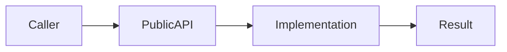

<!--
MODULE PAGE TEMPLATE (MP §3.3). Copy to architecture/modules/<name>.md and fill from REAL code.
- Keep the 12 section headings below verbatim and in order (tools/check_architecture.py checks them).
- Point to code (path + symbol); do not paste code. Prefer facts verified with codegraph_explore.
- Doc status and test status are different fields (legend below). Delete these guidance comments when filling.
-->

# MODULE: <gradle-path> — <name>
Status: DRAFT | VERIFIED | NEEDS_REFRESH
Verified commit: <SHA or UNKNOWN>
Last source audit: <YYYY-MM-DD or NOT_RUN>
Test status: NOT_RUN | TESTED | FAILED | BLOCKED (evidence: reports/...)

> **Two separate vocabularies**
> - **Doc status** (`Status:`; freshness of this page vs source): `DRAFT` = written/unreviewed; `VERIFIED` = checked against current source and build files, requires a `Verified commit` SHA and an audit date; `NEEDS_REFRESH` = source or commit moved on, or docs and source disagree.
> - **Test status** (`Test status:`; result of running the module's tests): `NOT_RUN` (not executed, say why), `TESTED` (executed and passed), `FAILED`, `BLOCKED` (cannot run, say why). **`TESTED` and `FAILED` require an evidence path** (command output under `reports/`); never derive them from reading code. Default is `NOT_RUN`.
> - Per-fact info tags (optional, MP 3.2): `CONFIRMED_IN_CODE`, `TESTED`, `DOCUMENTED_ONLY`, `REPORTED`, `PROPOSED`, `UNKNOWN`, `BLOCKED`, each with a commit or evidence path when they matter.

## 1. Identity and responsibility
<!-- Source: settings.gradle.kts, <module>/build.gradle.kts. One line per bullet. -->
- Owns:
- Does not own:
- Public package/API:
- Consumer(s):

## 2. Context and discovery
<!-- Pointers only. Rule IDs come from architecture/01..24 (e.g. DEP-01, THR-02). -->
- Read first: `architecture/00-index.md`, `architecture/<relevant-rules>.md`
- Main code:
- Tests:
- Build config:
- CodeGraph entry symbols/callers/callees:

## 3. Dependencies and boundaries
<!-- Allowed/forbidden edges must match architecture/dependency-rules.md. -->
- Allowed:
- Forbidden:
- Exceptions (DEC/KD):

## 4. Data/control flow
<!-- One small Mermaid diagram of the real call/state flow, with source refs below it. -->

## 5. Contracts
<!-- Signatures by symbol name; inputs/outputs, errors (AppError mapping), cancellation, threading, lifecycle. -->
- API, inputs/outputs, errors, cancellation, threading, lifecycle:

## 6. DI, configuration and ownership
<!-- Who constructs it, which :app Hilt module binds it, scope, variants/defaults. -->

## 7. Edge cases, security and performance
<!-- Secret/PII handling (SEC-01/02), blocking work (THR-02), failure modes, size/perf limits. -->

## 8. Tests and evidence
<!-- Test status per row uses the test-status legend. Commands are exact Gradle tasks. -->
- Unit:
- Integration:
- Instrumented:
- Commands:
- Test status: NOT_RUN (evidence: reports/baseline-verification.md)  <!-- NOT_RUN | TESTED | FAILED | BLOCKED; TESTED/FAILED need an evidence path -->
- Last verified result:

## 9. Known debt / decisions
<!-- Link KD-xx (22-known-deviations.md) and DEC-xx (23-decision-log.md); no free-form debt. -->

## 10. Safe extension guide
<!-- How another module/feature may reuse or extend this safely; name a real sample consumer. -->

## 11. AI task playbook
- Read → Graph → Propose → Edit → Test → Update docs → Handover.
<!-- Files to read, `codegraph_explore` queries to run, task recipe, definition of done. -->

## 12. Change log and links
<!-- Date, WP id, one line; links to rules, context-map entry, reports/wp/<WP>.md. -->
