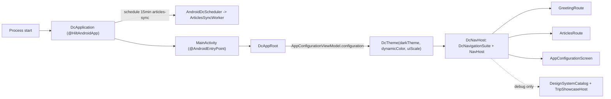

# MODULE: :app — composition root and reference journeys
Status: DRAFT
Verified commit: UNKNOWN
Last source audit: NOT_RUN
Test status: NOT_RUN (evidence: reports/baseline-verification.md)

> **Two separate vocabularies**
> - **Doc status** (`Status:`): `DRAFT` = written/unreviewed; `VERIFIED` = checked against current source and build files (needs commit SHA + audit date); `NEEDS_REFRESH` = source moved on or docs disagree.
> - **Test status** (`Test status:`): `NOT_RUN` | `TESTED` | `FAILED` | `BLOCKED`; `TESTED`/`FAILED` require an evidence path under `reports/`. Never derived from reading code.
> - Fact tags used below: `CONFIRMED_IN_CODE`, `DOCUMENTED_ONLY`, `PROPOSED`, `UNKNOWN`.

## 1. Identity and responsibility
- Owns: the only Android application (`applicationId` = namespace `com.dc.android.foundation`), `DcApplication`, `MainActivity`, all Hilt `@Module`s that bind library implementations, the `config` package (app appearance + environment), and three reference features (`greeting`, `articles`, `showcase/trip`). `CONFIRMED_IN_CODE` (`app/build.gradle.kts`, `app/src/main/AndroidManifest.xml`)
- Does not own: reusable UI (`:ui:designsystem`), navigation contracts (`Destination` lives in `:platform:navigation`), preferences/network/database/security/observability implementations (library modules). Not a product: reference code must stay small and business-neutral (master-plan 4.13 non-goal).
- Public package/API: none for reuse; root package `com.dc.android.foundation` with sub-packages `di`, `config`, `greeting`, `articles`, `showcase.trip`. Nothing may depend on `:app` (DEP-01).
- Consumer(s): none (leaf of the module graph).

## 2. Context and discovery
- Read first: `architecture/00-index.md`, `04-app-bootstrap-and-lifecycle.md`, `08-dependency-injection-hilt.md`, `16-config-feature-flags-environments.md`, `20-feature-template.md`, `05-presentation-udf.md`.
- Main code (`app/src/main/java/com/dc/android/foundation/`): `DcApplication.kt`, `MainActivity.kt`, `di/*` (6 modules), `config/*` (7 files), `greeting/`, `articles/`, `showcase/trip/`; manifest `app/src/main/AndroidManifest.xml`; resources `app/src/main/res/` (`values`, `values-vi`, `values-night`, `resources.properties`).
- Feature pages (written by R1.2, links only): [greeting](../features/greeting.md), [articles](../features/articles.md), [showcase](../features/showcase.md).
- Tests: `app/src/test` (4 files), `app/src/androidTest` (2 files).
- Build config: `app/build.gradle.kts` — plugins `dc.android.application`, `dc.compose`, `kotlin.serialization`, `dc.hilt`, `dc.room`, `dc.testing`, `dc.feature.generator`; `generateLocaleConfig = true`; `release.optimization.enable = false` (R8 off, as-is).
- CodeGraph entry symbols: `DcApplication`, `MainActivity`, `ConcurrencyModule`, `DatabaseModule`, `NetworkModule`, `AppEnvironmentProvider` (7 callers: `MainActivity`, `NetworkModule`, `ObservabilityModule`).

## 3. Dependencies and boundaries
- Allowed (`architecture/dependency-rules.md`, `implementation`): `:foundation`, `:ui:designsystem`, `:runtime:concurrency`, `:runtime:scheduling`, `:data:preferences`, `:data:network`, `:data:database`, `:observability`, `:platform:navigation`, `:platform:permission`, `:security`; test-only `:testing` (BLD-03).
- Forbidden: reverse edges from any module to `:app` (DEP-01); feature package importing another feature's internals (DEP-02: `greeting`, `articles`, `showcase`, `config`); Composables resolving repositories/DAO/DataStore directly (DEP-03/INV-02); `androidx.navigation.*` in feature code (NAV-01: only `MainActivity` touches it); `BuildConfig.DEBUG` read outside `AppEnvironmentProvider` (CFG-01).
- Exceptions (DEC/KD): none for edges. Enforcement is manual (KD-02, R2.1). `:foundation` is used by `articles/ArticlesSyncWorker.kt` (`foundation.core.*`).

## 4. Data/control flow

- `DcApplication.onCreate` launches on an `AppCoroutineScope(dispatcherProvider)` (no `GlobalScope`) and schedules `ArticlesSyncWorker` every 15 minutes with `DcConstraints.Network`, logging the outcome (`DcApplication.kt:56-75`). WorkManager auto-init is removed in the manifest; `DcApplication` is `Configuration.Provider` with `HiltWorkerFactory` (BG-01).
- `MainActivity` (`AppCompatActivity`) calls `enableEdgeToEdge()` and `setContent { DcAppRoot() }`. `DcAppRoot` collects `AppConfigurationViewModel.configuration` and roots the tree in `DcTheme` (DS-01).
- `DcNavHost` (`MainActivity.kt:74-`): start destination `Destination.Greeting`; typed routes `composable<Destination.Greeting>` / `<Destination.Articles>`; string routes `more` (settings), `design-system-catalog`, `trip-showcase`. Bottom/side items built from `DcNavigationItem`; selection uses `popUpTo(startDestination){saveState}`, `launchSingleTop`, `restoreState`. Catalog and showcase items/routes exist only when `AppEnvironmentProvider.current == DEBUG` (runtime check, same source set, so the code is compiled into release).

## 5. Contracts
- `AppConfiguration(themeMode: AppThemeMode, uiScale: DcUiScale, dynamicColor: Boolean)`; `AppThemeMode.resolveDarkTheme(systemDark)`; actions `AppConfigurationAction.{SetThemeMode, SetUiScale, SetDynamicColor, Reset}` (`config/AppConfiguration.kt`, `AppConfigurationViewModel.kt`).
- `AppConfigurationRepository` (`@Singleton`): `configuration: Flow<AppConfiguration>` (combine of 3 preference flows), `setThemeMode`, `setUiScale`, `setDynamicColor`, atomic `update`, `reset` (suspend, via `PreferencesDataSource`; keys `app_theme_mode`, `app_ui_scale`, `app_dynamic_color`; defaults System / Standard / false). Main-safety is delegated to the preferences module.
- `AppConfigurationViewModel` (`@HiltViewModel`): `configuration: StateFlow` (`stateIn` `Eagerly`, initial `AppConfiguration()`), `onAction(action)` launches in `viewModelScope`.
- `AppLanguageController` (object, `@MainThread`): `currentLanguageTag()`, `setApplicationLanguage(tag?)`, `useSystemLanguage()` over `AppCompatDelegate`; locale is not duplicated in DataStore (DEC-07); consumed by `AppConfigurationScreen`. Locales: `values` + `values-vi` (26 strings each), `resources.properties` `unqualifiedResLocale=en`.
- `AppEnvironment { DEBUG, RELEASE }`, `AppEnvironmentProvider.current` (sole `BuildConfig.DEBUG` reader, CFG-01), `ARTICLES_BASE_URL` constant. No feature flags exist.
- Features: Route (stateful, `hiltViewModel()`) -> ViewModel (`UiState`/`UiAction`) -> Screen (stateless); detail in the feature pages above.

## 6. DI, configuration and ownership
Library modules are DI-framework-agnostic, so `:app` binds them (08-dependency-injection-hilt.md). All are `@InstallIn(SingletonComponent::class)`, `@Singleton`; no `AppModule` (DI-02).

| Module (`di/`) | Provides |
|---|---|
| `ConcurrencyModule` | `DispatcherProvider` = `DefaultDispatcherProvider` |
| `DataStoreModule` | `DataStore<Preferences>` (file `dc_foundation_prefs`), `PreferencesDataSource` = `DataStorePreferencesDataSource` |
| `DatabaseModule` | `DcDatabase` via `RoomDatabaseFactory` (`dc_foundation_db`), `ArticleDao` |
| `NetworkModule` | `OkHttpClient`, `Retrofit` (base `ARTICLES_BASE_URL`), `ArticlesApiService` |
| `ObservabilityModule` | `Logger` = `AndroidLogger(isDebug)`, `AnalyticsTracker`/`CrashReporter` = logging no-ops (KD-05) |
| `SecurityModule` | `SecureStorage` = `EncryptedSharedPreferencesSecureStorage`; no `:app` consumer found (KD-04) |
| `greeting/GreetingModule`, `articles/ArticlesModule` | `@Binds` `GreetingProvider`, `ArticlesNetworkDataSource` (feature-local, DI-02) |

`DcApplication` uses field injection (`HiltWorkerFactory`, `DispatcherProvider`, `Logger`) because `Application` has no injectable constructor.

## 7. Edge cases, security and performance
- Manifest requests `POST_NOTIFICATIONS` (PERM-01, sync completion notification); `allowBackup=true` with `backup_rules.xml`/`data_extraction_rules.xml` (content of rules `UNKNOWN`, not audited here).
- `ARTICLES_BASE_URL` is a public demo endpoint (`jsonplaceholder.typicode.com`); no secrets in `app/` source (not scanned by tool). `SecureStorage` is wired but unused (KD-04).
- Release build has `optimization.enable=false` and an empty `rules.keep`; debug-only screens are still compiled into release.
- `ArticlesScreen.kt` hard-codes English "Showing cached data — refresh failed" (not a string resource); drift against DS string convention (DEC-08), feature-level debt.
- Startup/perf baselines absent (APP-06).

## 8. Tests and evidence
- Unit (`app/src/test`, 19 `@Test`, never executed): `GreetingViewModelTest`, `ArticlesViewModelTest`, `AppConfigurationRepositoryTest`, `ExampleUnitTest`.
- Integration: none.
- Instrumented (`app/src/androidTest`, 3 `@Test`): `GreetingScreenTest` is compiled-only and has never been executed (no device/emulator); `ExampleInstrumentedTest` likewise not run.
- Commands: `./gradlew :app:testDebugUnitTest`, `./gradlew :app:assembleDebug`, `./gradlew :app:connectedDebugAndroidTest` (needs emulator).
- Test status: NOT_RUN (evidence: reports/baseline-verification.md; Gradle blocked at daemon toolchain 25 and AGP plugin resolution, Part B)
- Last verified result: none.

## 9. Known debt / decisions
- DEC-07 (appearance persisted in `:app`; locale via AppCompat; `config` stays in `:app` until a second consumer earns `:platform:configuration`), DEC-05 (showcase is `:app` reference code, not DS). KD-02 (no enforced boundaries), KD-04, KD-05 (see section 6).
- Docs vs source: `07-design-system/README.md` and DEC-05 describe the showcase as debug-only `:app` code; source gates it by runtime `AppEnvironment` in the main source set (`MainActivity.kt`). Recorded in report D.
- Backlog (PROPOSED, master-plan 4.13): APP-01 verify greeting/articles/config tests (P0); APP-02 run `GreetingScreenTest` on device/emulator (P0); APP-03 navigation + permission journeys; APP-04 missing error/offline/loading/retry/empty flows; APP-05 full catalog showcase; APP-06 startup/screen benchmark baselines.

## 10. Safe extension guide
- New feature: create a package with Route/ViewModel/UiState/UiAction/Screen (`20-feature-template.md`, generator plugin `dc.feature.generator`); bind in a feature-local `@Module`; add a destination in `:platform:navigation` and register it in `DcNavHost` (the only nav-aware file).
- New infrastructure binding: add a focused `di/<Capability>Module`; never a catch-all `AppModule`.
- New app-wide setting: extend `AppConfiguration` + repository key + action, apply at `DcAppRoot`; features must not read DataStore.
- Reference consumers: `greeting` (smallest slice), `articles` (network + Room + worker), `config` (settings UI).

## 11. AI task playbook
- Read → Graph → Propose → Edit → Test → Update docs → Handover.
- Read: pages listed in section 2 plus the feature page for the touched feature.
- Graph: `codegraph_explore "DcApplication MainActivity <ModuleName> <FeatureViewModel>"`, `projectPath` = repo root; check who calls a binding before moving it.
- Recipe: keep `:app` the only composition root; keep features independent (DEP-02); route all theming through `DcTheme`.
- Done when: `:app:testDebugUnitTest` and `:app:assembleDebug` pass (currently cannot run, see section 8), docs and `context-map.yaml` updated if edges or ownership change, report in `reports/wp/<WP>.md`.

## 12. Change log and links
- 2026-10-27 — R1.1d — first DRAFT from source; report `reports/wp/R1.1d.md`.
- Links: `architecture/context-map.yaml` (`app`; features `greeting`, `articles`, `showcase`), `architecture/dependency-rules.md`, `architecture/modules/ui-designsystem.md`, `architecture/22-known-deviations.md`, `architecture/23-decision-log.md`.
