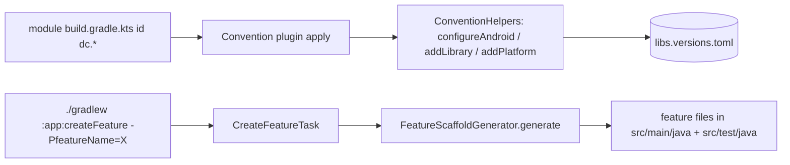

# MODULE: includeBuild:build-logic — build-logic
Status: DRAFT
Verified commit: UNKNOWN (drafted against working tree at HEAD 2c0ae05b; not audited)
Last source audit: NOT_RUN
Test status: NOT_RUN (evidence: reports/baseline-verification.md)

> Doc status (`DRAFT|VERIFIED|NEEDS_REFRESH`) and test status (`NOT_RUN|TESTED|FAILED|BLOCKED`) are separate vocabularies; see `TEMPLATE.md`.

## 1. Identity and responsibility
- Owns: the 8 `dc.*` Gradle convention plugins, shared SDK/Java constants, and the feature scaffold generator (`createFeature`). It is an included build (`settings.gradle.kts:2` `includeBuild("build-logic")`, root project `dc-build-logic`), not a project of the main build.
- Does not own: dependency versions (the catalog `gradle/libs.versions.toml`, shared via `build-logic/settings.gradle.kts` `from(files("../gradle/libs.versions.toml"))`), module dependency-edge enforcement (none exists, KD-02), `gradle.properties` flags (KD-03), CI (`.github/workflows/ci.yml`).
- Public package/API: default package (no package declaration); plugin ids below.
- Consumer(s): every module `build.gradle.kts` (via `id("dc.*")`); `:app` additionally applies `dc.feature.generator`.

## 2. Context and discovery
- Read first: `architecture/00-index.md`, `18-build-logic-and-dependencies.md` (BLD-01..03), `19-ci-release-quality-gates.md`, `dependency-rules.md`.
- Main code: `build-logic/src/main/kotlin/*.kt` (11 files). Build: `build-logic/build.gradle.kts` (`kotlin-dsl`, `gradlePlugin { register(...) }`).
- Tests: `build-logic/src/test/kotlin/FeatureScaffoldGeneratorTest.kt` (4 `@Test`; JUnit via `testImplementation(libs.junit)`).
- CodeGraph entry symbols/callers/callees: `DcAndroidLibraryConventionPlugin`, `DcAndroidApplicationConventionPlugin`, `DcKotlinJvmConventionPlugin`, `DcFeatureGeneratorPlugin` -> `CreateFeatureTask` -> `FeatureScaffoldGenerator.generate` (tested by `FeatureScaffoldGeneratorTest`).

## 3. Dependencies and boundaries
- Allowed: AGP, Kotlin, Compose-compiler, KSP, Hilt and Room Gradle plugins as `implementation` of the build-logic build; catalog libraries via `Project.libs`.
- Forbidden: project `project(":...")` coupling to app code (it is a separate build, `depends_on: []`); hard-coded dependency versions (BLD-01); adding `:testing` to production configurations (BLD-03 - `dc.testing` adds only external test libs, not `:testing`).
- Exceptions (DEC/KD): KD-03 (`android.disallowKotlinSourceSets=false` for KSP on AGP 9; `gradle.properties:24`); KD-02 (no enforced module boundaries).

## 4. Data/control flow

## 5. Contracts
| Plugin id | Class | Applies / configures (source) |
|---|---|---|
| `dc.android.application` | `DcAndroidApplicationConventionPlugin` | `com.android.application`; `configureAndroid`; `targetSdk=37`; AndroidJUnitRunner; `buildConfig=true`; `coreLibraryDesugaring` |
| `dc.android.library` | `DcAndroidLibraryConventionPlugin` | `com.android.library`; `configureAndroid`; AndroidJUnitRunner; desugaring |
| `dc.kotlin.jvm` | `DcKotlinJvmConventionPlugin` | `org.jetbrains.kotlin.jvm`; `jvmToolchain(11)` |
| `dc.compose` | `DcComposeConventionPlugin` | `kotlin.plugin.compose`; on app/library: `buildFeatures.compose`, Compose BOM, ui, graphics, tooling-preview, material3, `debugImplementation` tooling |
| `dc.hilt` | `DcHiltConventionPlugin` | `com.google.dagger.hilt.android`, `com.google.devtools.ksp`; `hilt-android`, `ksp(hilt-compiler)` |
| `dc.room` | `DcRoomConventionPlugin` | `com.google.devtools.ksp`, `androidx.room`; `schemaDirectory("$projectDir/schemas")`; room runtime/ktx/compiler |
| `dc.testing` | `DcTestingConventionPlugin` | `testImplementation` junit, coroutines-test, turbine; `androidTestImplementation` androidx-junit, espresso (Android only); Compose UI test deps when `dc.compose` is present |
| `dc.feature.generator` | `DcFeatureGeneratorPlugin` | registers task `createFeature` (group "dc scaffolding") |
- `configureAndroid` (`ConventionHelpers.kt`): `compileSdk=37`, `minSdk=24`, Java 11 source/target, core-library desugaring on, `lint.abortOnError=true`, `lint.checkReleaseBuilds=true`. Constants: `DC_COMPILE_SDK`, `DC_MIN_SDK`, `DC_TARGET_SDK`, `DC_JAVA_VERSION`.
- Generator inputs: `-PfeatureName` (required, one identifier), `-PfeaturePackage` (else inferred from the module namespace), booleans `navigation|network|room|permission|backgroundWork` (default false, other values throw `GradleException`). Output: UiState/UiAction/ViewModel/Route/Screen/Preview + `ViewModelTest` (+ optional UiEffect, `<Name>Destination`, `remote/ApiService`, `local/Dao`, `background/WorkScheduler`). All-or-nothing: aborts if any planned file exists; `CREATE_NEW`, never overwrites. `outputs.upToDateWhen { false }`. It emits no architecture-doc stub (CONFIRMED_IN_CODE).
- Errors: `IllegalArgumentException`/`IllegalStateException` mapped to `GradleException`. Threading/cancellation: configuration-time and a single task action.

## 6. DI, configuration and ownership
- No Hilt (build tooling). `dc.hilt` wires Hilt for `:app` only among current modules. SDK levels, Java level and lint defaults are owned here (BLD-02), not per module. Generated ViewModels use `@HiltViewModel` with an empty `@Inject constructor()`.

## 7. Edge cases, security and performance
- Validation: feature name regex, package segments, Kotlin keywords (`FeatureScaffoldGenerator`); invalid input fails before creating directories (test). No secrets handled. Generator writes only under the module's `src/main/java` and `src/test/java`.
- `dc.testing` + `dc.compose`: Compose UI test deps are added whenever `dc.compose` is applied to the same module, in either order (`pluginManager.withPlugin("dc.compose")` in `DcTestingConventionPlugin.kt:21` fires immediately or on later application).

## 8. Tests and evidence
- Unit: `FeatureScaffoldGeneratorTest` - minimal feature files; capability boundaries; invalid name; existing-file abort. Integration/Instrumented: none. No test covers the Gradle plugins themselves.
- Commands (once Gradle runs): `./gradlew -p build-logic test`; smoke `./gradlew help` (verifies the included build); generator smoke `./gradlew :app:createFeature -PfeatureName=Sample` (then revert).
- Test status: NOT_RUN (evidence: reports/baseline-verification.md)
- Last verified result: none; no Gradle task has been run by R0/R1 agents.

## 9. Known debt / decisions
- CI finding (CONFIRMED_IN_CODE for the workflow, coverage by Gradle selection semantics, not run-verified): `.github/workflows/ci.yml` runs `./gradlew testDebugUnitTest`, lint and `assembleDebug` only. `testDebugUnitTest` is an Android-variant task, so `dc.kotlin.jvm` modules (`:foundation`, `:runtime:concurrency`; tests run via `test`) are not selected, and tests of the included build (`build-logic/src/test`) are not part of the main task graph. Their tests therefore do not run in CI. Needs a decision: add `./gradlew test` (or explicit `:foundation:test :runtime:concurrency:test`) plus `-p build-logic test`. Docs `19-ci-release-quality-gates.md` say `testDebugUnitTest` covers "all modules" (drift, report D). CI uses JDK 21 while the daemon requires toolchain 25 (`gradle/gradle-daemon-jvm.properties`); effect UNKNOWN.
- KD-03: `dc.hilt` and `dc.room` apply KSP; the flag stays until KSP supports AGP 9 `android.sourceSets` (KSP `2.2.10-2.0.2`, AGP 9.3.1 per baseline A1).
- PROPOSED backlog (MP 4.14, none implemented): BLD-01 automated dependency-boundary checks, fail CI on forbidden edge (P0, = R2.1/KD-02); BLD-02 verify generator output compiles/tests, add doc stub (P1); BLD-03 check KD-03 workaround against resolved versions (P0); BLD-04 repeatable test/lint/assemble + report export for all modules (P0); BLD-05 release publishing/API compatibility only when shipping artifacts (P1); BLD-06 portable or optional Graphify hooks, keep CodeGraph (P1). Rule IDs BLD-01..03 in `18-...md` differ in meaning from these backlog IDs.

## 10. Safe extension guide
- New capability = new small `Dc*ConventionPlugin` registered in `build-logic/build.gradle.kts`, composable with others (BLD-02); read versions from the catalog (BLD-01). Add a generator option by extending `FeatureGeneratorOptions`, `CreateFeatureTask`, `DcFeatureGeneratorPlugin` and a test case together. Sample consumer: `:app` (`createFeature`), `:data:database` (`dc.room`).

## 11. AI task playbook
- Read -> Graph -> Propose -> Edit -> Test -> Update docs -> Handover.
- Read: `18-build-logic-and-dependencies.md`, the plugin touched, one consumer `build.gradle.kts`. Graph: `codegraph_explore "FeatureScaffoldGenerator CreateFeatureTask DcAndroidLibraryConventionPlugin"`. Changing a convention affects every module: run `./gradlew help` and `-p build-logic test`, then broader tasks.
- DoD: plugin table in section 5 updated; `dependency-rules.md` if edges change.

## 12. Change log and links
- 2026-10-27 — R1.1c — first draft from plugin sources and CodeGraph. Report: `reports/wp/R1.1c.md`.
- Links: `context-map.yaml` entry `build-logic`; `18-build-logic-and-dependencies.md`; `19-ci-release-quality-gates.md`; `22-known-deviations.md` (KD-02, KD-03).
