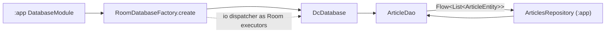

# MODULE: :data:database — Room infrastructure (+ sample Article schema)
Status: DRAFT
Verified commit: UNKNOWN (source read at base 2c0ae05; not VERIFIED)
Last source audit: 2026-10-27 (CodeGraph + file read; no Gradle build)
Test status: NOT_RUN (evidence: reports/baseline-verification.md)

> Doc status and test status are separate fields; legend in [`TEMPLATE.md`](TEMPLATE.md). Open decision D-01 (MP 12.1): ownership of `DcDatabase` and `Article*` (PROPOSED Option 2 in [`reports/wp/B3-design.md`](../../reports/wp/B3-design.md), pending Opus final review; see `23-decision-log.md` DEC-B3-1).

## 1. Identity and responsibility
- Owns (generic): `RoomDatabaseFactory` (builder policy), `TransactionRunner`/`RoomTransactionRunner`, `StalenessPolicy`.
- Owns (sample schema, currently in this module): `DcDatabase` (`@Database(entities=[ArticleEntity], version=1, exportSchema=true)`), `ArticleEntity` (table `articles`), `ArticleDao`, exported schema `data/database/schemas/com.dc.android.foundation.data.database.DcDatabase/1.json`.
- FACT (D-01): the Article* sample schema lives in this generic module, so any consumer importing `DcDatabase` gets the `articles` schema. `ArticleEntity` KDoc calls it the "`articles` reference feature". Whether it stays (annotated) or moves to `:app` is OPEN. Lane B3 (`c2e7331`) labelled `DcDatabase`, `ArticleEntity`, `ArticleDao` as GENERIC vs SAMPLE in KDoc; no move was performed and no schema/version change was made.
- Does not own: feature models (`Article` in `:app` `articles/ArticlesRepository.kt:12`), network DTOs, repositories, database file name/instance (`:app`).
- Public package/API: `com.dc.android.foundation.data.database`.
- Consumer(s): `:app` only (`di/DatabaseModule.kt`, `articles/ArticlesRepository.kt`; `ArticlesViewModelTest` uses a `FakeArticleDao`).

## 2. Context and discovery
- Read first: `architecture/00-index.md`, `10-data/persistence-room.md`, `10-data/cache-and-offline.md`, `11-error-and-result-model.md`, `09-concurrency-and-threading.md`.
- Main code: `data/database/src/main/java/com/dc/android/foundation/data/database/` — `DcDatabase.kt:7`, `RoomDatabaseFactory.kt:16`, `ArticleDao.kt:10`, `ArticleEntity.kt:12`, `RoomTransactionRunner.kt:7,11`, `StalenessPolicy.kt:6`.
- Tests: `data/database/src/test/.../StalenessPolicyTest.kt` (12 `@Test` after lane B3, was 3). No test for factory, DAO or transaction runner in this module.
- Build config: `data/database/build.gradle.kts` (`dc.android.library`, `dc.room`, `dc.testing`; `implementation(:runtime:concurrency)`); `dc.room` sets Room `schemaDirectory("$projectDir/schemas")` (`build-logic/.../DcRoomConventionPlugin.kt:12`).
- CodeGraph entry symbols/callers/callees: `ArticleDao` (callers: `DatabaseModule`, `ArticlesRepository`), `RoomDatabaseFactory.create` (1 caller: `DatabaseModule`), `ArticleEntity` (5 refs in `ArticlesRepository`), `TransactionRunner`/`StalenessPolicy` (no production caller found).

## 3. Dependencies and boundaries
- Allowed: `:runtime:concurrency` (`DispatcherProvider`) per `dependency-rules.md`; Room/coroutines inside this module (DEP-04).
- Forbidden: `:app` (DEP-01), `:testing` in production configs (BLD-03), `:ui:*`. PROPOSED only: `:data:database <-> :data:network` banned; `:data:database -> :foundation` allowed.
- Exceptions (DEC/KD): none recorded. D-01 is a pending decision (MP 12.1), not an exception. R5.0 plans an ADR before any move.

## 4. Data/control flow

Refs: `DatabaseModule.kt:22,34`; `ArticlesRepository.kt:37` (observe, mapped to `Article`), `:41` (refresh upserts via `upsertAll`).

## 5. Contracts
- `RoomDatabaseFactory.create(context, databaseClass, name, dispatcherProvider, migrations = [], allowDestructiveMigrationInDebugOrTest = false): T`. Requires non-blank `name`; uses `context.applicationContext`; sets `setQueryExecutor` and `setTransactionExecutor` to an `Executor` that dispatches on `dispatcherProvider.io`; adds migrations if any; `fallbackToDestructiveMigration(dropAllTables = true)` only if the flag is true. Does not open the DB (builder `.build()` only; Room opens lazily).
- `ArticleDao`: `observeArticles(): Flow<List<ArticleEntity>>` (`ORDER BY id ASC`, cold, re-emits on table change), `suspend upsertAll(List)` (`REPLACE`), `suspend clear()`.
- `TransactionRunner.inTransaction(block: suspend () -> T): T` -> `database.withTransaction { block() }`. Commit/rollback/cancellation semantics are Room's `withTransaction`; not tested here.
- `StalenessPolicy(maxAge: Duration)`: `init` rejects negative `maxAge`; `isStale(lastUpdatedAtMillis: Long?, nowMillis)`: null -> stale; timestamp in the future -> fresh; else stale when age >= `maxAge`. Clock is a parameter (no system clock read inside, so no injectable-clock change was needed). Semantics are now also in the KDoc (lane B3); sub-millisecond ages are truncated (current behaviour, documented by a test).
- Errors: no `AppError` mapping in this module (ERR-01 is not an owner rule of this module; Room failures are not mapped); Room exceptions propagate to the caller. `ArticlesRepository.refresh` does not catch `upsertAll` failures.

## 6. DI, configuration and ownership
- `:app` `di/DatabaseModule.kt` (`@InstallIn(SingletonComponent)`): `provideDcDatabase` (`@Singleton`, name `dc_foundation_db`, no migrations, no destructive flag) and `provideArticleDao`. No binding exists for `TransactionRunner` or `StalenessPolicy` (no production use).
- Room compiler/KSP and schema export come from the `dc.room` convention plugin; this module has no Hilt plugin.

## 7. Edge cases, security and performance
- DB is created lazily on first DAO use; MP:DB-05 (no module-initialization open, no global DAO singleton) holds today: no static state seen in the module (PROPOSED check still pending).
- Version 1 only; no migration exists, so any future `@Database` version bump without a `Migration` fails at open unless the destructive flag is set (flag defaults to false and is not set in `:app`).
- `ArticleEntity` rows hold article title/body in plaintext SQLite (non-secret sample data); no SEC-01/02 data flows through here.
- Backup coverage of `dc_foundation_db`: `UNKNOWN` (backup XML files are template files).
- `ArticleEntity.fetchedAt` is written by `:app` using `System.currentTimeMillis()`; no code reads it or applies `StalenessPolicy` today.

## 8. Tests and evidence
- Unit: `StalenessPolicyTest` — missing data stale; at/over max age stale; future timestamp fresh; lane B3 added TTL boundary (-1 ms / equal / +1 ms), now == timestamp, negative clock skew incl. `Long.MAX_VALUE`, zero `maxAge`, sub-ms truncation, caller-supplied now, negative `maxAge` rejected (written, NOT_RUN). App-side: `ArticlesViewModelTest` with `FakeArticleDao` (no real Room).
- Integration/Instrumented: none (0 `src/androidTest`; no Room in-memory tests).
- Commands: `./gradlew :data:database:testDebugUnitTest`; `./gradlew :app:testDebugUnitTest --tests '*ArticlesViewModelTest'`.
- Test status: NOT_RUN (evidence: reports/baseline-verification.md)
- Last verified result: none (Gradle not executed).
- Not covered: factory executors/migrations, DAO queries, transaction commit/rollback/cancel (MP:DB-02: needs a real `RoomDatabase`, so Robolectric or `androidTest` plus `room-testing`, none in the version catalog; a fake `TransactionRunner` test would be tautological; see HANDOVER follow-ups). TTL boundary equality is now covered.

## 9. Known debt / decisions
- D-01 (MP 12.1, OPEN; PROPOSED Option 2 "move `Article*` + `DcDatabase` to `:app`", recommendation in `reports/wp/B3-design.md`, DEC-B3-1 PROPOSED): ADR planned in R5.0. Constraints: keep `version = 1`, table `articles`, DB file `dc_foundation_db`, identity hash (diff regenerated `1.json`), preferably keep the `DcDatabase` FQCN; `:app` must apply `dc.room`/KSP (unverified). Moving `Article*` to `:app` must preserve schema version/`1.json` (separate refactor, MP 4.5 note). No DEC/KD file entry exists yet.
- Backlog (PROPOSED, MP 4.5): MP:DB-01 audit/ownership decision (P0); MP:DB-02 `RoomTransactionRunner` semantics integration tests (P0; NOT done, test stack undecided; contract KDoc added by B3); MP:DB-03 `StalenessPolicy` fake-clock/boundary tests (P1; done at unit level, NOT_RUN); MP:DB-04 migration/corruption strategy (P1); MP:DB-05 no global DAO / no auto-open check (P0).
- Observation: `TransactionRunner`, `RoomTransactionRunner`, `StalenessPolicy` have no production consumer; DAT-CACHE-01 staleness is not applied by the sample repository.

## 10. Safe extension guide
- New consumer database: declare your own `RoomDatabase` in your module/app and call `RoomDatabaseFactory.create` with a `DispatcherProvider`; do not add entities to `DcDatabase` (it is the sample schema until D-01 resolves).
- Always map entities to feature models at the repository (DAT-ROOM-01, INV-07); real sample consumer: `ArticlesRepository`.
- Any entity change: bump `version`, add a `Migration`, commit the new exported schema JSON.

## 11. AI task playbook
- Read → Graph → Propose → Edit → Test → Update docs → Handover.
- Query: `codegraph_explore "DcDatabase RoomDatabaseFactory ArticleDao ArticleEntity TransactionRunner StalenessPolicy DatabaseModule"`.
- Recipe: do not relocate `Article*` without the D-01 ADR; schema/DAO edits require updating `schemas/*.json`, `DatabaseModule` and `ArticlesViewModelTest` fakes. Done = unit tests + this page + context-map consistent.

## 12. Change log and links
- 2026-10-27 DOC-B (lane B3 `c2e7331`): test count, KDoc labels, D-01 proposal. Report: [`reports/wp/DOC-B.md`](../../reports/wp/DOC-B.md).
- 2026-10-27 R1.1b: first DRAFT from source (base 2c0ae05). Report: [`reports/wp/R1.1b.md`](../../reports/wp/R1.1b.md).
- Links: context-map id `data-database`; rules DAT-ROOM-01, DAT-CACHE-01; [`dependency-rules.md`](../dependency-rules.md).
- Rule glosses (text lives in the named doc; gloss only, the rule doc is authoritative): `INV-07` (01-overview-and-invariants.md): infrastructure exceptions and vendor types do not leak into presentation/public contracts; `DEP-01` (02-layers-and-dependencies.md): core/base modules do not depend on feature implementation (or on :app); `DEP-04` (02-layers-and-dependencies.md): infrastructure-specific types stay behind the owning module boundary; `ERR-01` (11-error-and-result-model.md): infrastructure exceptions are caught at the data-source boundary, not in the ViewModel; `DAT-ROOM-01` (10-data/persistence-room.md): DAO/entity types do not cross the repository mapping boundary; `DAT-CACHE-01` (10-data/cache-and-offline.md): one repository owns remote/local coordination and stale policy; `SEC-01` (12-security-and-session.md): no secret/token/PII in a log call; `SEC-02` (12-security-and-session.md): credentials/tokens are stored only through SecureStorage, never PreferencesDataSource; `BLD-03` (18-build-logic-and-dependencies.md): test utilities never enter production runtime graphs.
