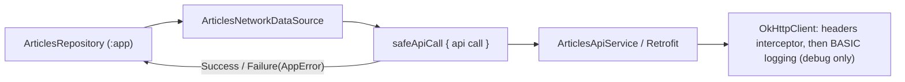

# MODULE: :data:network — Configurable Retrofit/OkHttp client
Status: DRAFT
Verified commit: UNKNOWN (source read at base 2c0ae05; not VERIFIED)
Last source audit: 2026-10-27 (CodeGraph + file read; no Gradle build)
Test status: NOT_RUN (evidence: reports/baseline-verification.md)

> Doc status and test status are separate fields; legend in [`TEMPLATE.md`](TEMPLATE.md).

## 1. Identity and responsibility
- Owns: generic HTTP client construction (`NetworkClientFactory`, `NetworkClientConfig`, internal `NetworkHeadersInterceptor`, `RequestIdProvider`/`UuidRequestIdProvider`), the failure vocabulary wrapper `NetworkResult` + `safeApiCall`, and the `HttpErrorBodyParser` extension point.
- Does not own: base URLs, endpoints, API interfaces, DTOs (feature-owned, DAT-NET-01: `:app` `articles/ArticlesApiService`, `ArticleDto`, `ArticlesNetworkDataSource`); `AppError` (defined in `:foundation`); auth/JWT/refresh (none exists).
- Public package/API: `com.dc.android.foundation.data.network`.
- Consumer(s): `:app` (`di/NetworkModule.kt`, `articles/ArticlesNetworkDataSource.kt`, `articles/ArticlesRepository.kt`).

## 2. Context and discovery
- Read first: `architecture/00-index.md`, `10-data/network.md`, `11-error-and-result-model.md` (ERR-01), `12-security-and-session.md` (SEC-01), `09-concurrency-and-threading.md`.
- Main code: `data/network/src/main/java/com/dc/android/foundation/data/network/` — `NetworkClientFactory.kt:16`, `NetworkClientConfig.kt:21`, `NetworkHeadersInterceptor.kt:11`, `NetworkResult.kt:19,30`, `HttpErrorBodyParser.kt:9`.
- Tests: `data/network/src/test/.../NetworkClientFactoryTest.kt` (2), `NetworkResultTest.kt` (6); uses `okhttp-mockwebserver` (testImplementation).
- Build config: `data/network/build.gradle.kts` (`dc.android.library`, kotlin.serialization, `dc.testing`; `implementation` of `:foundation`, `:observability`, retrofit, okhttp + logging-interceptor, kotlinx-serialization).
- CodeGraph entry symbols/callers/callees: `NetworkClientFactory` (callers `NetworkModule`), `safeApiCall` (caller `DefaultArticlesNetworkDataSource.fetchArticles`), `NetworkResult` (consumer `ArticlesRepository.refresh`), `HttpErrorBodyParser.parse` (called by `safeApiCall`).

## 3. Dependencies and boundaries
- Allowed (`dependency-rules.md`): `:foundation`, `:observability`. Third-party Retrofit/OkHttp/serialization stay behind this module's API (DEP-04).
- Forbidden: `:app` (DEP-01), `:testing` in production (BLD-03), `:ui:*`. PROPOSED only: `:data:network <-> :data:database` banned.
- FACT/drift: `:observability` is declared `implementation` but no main or test file imports it; the only textual match is a comment in `NetworkClientConfig.kt:7`. Edge is allowed by the current table; whether it is needed is for R2.1/owner to decide.
- Exceptions (DEC/KD): none. Leak note (not a recorded KD): `NetworkClientFactory`'s public signatures expose `OkHttpClient`/`Retrofit`/`Json` types; `:app` `NetworkModule` consumes them directly.

## 4. Data/control flow

Refs: `NetworkClientFactory.createOkHttpClient` `:25,29`, `createRetrofit` `:50`; `safeApiCall` `NetworkResult.kt:30`; `DefaultArticlesNetworkDataSource.fetchArticles` (`:app` `ArticlesNetworkDataSource.kt:20`).

## 5. Contracts
- `NetworkClientFactory.createOkHttpClient(isDebug)` and `createOkHttpClient(NetworkClientConfig)`; `createRetrofit(baseUrl, okHttpClient, json = ignoreUnknownKeys)` with a kotlinx-serialization converter for `application/json`.
- `NetworkClientConfig(isDebug, connectTimeout=15s, readTimeout=30s, writeTimeout=30s, headers={}, requestIdHeader="X-Request-Id", requestIdProvider=UuidRequestIdProvider)`; `init` rejects non-positive timeouts and blank header names. KDoc: retry is deliberately absent. No call timeout is set.
- Interceptor: adds each configured header and the request-id header only if the request lacks it (feature headers win). Logging interceptor only when `isDebug`, level `BASIC`.
- `NetworkResult<T>`: `Success(data)` | `Failure(error: AppError)`. `safeApiCall(errorBodyParser = NoOp, block)`: `IOException` -> `AppError.Connectivity`; `HttpException` -> `AppError.Http(code, serverMessage = parser result or null, cause)` (parser exceptions swallowed via `runCatching`); `SerializationException` -> `AppError.Serialization`; any other throwable is rethrown (ERR-01).
- `HttpErrorBodyParser.parse(ResponseBody?): String?` — must return short display-safe text; default `NoOpHttpErrorBodyParser` returns null. No `:app` code supplies a parser today (grep over `app/`).
- Threading: `safeApiCall` is `suspend` but does not switch dispatcher; the caller owns it (`ArticlesViewModel.refresh` wraps in `withContext(dispatcherProvider.io)`). Cancellation: `CancellationException` is not caught by the three handlers, so it propagates.

## 6. DI, configuration and ownership
- `:app` `di/NetworkModule.kt` (`@InstallIn(SingletonComponent)`, all `@Singleton`): `provideOkHttpClient` (`isDebug = AppEnvironmentProvider.current == DEBUG`; the `NetworkClientConfig` overload is not used), `provideRetrofit` (`AppEnvironmentProvider.ARTICLES_BASE_URL`), `provideArticlesApiService`.
- Base URL and environment live in `:app` `config/AppEnvironmentProvider.kt`; nothing in this module hard-codes them. No Hilt in this module.

## 7. Edge cases, security and performance
- SEC-01: logging is never `HEADERS`/`BODY` and never runs in release; `BASIC` still logs method/URL/status (URL query data would appear in debug logs). No header redaction exists because headers are not logged (NET-02 PROPOSED).
- Error bodies are discarded by default; a custom parser must not log raw server text.
- No retry, no auth interceptor, no token refresh. Request id is a random UUID per request.
- Header map is applied to every request of that client; do not put secrets in `headers` (stored in `NetworkClientConfig`, whose data-class `toString` would print them).

## 8. Tests and evidence
- Unit: `NetworkResultTest` — success wrap; IOException; HttpException; explicit error-body parser; serialization failure; unexpected exception rethrown. `NetworkClientFactoryTest` — shared headers + request id without overriding feature headers; configured timeouts (MockWebServer).
- Integration: only the MockWebServer-based factory test above. Instrumented: none.
- Commands: `./gradlew :data:network:testDebugUnitTest`.
- Test status: NOT_RUN (evidence: reports/baseline-verification.md)
- Last verified result: none (Gradle not executed).
- Not covered: Retrofit end-to-end mapping with a real `ArticlesApiService`, debug-logging level, `NetworkClientConfig` validation failures, cancellation.

## 9. Known debt / decisions
- No KD/DEC for this module. Backlog (PROPOSED, MP 4.6): NET-01 exhaustive transport/HTTP/serialization/cancellation mapping (P0); NET-02 timeouts, request id, redaction (P1); NET-03 retry only for safe/idempotent ops (P1); NET-04 optional auth/refresh adapter only with a real consumer (P2); NET-05 API contract/KDoc/sample for error response and config (P0).
- Open items: `:observability` edge appears unused (see §3); `NetworkModule` uses the `isDebug` overload rather than `NetworkClientConfig`.

## 10. Safe extension guide
- New API: add the Retrofit interface, DTOs and a `*NetworkDataSource` in the feature (sample: `articles/ArticlesNetworkDataSource.kt`), wrap calls with `safeApiCall`, and map `NetworkResult` in the repository.
- Different timeouts/headers: build a `NetworkClientConfig` and pass it to `createOkHttpClient`; add a Hilt provider in `:app` `NetworkModule` (do not create a giant module).
- Retry/auth: add as feature-level or new optional adapter (NET-03/NET-04); do not add to the interceptor by default.

## 11. AI task playbook
- Read → Graph → Propose → Edit → Test → Update docs → Handover.
- Query: `codegraph_explore "NetworkClientFactory NetworkClientConfig NetworkResult safeApiCall HttpErrorBodyParser NetworkModule ArticlesNetworkDataSource"`.
- Recipe: changing `NetworkResult`/`AppError` mapping => update `ArticlesRepository` and `ArticlesViewModelTest`; run `:data:network:testDebugUnitTest` first. Done = tests + this page + context-map.

## 12. Change log and links
- 2026-10-27 R1.1b: first DRAFT from source (base 2c0ae05). Report: [`reports/wp/R1.1b.md`](../../reports/wp/R1.1b.md).
- Links: context-map id `data-network`; rules DAT-NET-01, ERR-01, SEC-01; [`dependency-rules.md`](../dependency-rules.md).
