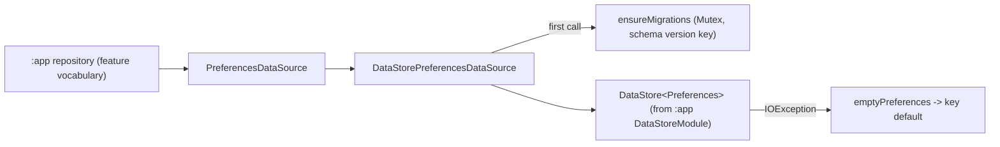

# MODULE: :data:preferences — Typed DataStore preferences
Status: DRAFT
Verified commit: UNKNOWN (source read at base 2c0ae05; not VERIFIED)
Last source audit: 2026-10-27 (CodeGraph + file read; no Gradle build)
Test status: NOT_RUN (evidence: reports/baseline-verification.md)

> Doc status and test status are separate fields; legend in [`TEMPLATE.md`](TEMPLATE.md). Fact tags: `CONFIRMED_IN_CODE` unless marked `PROPOSED`/`UNKNOWN`.

## 1. Identity and responsibility
- Owns: business-neutral typed key/value contract over Jetpack DataStore Preferences: `PreferencesDataSource`, `PreferenceKey<T>` (typed key + default), `PreferencesEditor`/`PreferencesMigration`, and `DataStorePreferencesDataSource`.
- Does not own: concrete setting names, theme logic or feature vocabulary (those live in `:app`: `config/AppConfigurationRepository.kt`, `greeting/GreetingPreferencesRepository.kt`, DAT-01); the DataStore instance and file name (created in `:app` `DataStoreModule`); secrets/tokens (SEC-02 -> `:security`).
- Public package/API: `com.dc.android.foundation.data.preferences` (4 main files, namespace in `data/preferences/build.gradle.kts`).
- Consumer(s): `:app` (`AppConfigurationRepository` 3 `EnumKey/BooleanKey`s, `GreetingPreferencesRepository` 1 `IntKey`, `DataStoreModule`); `:testing` (`InMemoryPreferencesDataSource` implements the contract; `:testing` exposes this module via `api`).

## 2. Context and discovery
- Read first: `architecture/00-index.md`, `10-data/preferences-datastore.md`, `10-data/README.md`, `11-error-and-result-model.md` (ERR-01), `12-security-and-session.md` (SEC-02), `09-concurrency-and-threading.md`.
- Main code: `data/preferences/src/main/java/com/dc/android/foundation/data/preferences/` (`PreferencesDataSource.kt:10`, `PreferenceKey.kt:7`, `PreferencesMigration.kt:4,14`, `DataStorePreferencesDataSource.kt:29`).
- Tests: `data/preferences/src/test/.../DataStorePreferencesDataSourceTest.kt` (4 tests); fake contract test `testing/src/test/.../InMemoryPreferencesDataSourceTest.kt`.
- Build config: `data/preferences/build.gradle.kts` (`dc.android.library`, `dc.testing`; no project deps; datastore-preferences, coroutines-core, kotlinx-serialization-json, javax-inject).
- CodeGraph entry symbols/callers/callees: `PreferencesDataSource` (5 callers: `AppConfigurationRepository`, `DataStoreModule`, `GreetingPreferencesRepository`), `PreferenceKey` (4 callers), `PreferencesMigration.migrate` (called only from `DataStorePreferencesDataSource.ensureMigrations`).

## 3. Dependencies and boundaries
- Allowed: none on other project modules (`dependency-rules.md`: `:data:preferences -> (none)`); third-party DataStore/coroutines/serialization stay inside (DEP-04).
- Forbidden: any edge to `:app` (DEP-01); `:testing` outside test configs (BLD-03); UI/Compose modules (DEP-03).
- Exceptions (DEC/KD): none recorded. PROPOSED (not rule): `:data:preferences -> :foundation` (listed in `dependency-rules.md` PROPOSED block, R2.1 to confirm).

## 4. Data/control flow

Refs: `observe` `DataStorePreferencesDataSource.kt:38`; `edit` `:64`; `ensureMigrations` `:71`; `Preferences.read` `:99`.

## 5. Contracts
- `observe(key): Flow<T>` cold; runs `ensureMigrations()` first, then `dataStore.data`, mapping to the key's type. `get(key)` = `observe(key).first()`.
- `set`/`remove` delegate to `edit`; `clear()` runs migrations then `dataStore.edit { clear() }`.
- `edit(block: PreferencesEditor.() -> Unit)`: the non-suspending block records operations (Set/Remove/Clear) in a pending list; they are then applied in one `dataStore.edit` (atomic multi-key commit). Block is deliberately non-suspending (INV-05, KDoc).
- Key kinds (sealed `PreferenceKey`): Int, Long, Float, Boolean, String, StringSet, `EnumKey` (stored as `Enum.name`; unknown name -> default), `JsonKey` (kotlinx.serialization; decode failure -> default).
- Errors (ERR-01): read-path `IOException` from `dataStore.data` -> `emptyPreferences()` -> key default; other exceptions rethrown. No `AppError` is produced; no error is exposed to callers. Write-path exceptions are not caught (`edit`/`clear`), and `JsonKey` encode is not guarded.
- Migrations: `PreferencesMigration(toVersion, migrate(editor))`; sorted by `toVersion`, applied once per instance when version key `dc_preferences_schema_version` is lower; each migration and its version bump commit in one `dataStore.edit`. `toVersion <= 0` throws `IllegalArgumentException`.
- Threading/cancellation: no dispatcher is chosen here (DataStore does its own IO); `migrationMutex` guards migration; `migrationsApplied` is a plain `var` read inside the lock. Cancellation propagates via coroutines (no custom handling).

## 6. DI, configuration and ownership
- Constructed by `:app` `di/DataStoreModule.kt` (`@Module @InstallIn(SingletonComponent)`): `provideDataStore` -> `PreferenceDataStoreFactory.create` with file `dc_foundation_prefs`; `providePreferencesDataSource` -> `DataStorePreferencesDataSource(dataStore)` (both `@Singleton`). Only the `dataStore` argument is passed, so `migrations` is empty and `json` is the default (`ignoreUnknownKeys = true`) in the app today.
- This module has no Hilt dependency; one DataStore per file is enforced by the single `@Singleton` provider (ownership in `:app`, not in this module).

## 7. Edge cases, security and performance
- Nothing prevents a caller from storing a secret under a `PreferenceKey`; SEC-02 forbids it by convention only (MP:PREF-03, PROPOSED review). Data is plaintext in the DataStore file.
- Whether `dc_foundation_prefs` is included in Android backup: `UNKNOWN` (`app/src/main/res/xml/backup_rules.xml`, `data_extraction_rules.xml` are template/sample files; effective policy not verified).
- Corruption policy beyond `IOException` -> default: not defined in code. A corrupt value silently becomes the default (no log/metric).
- Cost: each `observe` collection re-reads the `Preferences` snapshot and maps one key; first call pays the migration check (one `dataStore.data.first()`).

## 8. Tests and evidence
- Unit: `DataStorePreferencesDataSourceTest` — migrations run in version order once before first read; edit commits related mutations in one update; invalid enum -> default; IO read failure -> default. `InMemoryPreferencesDataSourceTest` (in `:testing`): typed defaults and atomic edit on the fake.
- Integration: none. Instrumented: none (0 `src/androidTest`).
- Commands: `./gradlew :data:preferences:testDebugUnitTest`; fake: `./gradlew :testing:testDebugUnitTest`.
- Test status: NOT_RUN (evidence: reports/baseline-verification.md)
- Last verified result: none (Gradle not executed; reason in baseline Part B).
- Not covered by any test seen: concurrent writers, restart persistence, JSON/Long/Float/StringSet round trip, migration idempotency across restart, `clear`/`remove`.

## 9. Known debt / decisions
- No KD or DEC specific to this module. Backlog (PROPOSED, from MP 4.4): MP:PREF-01 contract + flow/restart/concurrent-write UT (P0); MP:PREF-02 migration tests and recovery policy (P1); MP:PREF-03 config-vs-secret separation review (P0); MP:PREF-04 sample wiring/lifecycle ownership consumer test (P0).
- Observation (not a KD): no `PreferencesMigration` implementation exists in the repo and none is wired in `DataStoreModule`; migration code path is only exercised by the unit test.

## 10. Safe extension guide
- Add a setting: define a `PreferenceKey` in the owning feature/repo in `:app` (as `AppConfigurationRepository.kt` `THEME_MODE_KEY`) and expose a feature type; do not add feature keys here (DAT-01).
- Add a key type: extend the sealed class and update `read`, `write`, `removeValue` in `DataStorePreferencesDataSource` together (exhaustive `when`).
- Add a migration: implement `PreferencesMigration` (idempotent, editor-only) and pass it through the `:app` provider; add a unit test like the existing migration test.
- Tests of consumers use `InMemoryPreferencesDataSource` (CodeGraph lists `app/src/test/.../GreetingViewModelTest.kt` as a test touching the contract).

## 11. AI task playbook
- Read → Graph → Propose → Edit → Test → Update docs → Handover.
- Read: this page, `10-data/preferences-datastore.md`, `DataStoreModule.kt`. Graph: `codegraph_explore "PreferencesDataSource DataStorePreferencesDataSource PreferenceKey PreferencesMigration"`.
- Recipe: contract change => update `InMemoryPreferencesDataSource` in `:testing` and both `:app` repositories in the same change. Done = unit tests + this page + `context-map.yaml` pointers consistent.

## 12. Change log and links
- 2026-10-27 R1.1b: first DRAFT from source (base 2c0ae05). Report: [`reports/wp/R1.1b.md`](../../reports/wp/R1.1b.md).
- Links: context-map id `data-preferences`; rules DAT-01, ERR-01, INV-05, SEC-02; [`dependency-rules.md`](../dependency-rules.md).
- Rule glosses (text lives in the named doc; gloss only, the rule doc is authoritative): `INV-05` (01-overview-and-invariants.md): no locks held while invoking external callbacks or across unsafe suspension points; `DEP-01` (02-layers-and-dependencies.md): core/base modules do not depend on feature implementation (or on :app); `DEP-03` (02-layers-and-dependencies.md): presentation does not import infrastructure implementations; `DEP-04` (02-layers-and-dependencies.md): infrastructure-specific types stay behind the owning module boundary; `ERR-01` (11-error-and-result-model.md): infrastructure exceptions are caught at the data-source boundary, not in the ViewModel; `DAT-01` (10-data/preferences-datastore.md): features map the generic preferences API onto their own vocabulary; `SEC-02` (12-security-and-session.md): credentials/tokens are stored only through SecureStorage, never PreferencesDataSource; `BLD-03` (18-build-logic-and-dependencies.md): test utilities never enter production runtime graphs.
