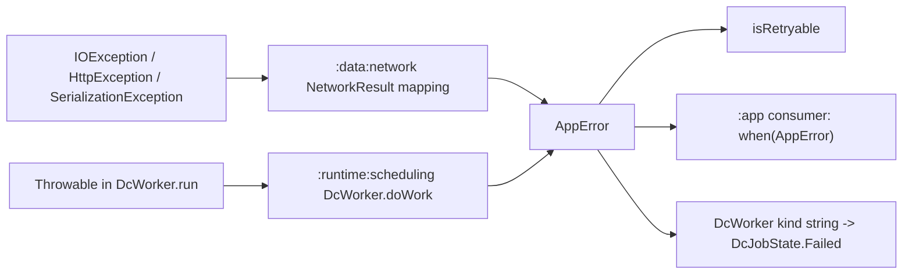

# MODULE: :foundation — core contracts
Status: DRAFT
Verified commit: UNKNOWN (source read at working-tree HEAD 2c0ae05; page not yet reviewed)
Last source audit: NOT_RUN
Test status: NOT_RUN (evidence: reports/baseline-verification.md; Part B1/B2 blocked Gradle)

Legends for `Status:` / `Test status:` and per-fact tags: [`TEMPLATE.md`](TEMPLATE.md). Tags used below: CONFIRMED_IN_CODE (read in source at 2c0ae05), PROPOSED (backlog, not implemented).

## 1. Identity and responsibility
- Owns: the shared infrastructure-error vocabulary `AppError` and its retryability policy `AppError.isRetryable`. CONFIRMED_IN_CODE
- Does not own: error-to-text/UI mapping (MP:CORE-03, PROPOSED), `NetworkResult`/`safeApiCall` (`:data:network`), Android or HTTP-library types, DTOs, navigation events, locale strings (MP 4.1 "do not put here").
- Public package/API: `com.dc.android.foundation.core` - `AppError` (sealed interface: `Connectivity`, `Http(code, serverMessage)`, `Serialization`, `Storage`, `Unknown`; each has nullable `cause`), `AppError.isRetryable` (extension, file `Retryable.kt`; there is no `Retryable` type).
- Consumer(s): `:data:network` (`NetworkResult.Failure(AppError)`), `:runtime:scheduling` (`DcJobResult.Failure`, `DcJobState.Failed`, `DcWorker`), `:app` (`ArticlesSyncWorker`; `ArticlesViewModelTest` builds `AppError.Connectivity`).

## 2. Context and discovery
- Read first: [`00-index.md`](../00-index.md), [`11-error-and-result-model.md`](../11-error-and-result-model.md) (ERR-01), [`dependency-rules.md`](../dependency-rules.md).
- Main code: `foundation/src/main/kotlin/com/dc/android/foundation/core/AppError.kt`, `.../core/Retryable.kt`.
- Tests: `foundation/src/test/kotlin/com/dc/android/foundation/core/AppErrorTest.kt` (12 test methods after lane A3, commit `bb5ce19`; Gradle NOT_RUN).
- Build config: `foundation/build.gradle.kts` (`dc.kotlin.jvm`, `dc.testing`; no `dependencies {}` block, so no project or library deps).
- CodeGraph entry symbols: `AppError`, `isRetryable`; callers: `NetworkResult.kt` (creates Connectivity/Http/Serialization), `DcWorker.kt` (creates Serialization/Unknown, maps all variants), `DcJobState.kt`, `ArticlesSyncWorker.kt` (creates Unknown).

## 3. Dependencies and boundaries
- Allowed: none (current edge table in [`dependency-rules.md`](../dependency-rules.md): `:foundation -> (none)`). Inbound edges from `:data:network`, `:runtime:scheduling`, `:app` are allowed there.
- Forbidden: any edge to `:app` (DEP-01); PROPOSED (not yet a rule): `:foundation` stays Android-free, based on the build fact that it applies `dc.kotlin.jvm`.
- Exceptions (DEC/KD): none for this module. KD-02 (Open, partially mitigated: static `tools/check_architecture.py --boundaries-only`; CI run NOT_RUN) applies to every edge: [`22-known-deviations.md`](../22-known-deviations.md).

## 4. Data/control flow

Refs: `NetworkResult.kt:21` (`Failure(error: AppError)`), `DcWorker.kt:37-68,87-93` (creation and `kind()` mapping), `DcJobState.kt:9`. In current source `isRetryable` is referenced only by its declaration and `AppErrorTest` (repo-wide grep): no production code uses it yet.

## 5. Contracts
- `AppError`: sealed, exhaustive `when` is possible; `cause: Throwable?` is diagnostic-only (KDoc) and must not be rendered or logged raw by presentation. No Android, HTTP-engine or UI types in signatures. CONFIRMED_IN_CODE
- Cause / `toString` policy (PROPOSED, DEC-A3-8): `cause` is kept by reference and is part of `equals`; the data-class `toString` prints it, so never log `"$error"`; redacting `toString` is a follow-up. Exhaustive `when` (no `else`) sites today: `Retryable.kt` and `DcWorker.workKind` (`:runtime:scheduling`). CONFIRMED_IN_CODE (A3 commit `bb5ce19`).
- `AppError.isRetryable`: `Connectivity` true; `Http` true for 408, 429, >=500; `Serialization`, `Storage`, `Unknown` false.
- Errors/cancellation: the module throws nothing and has no coroutine or Android dependency; cancellation is the callers' concern (`DcWorker` rethrows `CancellationException` before mapping).
- Threading/lifecycle: pure immutable data classes; no state, no lifecycle.
- Versioning/API policy: none written (MP:CORE-04, PROPOSED).

## 6. DI, configuration and ownership
Not bound in any Hilt module: values are constructed at failure sites. No configuration or variants. `:app/.../di/` contains no `AppError` binding (ConcurrencyModule, DataStoreModule, DatabaseModule, NetworkModule, ObservabilityModule, SecurityModule).

## 7. Edge cases, security and performance
- `Http.serverMessage` and `cause` can carry server/infrastructure text; do not log or show them raw (SEC-01 intent, `AppError` KDoc). No policy enforces this beyond the KDoc (MP:CORE-04, PROPOSED).
- The WorkManager wire kind (`DcWorker` `workKind` / `errorFromKind`) is lossy by design: `Http` comes back as `code = 0` and `cause`/`serverMessage` are lost, so `isRetryable` on a restored `Http` is false; pinned per variant by `DcWorkContractTest`.
- `AppError.Storage` has no production producer (only the worker kind decoder instantiates it); the data/storage modules do not emit it yet. Real producers: `safeApiCall` (Connectivity/Http/Serialization), `DcWorker`/`ArticlesSyncWorker` (Serialization/Unknown).
- Negligible size/perf cost.

## 8. Tests and evidence
- Unit: `AppErrorTest` (12 tests after A3): all variants, `Http` 408/429/5xx/499/599 boundaries, `cause` kept by reference, equality. Not covered: redaction (none exists), consumer-level mapping to UI text (MP:CORE-03).
- Integration: none in-module. Consumer mapping is exercised indirectly by `NetworkResultTest` (`:data:network`).
- Instrumented: none.
- Commands: `./gradlew :foundation:test` (JVM module). `testDebugUnitTest` does not exist for JVM modules (baseline Part A drift D2); lane A1 added an explicit `:foundation:test :runtime:concurrency:test` step to `ci.yml` (run NOT_RUN).
- Test status: NOT_RUN (evidence: reports/baseline-verification.md, Part B: Gradle blocked at daemon-toolchain provisioning)
- Scratch evidence only, NOT a Gradle gate (`reports/wp/A3.md` section C): `AppErrorTest` 12/12 on an out-of-repo JUnitCore run.
- Last verified result: none for the current HEAD (no Gradle run).

## 9. Known debt / decisions
- KD-02 (Open, partially mitigated: static `tools/check_architecture.py --boundaries-only`; CI run NOT_RUN). No module-specific KD/DEC.
- Backlog (MP 4.1): MP:CORE-01 `AppError` exhaustiveness audit across app/network/storage/Worker (P0) - closed in code and tests by lane A3 (`bb5ce19`, Gradle NOT_RUN, decision DEC-A3-8 PROPOSED); the rest PROPOSED: MP:CORE-02 unify `Outcome`/`Result` only if `NetworkResult` duplicates a domain result (P1, avoid a third result type); MP:CORE-03 error-presentation mapping lives in presentation, test raw error -> UI message (P0); MP:CORE-04 public-API policy, compatibility, KDoc (P1).
- MP:CORE-03 remains open (follow-up for lane C2: `ArticlesRepository` collapses errors to Boolean today, so no raw-error -> UI-message path exists to test).

## 10. Safe extension guide
- Add a variant only with every exhaustive `when` updated in the same change: `DcWorker.kind()` / `appErrorFrom`, `NetworkResult` mapping, any consumer `when` (CodeGraph the `AppError` blast radius first).
- Keep the module free of strings, Android types and vendor exceptions. Sample consumer: `NetworkResult.Failure` in `:data:network`.
- Adding a `project(...)` dependency requires updating `dependency-rules.md`, `context-map.yaml`, `module-map.md` together.

## 11. AI task playbook
- Read -> Graph -> Propose -> Edit -> Test -> Update docs -> Handover.
- Read: this page, `11-error-and-result-model.md`, `AppError.kt`, `Retryable.kt`.
- Graph: `codegraph_explore "AppError isRetryable DcWorker NetworkResult DcJobState"`.
- Recipe (MP:CORE-01): list every `when (error)` and constructor call, add missing-variant tests per consumer, then run `./gradlew :foundation:test :data:network:testDebugUnitTest :runtime:scheduling:testDebugUnitTest`.
- Done: exhaustive mappings, tests added with evidence under `reports/logs/`, this page and the 11-doc updated.

## 12. Change log and links
- 2026-10-27 - R1.1a - first DRAFT from source at 2c0ae05 ([`reports/wp/R1.1a.md`](../../reports/wp/R1.1a.md)).
- 2026-10-27 - DOC-A - merged lane A3 delta (`bb5ce19`, [`reports/wp/A3.md`](../../reports/wp/A3.md)); doc stays DRAFT, tests NOT_RUN.
- Links: [`context-map.yaml`](../context-map.yaml) entry `foundation`; rules INV-07, ERR-01; [`module-map.md`](../module-map.md).
- Rule glosses (text lives in the named doc; gloss only, the rule doc is authoritative): `INV-07` (01-overview-and-invariants.md): infrastructure exceptions and vendor types do not leak into presentation/public contracts; `DEP-01` (02-layers-and-dependencies.md): core/base modules do not depend on feature implementation (or on :app); `ERR-01` (11-error-and-result-model.md): infrastructure exceptions are caught at the data-source boundary, not in the ViewModel; `SEC-01` (12-security-and-session.md): no secret/token/PII in a log call.
