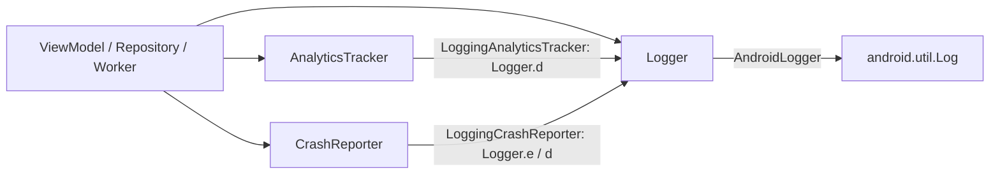

# MODULE: :observability — observability
Status: DRAFT
Verified commit: UNKNOWN (drafted against working tree at HEAD 2c0ae05b; not audited)
Last source audit: NOT_RUN
Test status: NOT_RUN (evidence: reports/baseline-verification.md)

> Doc status (`DRAFT|VERIFIED|NEEDS_REFRESH`) and test status (`NOT_RUN|TESTED|FAILED|BLOCKED`) are separate vocabularies; see `TEMPLATE.md`.

## 1. Identity and responsibility
- Owns: vendor-neutral contracts `Logger`, `AnalyticsTracker`, `CrashReporter`, and their local implementations `AndroidLogger`, `LoggingAnalyticsTracker`, `LoggingCrashReporter` (6 main files).
- Does not own: any vendor SDK or backend (KD-05), redaction, sampling, correlation IDs, schema, buffering (none exist), Hilt wiring (in `:app`), test fakes (in `:testing`).
- Public package/API: `com.dc.android.foundation.observability`.
- Consumer(s): `:app` (`ObservabilityModule`, `ArticlesViewModel`, `ArticlesRepository`, `ArticlesSyncWorker`, `GreetingViewModel`, `DcApplication`); `:testing` (`api(project(":observability"))`); `:data:network` declares `implementation(project(":observability"))` but has no import of it (see section 9).

## 2. Context and discovery
- Read first: `architecture/00-index.md`, `architecture/15-observability/{logging,analytics,crash-and-performance}.md` (OBS-01, OBS-ANALYTICS-01, OBS-CRASH-01), `12-security-and-session.md` (SEC-01).
- Main code: `observability/src/main/java/com/dc/android/foundation/observability/*.kt`. Fakes: `testing/src/main/java/com/dc/android/foundation/testing/ObservabilityFakes.kt`.
- Tests: none (`test_roots: []`; baseline A2: 0 test files), although `dc.testing` is applied.
- Build config: `observability/build.gradle.kts` (`dc.android.library`, `dc.testing`; no `dependencies {}` block).
- CodeGraph entry symbols/callers/callees: `Logger` (6 callers in `:app`), `AnalyticsTracker` (`ArticlesViewModel`, `ObservabilityModule`), `CrashReporter` (`ArticlesRepository`, `ObservabilityModule`), `LoggingAnalyticsTracker`/`LoggingCrashReporter` (only `ObservabilityModule`). Callees: `android.util.Log` (only in `AndroidLogger`).

## 3. Dependencies and boundaries
- Allowed: no project dependencies (`:observability -> (none)`), Android `android.util.Log` inside `AndroidLogger` only.
- Forbidden: vendor SDK types in public contracts (DEP-04, INV-07); `android.util.Log` in feature code (OBS-01); edges to `:app` (DEP-01); PROPOSED (not a rule): `:observability -> :security/:data:*/:ui:*`.
- Exceptions (DEC/KD): KD-05 (local logging-only analytics/crash backend, no vendor chosen). KD-02 applies.

## 4. Data/control flow

Source refs: `LoggingAnalyticsTracker.trackEvent`, `LoggingCrashReporter.recordException`/`log`, `AndroidLogger.d`/`e`.

## 5. Contracts
- `Logger`: `d(tag, message)`, `e(tag, message, throwable = null)`. `AnalyticsTracker.trackEvent(name, properties: Map<String,String> = emptyMap())`. `CrashReporter.recordException(Throwable)`, `log(message)` (breadcrumb).
- `AndroidLogger(isDebug)`: `d` only when `isDebug`; `e` always logs. Hence in release, `LoggingAnalyticsTracker` events and `LoggingCrashReporter.log` breadcrumbs (both via `Logger.d`) are not emitted; `recordException` goes through `Logger.e` and is emitted, including the throwable.
- No redaction anywhere (KDoc: caller responsible, SEC-01). No try/catch isolation: a throwing implementation propagates to the caller (CONFIRMED_IN_CODE; no isolation wrapper exists).
- Errors/`AppError`: none mapped. Threading: stateless, synchronous calls; implementations hold no mutable state. Cancellation/lifecycle: none.

## 6. DI, configuration and ownership
- `:app` `di/ObservabilityModule` (`@InstallIn(SingletonComponent)`, `@Singleton`): `provideLogger()` -> `AndroidLogger(isDebug = AppEnvironmentProvider.current == AppEnvironment.DEBUG)`; `provideAnalyticsTracker(logger)` -> `LoggingAnalyticsTracker`; `provideCrashReporter(logger)` -> `LoggingCrashReporter`. Debug/release is the only variant switch (CFG-01 via `AppEnvironmentProvider`).

## 7. Edge cases, security and performance
- SEC-01: call sites must pass counts/status only; `ArticlesViewModel` logs `succeeded=...` and a fixed event name. `LoggingAnalyticsTracker` prints the full `properties` map at debug level, so properties must stay non-sensitive.
- `LoggingCrashReporter.recordException` logs the throwable (stack trace, message) to logcat in all builds; throwable messages are not sanitized.
- No buffering/rate limiting: every call is a direct `Log` call (cheap, no blocking I/O, THR-02 n/a).

## 8. Tests and evidence
- Unit: none in module. Integration: none. Instrumented: none. `:testing` provides `NoOpLogger`, `RecordingLogger`, `NoOp/RecordingAnalyticsTracker`, `NoOp/RecordingCrashReporter` (thread-safe via `synchronized`); `:app` `ArticlesViewModelTest` asserts the `articles_refreshed` event via those fakes (consumer test).
- Commands (once Gradle runs): `./gradlew :observability:testDebugUnitTest` (no sources); `./gradlew :app:testDebugUnitTest --tests "*ArticlesViewModelTest"`.
- Test status: NOT_RUN (evidence: reports/baseline-verification.md)
- Last verified result: none; `AndroidLogger` has never been exercised by a test in this module.

## 9. Known debt / decisions
- KD-05 ([22-known-deviations.md](../22-known-deviations.md)): analytics/crash backend is local logging only; exit = real vendor behind same interfaces.
- PROPOSED backlog (MP 4.10, none implemented): OBS-01 Logger contract + fake/sink tests incl. redaction (P0); OBS-02 analytics/crash contract tests, no-op, error isolation (P0); OBS-03 correlation ID + bounded buffering (P1); OBS-04 optional vendor adapters after privacy/consent (P2); OBS-05 structured debug diagnostic export (P1).
- Observations: `dc.testing` applied but zero tests; edge `:data:network -> :observability` has no `import` of it (`NetworkClientConfig` KDoc only mentions observability vendors) - candidate unused dependency, not changed here. Rule-ID overlap: rule OBS-01 (`logging.md`) vs backlog OBS-01.

## 10. Safe extension guide
- Add a vendor adapter in `:app` (or an opt-in module) implementing the existing interfaces and swap the `ObservabilityModule` binding; no call site changes (KDoc of `Logging*`). Keep telemetry off by default (MP 4.10). Sample consumer: `ArticlesViewModel` (logger + analytics), `ArticlesRepository` (crash). Do not add vendor types to the public contracts.

## 11. AI task playbook
- Read -> Graph -> Propose -> Edit -> Test -> Update docs -> Handover.
- Read: the three 15-observability docs, six source files, `ObservabilityModule.kt`, `ObservabilityFakes.kt`. Graph: `codegraph_explore "Logger AnalyticsTracker CrashReporter ObservabilityModule"`.
- DoD: contract change updates `ObservabilityFakes.kt` in `:testing`, this page and the context-map; new behavior gets tests runnable without Logcat.

## 12. Change log and links
- 2026-10-27 — R1.1c — first draft from source and CodeGraph. Report: `reports/wp/R1.1c.md`.
- Links: `context-map.yaml` entry `observability`; `15-observability/`; `dependency-rules.md`.
