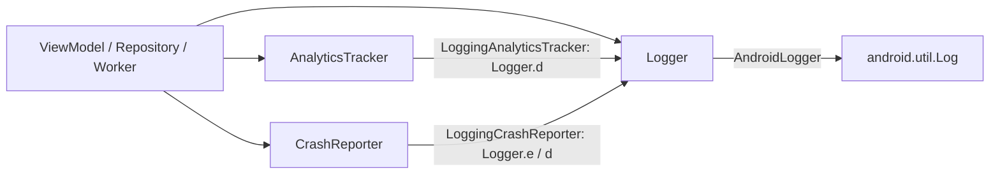

# MODULE: :observability — observability
Status: DRAFT
Verified commit: UNKNOWN (drafted against working tree at HEAD 2c0ae05b; not audited)
Last source audit: NOT_RUN
Test status: NOT_RUN (evidence: reports/baseline-verification.md)

> Doc status (`DRAFT|VERIFIED|NEEDS_REFRESH`) and test status (`NOT_RUN|TESTED|FAILED|BLOCKED`) are separate vocabularies; see `TEMPLATE.md`.

## 1. Identity and responsibility
- Owns: vendor-neutral contracts `Logger`, `AnalyticsTracker`, `CrashReporter`, and their local implementations `AndroidLogger`, `LoggingAnalyticsTracker`, `LoggingCrashReporter`, and the pure-Kotlin `Redactor` (7 main files, lane B2).
- Does not own: any vendor SDK or backend (KD-05), sampling, correlation IDs, schema, buffering (none exist), Hilt wiring (in `:app`), test fakes (in `:testing`).
- Public package/API: `com.dc.android.foundation.observability`.
- Consumer(s): `:app` (`ObservabilityModule`, `ArticlesViewModel`, `ArticlesRepository`, `ArticlesSyncWorker`, `GreetingViewModel`, `DcApplication`); `:testing` (`api(project(":observability"))`); `:data:network` no longer depends on it (unused edge removed in lane B1, `7a8a804`).

## 2. Context and discovery
- Read first: `architecture/00-index.md`, `architecture/15-observability/{logging,analytics,crash-and-performance}.md` (OBS-01, OBS-ANALYTICS-01, OBS-CRASH-01), `12-security-and-session.md` (SEC-01).
- Main code: `observability/src/main/java/com/dc/android/foundation/observability/*.kt`. Fakes: `testing/src/main/java/com/dc/android/foundation/testing/ObservabilityFakes.kt`.
- Tests: `observability/src/test/.../LoggingAnalyticsTrackerTest.kt` (7), `LoggingCrashReporterTest.kt` (6), lane B2: `RedactorTest.kt` (8), `SecretLeakAndIsolationTest.kt` (6), `ThrowingLogger.kt`, and a local `FakeLogger.kt` (lane A2; `test_roots: ["observability/src/test"]`; run NOT_RUN). The local fake is used because `:testing`'s `ObservabilityFakes` (`RecordingLogger`) cannot be used here: `:testing -> :observability` is an `api` edge, so the reverse edge would be a cycle (BLD-03).
- Build config: `observability/build.gradle.kts` (`dc.android.library`, `dc.testing`; no `dependencies {}` block).
- CodeGraph entry symbols/callers/callees: `Logger` (6 callers in `:app`), `AnalyticsTracker` (`ArticlesViewModel`, `ObservabilityModule`), `CrashReporter` (`ArticlesRepository`, `ObservabilityModule`), `LoggingAnalyticsTracker`/`LoggingCrashReporter` (only `ObservabilityModule`). Callees: `android.util.Log` (only in `AndroidLogger`).

## 3. Dependencies and boundaries
- Allowed: no project dependencies (`:observability -> (none)`), Android `android.util.Log` inside `AndroidLogger` only.
- Forbidden: vendor SDK types in public contracts (DEP-04, INV-07); `android.util.Log` in feature code (OBS-01); edges to `:app` (DEP-01); PROPOSED (not a rule): `:observability -> :security/:data:*/:ui:*`.
- Exceptions (DEC/KD): KD-05 (local logging-only analytics/crash backend, no vendor chosen). KD-02 (Open, partially mitigated: static `tools/check_architecture.py --boundaries-only`; CI run NOT_RUN) applies.

## 4. Data/control flow

Source refs: `LoggingAnalyticsTracker.trackEvent`, `LoggingCrashReporter.recordException`/`log`, `AndroidLogger.d`/`e`.

## 5. Contracts
- `Logger`: `d(tag, message)`, `e(tag, message, throwable = null)`. `AnalyticsTracker.trackEvent(name, properties: Map<String,String> = emptyMap())`. `CrashReporter.recordException(Throwable)`, `log(message)` (breadcrumb).
- `AndroidLogger(isDebug)`: `d` only when `isDebug`; `e` always logs. Hence in release, `LoggingAnalyticsTracker` events and `LoggingCrashReporter.log` breadcrumbs (both via `Logger.d`) are not emitted; `recordException` goes through `Logger.e` and is emitted, including the throwable.
- Redaction (lane B2, MP:SEC-04 / MP:OBS-01): `Redactor` (`REDACTED = "[REDACTED]"`) is applied by `LoggingAnalyticsTracker` (event name and properties) and `LoggingCrashReporter.log` (breadcrumbs). Layer 1 masks the whole value of a map entry whose key looks sensitive (password, secret, token, authorization, apikey, cookie, credential, privatekey, sessionid, email; case-insensitive, `_`/`-`/`.` ignored); layer 2 masks Bearer/Basic credentials, JWT-shaped strings, e-mail addresses and inline `key=value` pairs in text. It is heuristic and a safety net only: callers still own SEC-01. `AndroidLogger` itself does no redaction, so `Logging*` are the only appliers.
- Error isolation (MP:OBS-02, DEC-B2-2 PROPOSED, pending Opus final review): `Logging*` catch `Exception` (not `Throwable`) around the `Logger` call and swallow it silently, so telemetry never crashes the caller; `Error`s still propagate; `Logger` implementations (`AndroidLogger`) are not wrapped; future vendor adapters (MP:OBS-04) must follow the same rule.
- Errors/`AppError`: none mapped. Threading: stateless, synchronous calls; implementations hold no mutable state. Cancellation/lifecycle: none.

## 6. DI, configuration and ownership
- `:app` `di/ObservabilityModule` (`@InstallIn(SingletonComponent)`, `@Singleton`): `provideLogger()` -> `AndroidLogger(isDebug = AppEnvironmentProvider.current == AppEnvironment.DEBUG)`; `provideAnalyticsTracker(logger)` -> `LoggingAnalyticsTracker`; `provideCrashReporter(logger)` -> `LoggingCrashReporter`. Debug/release is the only variant switch (CFG-01 via `AppEnvironmentProvider`).

## 7. Edge cases, security and performance
- SEC-01: call sites must pass counts/status only; `ArticlesViewModel` logs `succeeded=...` and a fixed event name. `LoggingAnalyticsTracker` prints the full `properties` map at debug level, so properties must stay non-sensitive.
- `LoggingCrashReporter.recordException` uses only the exception class name as the message text but still forwards the throwable to `Logger.e`, so its stack trace and message reach logcat in all builds unredacted (HANDOVER follow-up). `Redactor` false positives are possible (the Bearer/Basic pattern also masks ordinary text such as "Basic design"); false negatives exist for free text.
- No buffering/rate limiting: every call is a direct `Log` call (cheap, no blocking I/O, THR-02 n/a).

## 8. Tests and evidence
- Unit (JVM, lane A2): `LoggingAnalyticsTrackerTest` (7) and `LoggingCrashReporterTest` (6) with a local `FakeLogger` (tag, level, message content, ordering, no caller-map mutation, no exception message leaked). Lane B2 (`8b6a6fe`) added redaction and isolation tests (`RedactorTest`, `SecretLeakAndIsolationTest` with `ThrowingLogger`), written and NOT_RUN; the A2 tests are unchanged (non-sensitive text is passed through identically). Not covered: schema/correlation id (no code), `AndroidLogger` (needs `android.util.Log`; gap). Integration: none. Instrumented: none. `:testing` provides `NoOpLogger`, `RecordingLogger`, `NoOp/RecordingAnalyticsTracker`, `NoOp/RecordingCrashReporter` (thread-safe via `synchronized`); `:app` `ArticlesViewModelTest` asserts the `articles_refreshed` event via those fakes (consumer test).
- Commands (once Gradle runs): `./gradlew :observability:testDebugUnitTest`; `./gradlew :app:testDebugUnitTest --tests "*ArticlesViewModelTest"`.
- Test status: NOT_RUN (evidence: reports/baseline-verification.md)
- Last verified result: none (NOT_RUN); `AndroidLogger` has never been exercised by a test in this module.

## 9. Known debt / decisions
- KD-05 ([22-known-deviations.md](../22-known-deviations.md)): analytics/crash backend is local logging only; exit = real vendor behind same interfaces.
- Backlog (MP 4.10): MP:OBS-01 Logger contract + fake/sink tests incl. redaction (P0; done-in-code by lane B2, NOT_RUN); MP:OBS-02 analytics/crash contract tests, no-op, error isolation (P0; done-in-code by lane B2, NOT_RUN, decision PROPOSED); PROPOSED, not implemented: MP:OBS-03 correlation ID + bounded buffering (P1); MP:OBS-04 optional vendor adapters after privacy/consent (P2); MP:OBS-05 structured debug diagnostic export (P1).
- Observations: `dc.testing` applied; tests cover the two `Logging*` classes only (no test for `AndroidLogger`, which needs `android.util.Log`, nor for exception isolation beyond the lane B2 tests). The former unused `:data:network -> :observability` edge was removed in lane B1. KD-05 stays Open (tests extended; still no vendor). KD-04 unchanged. Bare `OBS-01` is the rule in `15-observability/logging.md`; `MP:OBS-01` is the Logger-contract backlog item.

## 10. Safe extension guide
- Add a vendor adapter in `:app` (or an opt-in module) implementing the existing interfaces and swap the `ObservabilityModule` binding; no call site changes (KDoc of `Logging*`). Keep telemetry off by default (MP 4.10). Sample consumer: `ArticlesViewModel` (logger + analytics), `ArticlesRepository` (crash). Do not add vendor types to the public contracts.

## 11. AI task playbook
- Read -> Graph -> Propose -> Edit -> Test -> Update docs -> Handover.
- Read: the three 15-observability docs, six source files, `ObservabilityModule.kt`, `ObservabilityFakes.kt`. Graph: `codegraph_explore "Logger AnalyticsTracker CrashReporter ObservabilityModule"`.
- DoD: contract change updates `ObservabilityFakes.kt` in `:testing`, this page and the context-map; new behavior gets tests runnable without Logcat.

## 12. Change log and links
- 2026-10-27 — R1.1c — first draft from source and CodeGraph. Report: `reports/wp/R1.1c.md`.
- 2026-10-27 DOC-B (lane B2 `8b6a6fe`): `Redactor`, OBS-02 isolation, tests; `:data:network` edge removed (B1). Report: `reports/wp/DOC-B.md`.
- Links: `context-map.yaml` entry `observability`; `15-observability/`; `dependency-rules.md`.
- Rule glosses (text lives in the named doc; gloss only, the rule doc is authoritative): `INV-07` (01-overview-and-invariants.md): infrastructure exceptions and vendor types do not leak into presentation/public contracts; `DEP-01` (02-layers-and-dependencies.md): core/base modules do not depend on feature implementation (or on :app); `DEP-04` (02-layers-and-dependencies.md): infrastructure-specific types stay behind the owning module boundary; `THR-02` (09-concurrency-and-threading.md): dispatcher access goes through DispatcherProvider; `SEC-01` (12-security-and-session.md): no secret/token/PII in a log call; `OBS-01` (15-observability/logging.md): feature code uses Logger, never android.util.Log; `OBS-ANALYTICS-01` (15-observability/analytics.md): analytics events go through AnalyticsTracker, never a vendor SDK directly; `OBS-CRASH-01` (15-observability/crash-and-performance.md): crash reporting goes through CrashReporter, never a vendor SDK directly; `CFG-01` (16-config-feature-flags-environments.md): BuildConfig.DEBUG is read in exactly one place.
