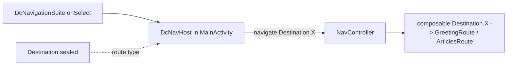

# MODULE: :platform:navigation — platform-navigation
Status: DRAFT
Verified commit: UNKNOWN (drafted against working tree at HEAD 2c0ae05b; not audited)
Last source audit: NOT_RUN
Test status: NOT_RUN (evidence: reports/baseline-verification.md)

> Doc status (`DRAFT|VERIFIED|NEEDS_REFRESH`) and test status (`NOT_RUN|TESTED|FAILED|BLOCKED`) are separate vocabularies; see `TEMPLATE.md`.

## 1. Identity and responsibility
- Owns: the engine-neutral, `@Serializable` top-level destination contract `Destination` (`Destination.Greeting`, `Destination.Articles`). Nothing else: the module has 1 main file and 1 JVM test class (`DestinationTest`, lane A2).
- Does not own: `NavHost`/`NavController`/back stack (in `:app`, `MainActivity.kt` `DcNavHost`); any `Navigator`/action wrapper (deliberately absent per the KDoc of `Destination`); argument encoding, deep links, state restoration (none implemented here).
- Public package/API: `com.dc.android.foundation.platform.navigation` -> `Destination` (sealed interface).
- Consumer(s): `:app` only (`MainActivity.kt`: 2 caller sites per CodeGraph, `DcNavHost`). Feature packages do not import it today.

## 2. Context and discovery
- Read first: `architecture/00-index.md`, `architecture/06-navigation.md` (NAV-01), `architecture/dependency-rules.md`.
- Main code: `platform/navigation/src/main/java/com/dc/android/foundation/platform/navigation/Destination.kt`.
- Tests: `platform/navigation/src/test/.../DestinationTest.kt` (9 tests, lane A2; `test_roots: ["platform/navigation/src/test"]`; run NOT_RUN).
- Build config: `platform/navigation/build.gradle.kts` (`dc.android.library` + `kotlin.serialization`; `implementation(libs.kotlinx.serialization.json)`; no `androidx.navigation`).
- CodeGraph entry symbols/callers/callees: `Destination` <- `DcNavHost` (`MainActivity.kt`: `Destination.Greeting::class.qualifiedName`, `navController.navigate(Destination.X, options)`, `startDestination`, `composable<Destination.X>`). No callees.

## 3. Dependencies and boundaries
- Allowed: no project dependencies (`dependency-rules.md` allowed-edge table: `:platform:navigation -> (none)`); `kotlinx-serialization-json` only.
- Forbidden: any `androidx.navigation.*` import (NAV-01, INV-07; module STRUCTURE.md); edges to `:app` (DEP-01) or to features; production edge to `:testing` (BLD-03).
- Exceptions (DEC/KD): none recorded. KD-02 (Open, partially mitigated: static `tools/check_architecture.py --boundaries-only`; CI run NOT_RUN) applies.

## 4. Data/control flow

Source refs: `MainActivity.kt` `DcNavHost` (selection by `Destination.*::class.qualifiedName`, `popUpTo ... saveState`, `launchSingleTop`, `restoreState`). Routes `more`, `design-system-catalog`, `trip-showcase` are raw string constants in `:app`, not `Destination` members (CONFIRMED_IN_CODE).

## 5. Contracts
- API: `sealed interface Destination` with two `@Serializable data object`s. Inputs/outputs: none (no arguments, no encoding/decoding code, no route-builder).
- Errors: none; no `AppError` mapping (no I/O). Cancellation/threading/lifecycle: not applicable (pure types).
- Stability: the type-safe route string is derived by Navigation-Compose from the serializer; `DestinationTest` pins the serial names and the `Json` round-trip of both destinations (lane A2, run NOT_RUN); the Navigation-Compose route-string derivation itself remains untested (MP:NAV-01 instrumented part).

## 6. DI, configuration and ownership
- No Hilt module; nothing to construct. `:app` owns the navigation engine and the graph. No variants or defaults.

## 7. Edge cases, security and performance
- No secrets/PII (SEC-01/02 n/a). Adding a destination requires a matching `composable<...>` in `DcNavHost`; there is no compile-time check that every `Destination` member is registered (CONFIRMED_IN_CODE: `Destination` is not exhaustively consumed by a `when`).
- Back/deep link/state restoration beyond `saveState`/`restoreState` options in `:app`: not implemented in this module (UNKNOWN whether configured elsewhere; no `<deep-link>` audit done here).

## 8. Tests and evidence
- Unit (JVM, lane A2): `DestinationTest` (9): round-trip of `Greeting` and `Articles` through `Json`, empty-object encoding of the data objects, stable and distinct serial names, unknown argument rejected by strict `Json` and ignored by lenient `Json`, malformed payload rejected, distinct subtypes, exhaustive `when`. NAV-01 is covered at the pure-JVM level only; "invalid argument" means decode failure, since `Destination` has only `data object`s and no dynamic argument yet. Integration: none. Instrumented: none (Navigation-Compose route derivation untested).
- Commands (once Gradle runs): `./gradlew :platform:navigation:testDebugUnitTest` (runs `DestinationTest`); `./gradlew :app:assembleDebug` to verify the consumer.
- Test status: NOT_RUN (evidence: reports/baseline-verification.md)
- Last verified result: none; tests exist but have not been run (NOT_RUN).

## 9. Known debt / decisions
- Gap, not completion: only `Destination.kt` exists; the master plan (MP 4.7) calls this a clear functional gap. Do not describe navigation as a finished framework.
- PROPOSED backlog (MP 4.7, none implemented): MP:NAV-01 destination/argument contract, encoding/decoding, stable route + round-trip/invalid-argument tests (P0); MP:NAV-02 minimal `Navigator`/effect adapter testable at ViewModel/Route boundary (P1); MP:NAV-03 back/deep link/state restoration rules + nested graph example (P1, instrumented); MP:NAV-04 greeting <-> articles/showcase sample integration (P1).
- ID note: bare `NAV-01` is the rule in `06-navigation.md` (engine isolation); `MP:NAV-01` is the route-contract backlog item (convention in `context-protocol.md`).
- Related: KD-02 ([22-known-deviations.md](../22-known-deviations.md)). No DEC.

## 10. Safe extension guide
- Add a destination only with a real screen and a `composable<Destination.X>` in `:app`'s `DcNavHost` (module STRUCTURE.md). Keep destinations immutable and free of mutable UI state (MP 4.7). Do not add a `Navigator` until a feature needs to trigger navigation itself (KDoc of `Destination`). Sample consumer: `DcNavHost` in `MainActivity.kt`.
- Generated features (`createFeature -Pnavigation=true`) emit a per-feature `<Name>Destination` data object that is not a `Destination` subtype (`FeatureScaffoldGenerator.destination`); see `build-logic.md`.

## 11. AI task playbook
- Read -> Graph -> Propose -> Edit -> Test -> Update docs -> Handover.
- Read: `06-navigation.md`, `Destination.kt`, `MainActivity.kt`. Graph: `codegraph_explore "Destination DcNavHost MainActivity"`.
- Recipe: add the member, register the route in `:app`, add a route test when MP:NAV-01/02 land. DoD: `:app:assembleDebug` compiles; no `androidx.navigation` in this module; `context-map.yaml`/this page updated if the public API changed.

## 12. Change log and links
- 2026-10-27 — R1.1c — first draft from source and CodeGraph. Report: `reports/wp/R1.1c.md`.
- Links: `context-map.yaml` entry `platform-navigation`; rules `06-navigation.md`; `dependency-rules.md`.
- Rule glosses (text lives in the named doc; gloss only, the rule doc is authoritative): `INV-07` (01-overview-and-invariants.md): infrastructure exceptions and vendor types do not leak into presentation/public contracts; `DEP-01` (02-layers-and-dependencies.md): core/base modules do not depend on feature implementation (or on :app); `SEC-01` (12-security-and-session.md): no secret/token/PII in a log call; `SEC-02` (12-security-and-session.md): credentials/tokens are stored only through SecureStorage, never PreferencesDataSource; `NAV-01` (06-navigation.md): feature code does not depend on the navigation engine; only :app does; `BLD-03` (18-build-logic-and-dependencies.md): test utilities never enter production runtime graphs.
