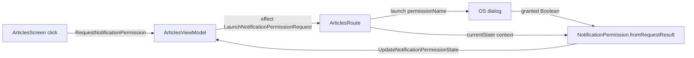

# MODULE: :platform:permission — platform-permission
Status: DRAFT
Verified commit: UNKNOWN (drafted against working tree at HEAD 2c0ae05b; not audited)
Last source audit: NOT_RUN
Test status: NOT_RUN (evidence: reports/baseline-verification.md)

> Doc status (`DRAFT|VERIFIED|NEEDS_REFRESH`) and test status (`NOT_RUN|TESTED|FAILED|BLOCKED`) are separate vocabularies; see `TEMPLATE.md`.

## 1. Identity and responsibility
- Owns: engine-neutral runtime-permission state `PermissionState` (`NotRequested`, `Granted`, `Denied`), the single concrete adapter `NotificationPermission` for `android.permission.POST_NOTIFICATIONS`, and (lane C1, `aca166d`, additive) the richer `PermissionStatus` (5 cases) with `PermissionStatusResolver`, the lifecycle-free `PermissionRequester` interface, `PermissionRequestTracker` and `FakePermissionRequester`.
- Does not own: launching the OS dialog (done by `ArticlesRoute` via `rememberLauncherForActivityResult`), rationale/settings flow, rationale UI, any permission other than notifications. No `Activity`-bound `PermissionRequester` implementation exists; the requester contract is not wired into any feature (the app still uses `PermissionState` and `NotificationPermission`).
- Public package/API: `com.dc.android.foundation.platform.permission` -> `PermissionState`, `NotificationPermission.{permissionName, currentState(Context), fromRequestResult(Boolean)}`.
- Consumer(s): `:app` `articles` package: `ArticlesRoute` (all three members), `ArticlesSyncWorker.postSyncNotification` (`currentState`), `ArticlesUiAction`/`ArticlesUiState`/`ArticlesScreen`/`ArticlesViewModel` (`PermissionState`).

## 2. Context and discovery
- Read first: `architecture/00-index.md`, `architecture/13-permissions.md` (PERM-01), `architecture/dependency-rules.md`.
- Main code: `platform/permission/src/main/java/com/dc/android/foundation/platform/permission/{PermissionState,NotificationPermission,PermissionStatus,PermissionRequester}.kt`.
- Tests: `platform/permission/src/test/.../PermissionStatusTest.kt` (8 `@Test`, lane C1, NOT_RUN), `PermissionStateTest.kt` (10 tests, lane A2; `test_roots: ["platform/permission/src/test"]`; run NOT_RUN): `fromRequestResult` mapping, state transitions, exhaustive `when`, `permissionName`. Consumer side: `app/src/test/.../articles/ArticlesViewModelTest.kt` has `UpdateNotificationPermissionState updates the permission field in state` (CodeGraph).
- Build config: `platform/permission/build.gradle.kts` (`dc.android.library`, `dc.testing`; `implementation` of `androidx.core.ktx` only). Lane C1 removed the unused `dc.compose` plugin and the `androidx.activity.compose` dependency (verified by import scan; `dc.testing` guards compose via `withPlugin`).
- CodeGraph entry symbols/callers/callees: `NotificationPermission` <- `ArticlesRoute`, `ArticlesSyncWorker`; callees `ContextCompat.checkSelfPermission`, `Build.VERSION.SDK_INT`.

## 3. Dependencies and boundaries
- Allowed: no project dependencies (`:platform:permission -> (none)`). Android `core-ktx` for `ContextCompat`.
- Forbidden: edges to `:app`/features (DEP-01), to `:data:*`/`:security`/`:ui:designsystem` (PROPOSED policy, not a rule); permission UI inside the platform module (MP:PERM-04 intent); production edge to `:testing` (BLD-03).
- Exceptions (DEC/KD): none recorded. KD-02 (Open, partially mitigated: static `tools/check_architecture.py --boundaries-only`; CI run NOT_RUN) applies.

## 4. Data/control flow

Source refs: `ArticlesViewModel.onAction`/`requestNotificationPermission`; `ArticlesRoute` (launcher, initial `currentState(context)` in `LaunchedEffect(Unit)`); `ArticlesSyncWorker.kt:68` guards posting on `currentState != Granted`.

## 5. Contracts
- `PermissionState`: sealed interface, 3 `data object`s. `NotRequested` is a caller-seeded default; `NotificationPermission.currentState` never returns it (KDoc).
- `currentState(context)`: pre-API 33 returns `Granted` (`Build.VERSION_CODES.TIRAMISU` check); on 33+ maps `checkSelfPermission` to `Granted`/`Denied`. `fromRequestResult(granted)`: `Granted`/`Denied`.
- Lane C1 additive types (MP:PERM-01/02): `PermissionStatus` = `NotRequested | Granted | DeniedShouldShowRationale | PermanentlyDenied | Unavailable`, with a lossy `toState()` to the legacy `PermissionState` (`Granted`/`Unavailable` -> Granted; both denied kinds -> Denied). `PermissionStatusResolver.resolve(supportedOnThisOs, granted, shouldShowRationale, requestedBefore)` is pure: unsupported -> Unavailable; granted -> Granted; rationale -> DeniedShouldShowRationale; requested before -> PermanentlyDenied; else NotRequested (`requestedBefore` is app-tracked because the OS cannot tell never-asked from permanently denied). `PermissionRequester` has `suspend check(permission)` and `suspend request(permission)` returning `PermissionStatus`; the framework-glue layer (Route/Activity) owns the real launcher and implements it. `PermissionRequestTracker` (`tryBegin`/`complete`/`isInFlight`) guards double requests; not thread-safe (single dispatcher). Legacy `PermissionState` is untouched (app `when`s stay exhaustive). Decision: DEC-C1-2 (PROPOSED, pending Opus final review).
- `PermissionState` itself still has three states and `NotificationPermission` does not use `PermissionStatus`; the Android-version capability matrix (MP:PERM-03) and `DcPermissionRationale` UI (MP:PERM-04) are not done.
- Activity for rationale: UNKNOWN / not designed. No code in the repo obtains an `Activity` or calls `shouldShowRequestPermissionRationale` (scan of `*.kt`: only KDoc mentions in `PermissionState.kt`). `ArticlesRoute` holds `LocalContext.current` (a `Context`) and an `ActivityResultContracts.RequestPermission` launcher only. Under PERM-01 any such unwrap belongs in the Route, not in this module or the ViewModel; where it lives and whether `PermissionState` gains a 4th state is an open decision (needs a DEC before `MP:PERM-01`/`MP:PERM-04` work).
- Errors: none thrown, no `AppError` mapping. Cancellation/lifecycle: none owned; the launcher lifecycle is in the Route. Threading: synchronous, cheap framework call; safe on main.

## 6. DI, configuration and ownership
- No Hilt binding; `NotificationPermission` is a Kotlin `object`, not injected (so tests cannot substitute it; consumers test via `PermissionState` in UiState). `POST_NOTIFICATIONS` is declared in `app/src/main/AndroidManifest.xml:6`.

## 7. Edge cases, security and performance
- Request is user-initiated (button in `ArticlesScreen` shown while state != `Granted`); the code audited does not auto-prompt at startup (only `currentState` is read in `LaunchedEffect`). No secrets/PII.
- A process-death or rotation re-reads `currentState`; a permanent denial is indistinguishable from a first denial (see section 5).

## 8. Tests and evidence
- Unit: `PermissionStateTest` (A2) and `PermissionStatusTest` (C1, resolver truth table, `toState`, tracker, fake; written, NOT_RUN). Integration: none. Instrumented: none.
- Commands (once Gradle runs): `./gradlew :platform:permission:testDebugUnitTest`; consumer check `./gradlew :app:testDebugUnitTest --tests "*ArticlesViewModelTest"`.
- How to unit-test (lane A2 added the module's plain-JVM tests; no Robolectric dependency and no `isReturnDefaultValues` setting exist):
  - Done, plain JVM: `PermissionState`, `NotificationPermission.fromRequestResult(Boolean)` (pure) and the `permissionName` constant (`PermissionStateTest`).
  - GAP, needs more than plain JVM: `currentState(Context)` reads static `Build.VERSION.SDK_INT` (below 33 it returns Granted; 33+ reads the live grant) and calls `ContextCompat.checkSelfPermission`. PROPOSED options, none present: (a) extract a pure `(sdkInt, checkResult) -> PermissionState` function and test that on JVM; (b) Robolectric with explicit SDK levels (new dependency, needs an ADR); (c) instrumented test on a device/emulator (pre-33 and 33+ behaviour needs two API levels). Rule PERM-01 OS-level behaviour therefore stays open.
  - Consumer coverage also in `ArticlesViewModelTest` (`UpdateNotificationPermissionState updates the permission field in state`).
- Last verified result: none; tests exist (lane A2) but no Gradle run has succeeded (NOT_RUN).

## 9. Known debt / decisions
- PROPOSED backlog (MP 4.8, none implemented): MP:PERM-01 state machine + notification contract with per-transition tests (P0); MP:PERM-02 lifecycle-safe requester/observer interface + fake driver (P1; requester interface, tracker and fake delivered by C1, NOT_RUN; the Flow-based observer and Activity-bound implementation are deferred; `FakePermissionRequester` lives in the main source set because this module may not depend on `:testing`, HANDOVER follow-up); MP:PERM-03 Android-version capability matrix (notifications, Bluetooth, camera, media, exact alarms) (P1); MP:PERM-04 `DcPermissionRationale` as design-system UI, not in platform (P1).
- Resolved (lane C1): the unused `dc.compose` plugin and `androidx.activity.compose` dependency were removed.
- ID note: bare `PERM-01` is the rule in `13-permissions.md`; `MP:PERM-01` is the state-machine backlog item (convention in `context-protocol.md`). No KD/DEC specific to this module.

## 10. Safe extension guide
- Add a permission only with a manifest declaration and a real use case (module STRUCTURE.md). Keep raw launcher calls in the Route; expose state via `PermissionState`. Do not move rationale UI here (MP:PERM-04). Sample consumer: `ArticlesRoute` + `ArticlesViewModel`. Tests for new transitions should be pure (no Android) where possible.

## 11. AI task playbook
- Read -> Graph -> Propose -> Edit -> Test -> Update docs -> Handover.
- Read: `13-permissions.md`, both source files, `ArticlesRoute.kt`. Graph: `codegraph_explore "NotificationPermission PermissionState ArticlesRoute ArticlesSyncWorker"`.
- DoD: `:app:assembleDebug` + consumer unit tests pass (with evidence under `reports/`); this page and `context-map.yaml` updated for API changes.

## 12. Change log and links
- 2026-10-27 DOC-B (lane C1 `aca166d`): `PermissionStatus`/`PermissionRequester`/tracker/fake, build cleanup. Report: `reports/wp/DOC-B.md`.
- 2026-10-27 — R1.1c — first draft from source and CodeGraph. Report: `reports/wp/R1.1c.md`.
- Links: `context-map.yaml` entry `platform-permission`; `13-permissions.md`; `dependency-rules.md`.
- Rule glosses (text lives in the named doc; gloss only, the rule doc is authoritative): `DEP-01` (02-layers-and-dependencies.md): core/base modules do not depend on feature implementation (or on :app); `PERM-01` (13-permissions.md): feature code reads PermissionState, never a raw Android permission API; only the Route touches the real API; `BLD-03` (18-build-logic-and-dependencies.md): test utilities never enter production runtime graphs.
