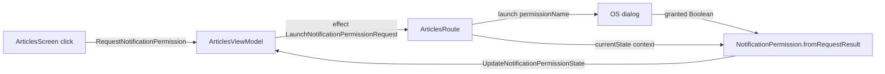

# MODULE: :platform:permission — platform-permission
Status: DRAFT
Verified commit: UNKNOWN (drafted against working tree at HEAD 2c0ae05b; not audited)
Last source audit: NOT_RUN
Test status: NOT_RUN (evidence: reports/baseline-verification.md)

> Doc status (`DRAFT|VERIFIED|NEEDS_REFRESH`) and test status (`NOT_RUN|TESTED|FAILED|BLOCKED`) are separate vocabularies; see `TEMPLATE.md`.

## 1. Identity and responsibility
- Owns: engine-neutral runtime-permission state `PermissionState` (`NotRequested`, `Granted`, `Denied`) and the single concrete adapter `NotificationPermission` for `android.permission.POST_NOTIFICATIONS`.
- Does not own: launching the OS dialog (done by `ArticlesRoute` via `rememberLauncherForActivityResult`), rationale/settings flow, rationale UI, any permission other than notifications. No state machine or requester interface exists.
- Public package/API: `com.dc.android.foundation.platform.permission` -> `PermissionState`, `NotificationPermission.{permissionName, currentState(Context), fromRequestResult(Boolean)}`.
- Consumer(s): `:app` `articles` package: `ArticlesRoute` (all three members), `ArticlesSyncWorker.postSyncNotification` (`currentState`), `ArticlesUiAction`/`ArticlesUiState`/`ArticlesScreen`/`ArticlesViewModel` (`PermissionState`).

## 2. Context and discovery
- Read first: `architecture/00-index.md`, `architecture/13-permissions.md` (PERM-01), `architecture/dependency-rules.md`.
- Main code: `platform/permission/src/main/java/com/dc/android/foundation/platform/permission/{PermissionState,NotificationPermission}.kt`.
- Tests: none in the module (`test_roots: []`). Consumer-side only: `app/src/test/.../articles/ArticlesViewModelTest.kt` has `UpdateNotificationPermissionState updates the permission field in state` (CodeGraph).
- Build config: `platform/permission/build.gradle.kts` (`dc.android.library`, `dc.compose`; `implementation` of `androidx.core.ktx`, `androidx.activity.compose`).
- CodeGraph entry symbols/callers/callees: `NotificationPermission` <- `ArticlesRoute`, `ArticlesSyncWorker`; callees `ContextCompat.checkSelfPermission`, `Build.VERSION.SDK_INT`.

## 3. Dependencies and boundaries
- Allowed: no project dependencies (`:platform:permission -> (none)`). Android `core-ktx` for `ContextCompat`.
- Forbidden: edges to `:app`/features (DEP-01), to `:data:*`/`:security`/`:ui:designsystem` (PROPOSED policy, not a rule); permission UI inside the platform module (MP 4.8 PERM-04 intent); production edge to `:testing` (BLD-03).
- Exceptions (DEC/KD): none recorded. KD-02 applies (edges not machine-enforced).

## 4. Data/control flow

Source refs: `ArticlesViewModel.onAction`/`requestNotificationPermission`; `ArticlesRoute` (launcher, initial `currentState(context)` in `LaunchedEffect(Unit)`); `ArticlesSyncWorker.kt:68` guards posting on `currentState != Granted`.

## 5. Contracts
- `PermissionState`: sealed interface, 3 `data object`s. `NotRequested` is a caller-seeded default; `NotificationPermission.currentState` never returns it (KDoc).
- `currentState(context)`: pre-API 33 returns `Granted` (`Build.VERSION_CODES.TIRAMISU` check); on 33+ maps `checkSelfPermission` to `Granted`/`Denied`. `fromRequestResult(granted)`: `Granted`/`Denied`.
- Denied vs "denied with rationale" vs permanently denied is NOT modelled (KDoc: three states by design; no `shouldShowRequestPermissionRationale` tracking, no settings deep link).
- Errors: none thrown, no `AppError` mapping. Cancellation/lifecycle: none owned; the launcher lifecycle is in the Route. Threading: synchronous, cheap framework call; safe on main.

## 6. DI, configuration and ownership
- No Hilt binding; `NotificationPermission` is a Kotlin `object`, not injected (so tests cannot substitute it; consumers test via `PermissionState` in UiState). `POST_NOTIFICATIONS` is declared in `app/src/main/AndroidManifest.xml:6`.

## 7. Edge cases, security and performance
- Request is user-initiated (button in `ArticlesScreen` shown while state != `Granted`); the code audited does not auto-prompt at startup (only `currentState` is read in `LaunchedEffect`). No secrets/PII.
- A process-death or rotation re-reads `currentState`; a permanent denial is indistinguishable from a first denial (see section 5).

## 8. Tests and evidence
- Unit: none in module. Integration: none. Instrumented: none.
- Commands (once Gradle runs): `./gradlew :platform:permission:testDebugUnitTest` (no sources); consumer check `./gradlew :app:testDebugUnitTest --tests "*ArticlesViewModelTest"`.
- Test status: NOT_RUN (evidence: reports/baseline-verification.md)
- Last verified result: none; the module has no tests (baseline A2: 0 test files).

## 9. Known debt / decisions
- PROPOSED backlog (MP 4.8, none implemented): PERM-01 state machine + notification contract with per-transition tests (P0); PERM-02 lifecycle-safe requester/observer interface + fake driver (P1); PERM-03 Android-version capability matrix (notifications, Bluetooth, camera, media, exact alarms) (P1); PERM-04 `DcPermissionRationale` as design-system UI, not in platform (P1).
- Observation: `dc.compose` and `androidx.activity.compose` are declared but no Compose import appears in the module's two source files (CONFIRMED_IN_CODE by import scan); intent UNKNOWN, possibly reserved for PERM-02. Not changed here.
- Rule-ID overlap: `13-permissions.md` PERM-01 (rule) vs backlog PERM-01 (state machine); see report D. No KD/DEC specific to this module.

## 10. Safe extension guide
- Add a permission only with a manifest declaration and a real use case (module STRUCTURE.md). Keep raw launcher calls in the Route; expose state via `PermissionState`. Do not move rationale UI here (PERM-04). Sample consumer: `ArticlesRoute` + `ArticlesViewModel`. Tests for new transitions should be pure (no Android) where possible.

## 11. AI task playbook
- Read -> Graph -> Propose -> Edit -> Test -> Update docs -> Handover.
- Read: `13-permissions.md`, both source files, `ArticlesRoute.kt`. Graph: `codegraph_explore "NotificationPermission PermissionState ArticlesRoute ArticlesSyncWorker"`.
- DoD: `:app:assembleDebug` + consumer unit tests pass (with evidence under `reports/`); this page and `context-map.yaml` updated for API changes.

## 12. Change log and links
- 2026-10-27 — R1.1c — first draft from source and CodeGraph. Report: `reports/wp/R1.1c.md`.
- Links: `context-map.yaml` entry `platform-permission`; `13-permissions.md`; `dependency-rules.md`.
