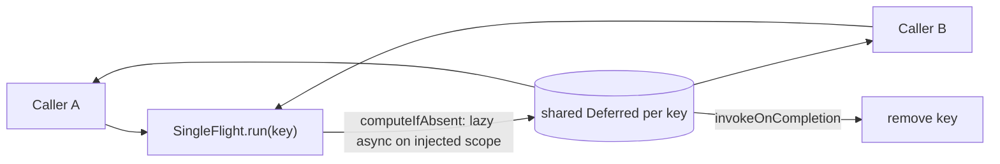

# MODULE: :runtime:concurrency — Coroutine/Flow primitives
Status: DRAFT
Verified commit: UNKNOWN (source read at working-tree HEAD 2c0ae05; page not yet reviewed)
Last source audit: NOT_RUN
Test status: NOT_RUN (evidence: reports/baseline-verification.md; Part B1/B2 blocked Gradle)

Legends for `Status:` / `Test status:` and per-fact tags: [`TEMPLATE.md`](TEMPLATE.md). Tags used below: CONFIRMED_IN_CODE (read in source at 2c0ae05), PROPOSED (backlog, not implemented).

## 1. Identity and responsibility
- Owns: dispatcher ownership (`DispatcherProvider`), process-lifetime scope (`AppCoroutineScope`), keyed de-duplication (`SingleFlight`), named-job bookkeeping (`JobRegistry`), retry/backoff (`RetryPolicy`, `retrying`), Flow sharing/throttle helpers. CONFIRMED_IN_CODE
- Does not own: WorkManager/Hilt/Android UI (module is plain Kotlin/JVM, only `kotlinx-coroutines-core`), the Hilt binding (lives in `:app`), crash reporting (callback only), WorkManager retry (`DcRetryPolicy`, `:runtime:scheduling`).
- Public package/API: `com.dc.android.foundation.runtime.concurrency` - `DispatcherProvider`, `DefaultDispatcherProvider`, `onIo`/`onDefault`/`flowOnIo` (`DispatcherShortcuts.kt`), `AppCoroutineScope`, `JobRegistry`, `SingleFlight<K,V>`, `RetryPolicy`, `retrying` (suspend and `Flow` forms), `WhileUiSubscribed`, `stateInWhileSubscribed`, `throttleFirst` (`FlowSharing.kt`).
- Consumer(s): `DispatcherProvider` - `:app` (`DcApplication`, `GreetingViewModel`, `ArticlesViewModel`, `DatabaseModule`, `SecurityModule`), `:data:database` (`RoomDatabaseFactory`), `:security` (`EncryptedSharedPreferencesSecureStorage`), `:runtime:scheduling`, `:testing`. `AppCoroutineScope` - `DcApplication` only. Every other symbol: no production caller (repo-wide grep, own tests only).

## 2. Context and discovery
- Read first: [`00-index.md`](../00-index.md), [`09-concurrency-and-threading.md`](../09-concurrency-and-threading.md) (THR-01, THR-02), INV-05/INV-06 in [`01-overview-and-invariants.md`](../01-overview-and-invariants.md), [`dependency-rules.md`](../dependency-rules.md).
- Main code: `runtime/concurrency/src/main/kotlin/com/dc/android/foundation/runtime/concurrency/` (8 files, one per symbol group).
- Tests: `.../src/test/kotlin/.../concurrency/` - `SingleFlightTest`, `JobRegistryTest`, `RetryPolicyTest`, `FlowSharingTest`.
- Build config: `runtime/concurrency/build.gradle.kts` (`dc.kotlin.jvm`, `dc.testing`, `implementation(libs.kotlinx.coroutines.core)`).
- CodeGraph entry symbols: `DispatcherProvider`, `DefaultDispatcherProvider`, `SingleFlight`, `JobRegistry`, `AppCoroutineScope`, `RetryPolicy`; callers listed in section 1.

## 3. Dependencies and boundaries
- Allowed: none (`:runtime:concurrency -> (none)` in [`dependency-rules.md`](../dependency-rules.md)); inbound from `:app`, `:runtime:scheduling`, `:data:database`, `:security`, `:testing`.
- Forbidden: edge to `:app` (DEP-01); `GlobalScope` (THR-01); PROPOSED (no rule ID): no Android module dependency, based on the `dc.kotlin.jvm` build fact.
- Exceptions (DEC/KD): none recorded. KD-02 (Open, partially mitigated: static `tools/check_architecture.py --boundaries-only`; CI run NOT_RUN): [`22-known-deviations.md`](../22-known-deviations.md).

## 4. Data/control flow

Refs: `SingleFlight.kt:21-30`; `JobRegistry.kt:21-68` (lazy job registered before start, removed on completion); `RetryPolicy.kt:62-82` (`retrying` loop, `delay` between attempts); `AppCoroutineScope.kt` (SupervisorJob + `default` + exception handler); wiring: `DcApplication.kt:45-49`, `ConcurrencyModule.kt`.

## 5. Contracts
| API | Owner scope / threading | Cancellation | Errors |
|---|---|---|---|
| `DispatcherProvider` (`main`, `mainImmediate`, `io`, `default`) | consumers choose the slot; `DefaultDispatcherProvider` maps to `Dispatchers.*` | n/a | n/a |
| `onIo`/`onDefault`/`flowOnIo` | `withContext` / `flowOn` on the provider's slot | follows caller | propagates |
| `AppCoroutineScope(dispatchers, onUncaughtException)` | `SupervisorJob + default`; created and never cancelled by `DcApplication` (no shutdown API) | process death | uncaught -> callback; app logs via `Logger.e` |
| `SingleFlight.run(key, block)` | `block` runs on the constructor `scope`, not the caller | one caller cancelling does not cancel the shared run (covered by `SingleFlightTest`, NOT_RUN) | exception reaches all awaiters; key removed on completion |
| `JobRegistry(scope)` | jobs launched on `scope` (e.g. `viewModelScope`); `synchronized` map | `launchLatest` cancels prior job of same key; `cancel`, `cancelAll` | job exceptions follow `scope` semantics |
| `RetryPolicy` (default 3 attempts, 500 ms, x2, cap 8 s, jitter 0.2, retries `IOException`) | `delay` on caller dispatcher | `CancellationException` never retried | rethrows last cause when exhausted or ineligible |
| `stateInWhileSubscribed`, `WhileUiSubscribed` | 5 s stop timeout | scope-bound | n/a |
| `throttleFirst(window)` | `channelFlow`, window via `delay` (virtual-time friendly) | collector-bound | upstream |
Presets: `RetryPolicy.None`, `.Default`, `.Background` (5 attempts, 60 s cap). `AppError` is not used here (no dependency on `:foundation`).

## 6. DI, configuration and ownership
- `DispatcherProvider` bound as `@Singleton` `DefaultDispatcherProvider()` in `app/src/main/java/com/dc/android/foundation/di/ConcurrencyModule.kt` (module itself has no `@Inject`; INV-03 per that file's comment).
- `AppCoroutineScope` is not a Hilt binding: `DcApplication` builds it lazily from the injected `DispatcherProvider` and `Logger`.
- `SingleFlight`/`JobRegistry` are constructed by the caller with its own scope; none is constructed in production code today.
- No variants or configuration flags.

## 7. Edge cases, security and performance
- Scopes bypassing the provider: `DcAlarmReceiver` and `DcAlarmRestorer` (`:runtime:scheduling`) build their own `CoroutineScope(SupervisorJob() + DefaultDispatcherProvider().default)`; not fakeable in tests.
- `SingleFlight`: failure cleanup depends on `invokeOnCompletion`; whether a failing `block` also cancels `scope` depends on the Job type of the scope passed in (not enforced, not tested; MP:CON-01). Different value types per key are not checked.
- `RetryPolicy.retryIf` default only retries `java.io.IOException`; jitter uses `Random` (not injectable, MP:CON-03).
- No secrets/PII handled. `JobRegistry` uses `synchronized`, no suspending locks; no blocking work inside.
- `AppCoroutineScope` has no `cancel`/shutdown contract (MP:CON-07).

## 8. Tests and evidence
- Unit (JVM, `runTest`/`runBlocking`): `SingleFlightTest` (4 tests: immediate-execution cleanup, key collapse, different keys, one caller cancels), `JobRegistryTest` (6: concurrent `launchIfIdle`, `launchLatest`, keys, idle/finished re-launch, `cancel`), `RetryPolicyTest` (6: success, exponential virtual delay, exhaustion, ineligible, cancellation, Flow), `FlowSharingTest` (1: `throttleFirst`). No test for `stateInWhileSubscribed`, `AppCoroutineScope`, `DispatcherShortcuts`, `cancelAll`, `isRunning`.
- Integration / Instrumented: none.
- Commands: `./gradlew :runtime:concurrency:test` (JVM module; `testDebugUnitTest` does not cover it, baseline drift D2; lane A1 added an explicit `:foundation:test :runtime:concurrency:test` step to `ci.yml`, run NOT_RUN).
- Test status: NOT_RUN (evidence: reports/baseline-verification.md, Part B: Gradle blocked at daemon-toolchain provisioning)
- Last verified result: none for the current HEAD.

## 9. Known debt / decisions
- KD-02 only. Backlog, all PROPOSED (MP 4.2): MP:CON-01 `SingleFlight` audit incl. race tests (P0); MP:CON-02 `JobRegistry` lifecycle/no orphan (P0); MP:CON-03 `RetryPolicy` virtual clock, injectable jitter (P0); MP:CON-04 `FlowSharing` semantics (P0); MP:CON-05 debounce/throttle only if no equivalent (P1); MP:CON-06 optional `ClockProvider` (P1); MP:CON-07 `AppCoroutineScope` ownership/shutdown doc (P0).
- Duplicate-semantics watch: `RetryPolicy` here vs `DcRetryPolicy` in scheduling (MP:SCH-06): keep distinct, document.

## 10. Safe extension guide
- Take `DispatcherProvider` by constructor and use its slots instead of `Dispatchers.*` (THR-02); create scopes at the composition root. Sample consumer: `GreetingViewModel` (`withContext(dispatcherProvider.default)`).
- New helper: add only if no kotlinx equivalent; give it a virtual-time test; do not add Android/Hilt/WorkManager imports.

## 11. AI task playbook
- Read -> Graph -> Propose -> Edit -> Test -> Update docs -> Handover.
- Read: this page, `09-concurrency-and-threading.md`, the symbol's file and its test.
- Graph: `codegraph_explore "SingleFlight JobRegistry RetryPolicy DispatcherProvider AppCoroutineScope"` and check callers before any signature change.
- Recipe (MP:CON-01): add interleaving/failure tests with `StandardTestDispatcher`, no real sleeps; run `./gradlew :runtime:concurrency:test`.
- Done: tests pass with evidence in `reports/logs/`, this page's section 5/8 refreshed.

## 12. Change log and links
- 2026-10-27 - R1.1a - first DRAFT from source at 2c0ae05 ([`reports/wp/R1.1a.md`](../../reports/wp/R1.1a.md)).
- Links: [`context-map.yaml`](../context-map.yaml) entry `runtime-concurrency`; rules THR-01, THR-02, INV-05, INV-06; [`module-map.md`](../module-map.md).
- Rule glosses (text lives in the named doc; gloss only, the rule doc is authoritative): `INV-03` (01-overview-and-invariants.md): reusable base/core APIs do not depend on project-specific business/domain models; `INV-05` (01-overview-and-invariants.md): no locks held while invoking external callbacks or across unsafe suspension points; `INV-06` (01-overview-and-invariants.md): long-lived mutable orchestration has one clear owner; `DEP-01` (02-layers-and-dependencies.md): core/base modules do not depend on feature implementation (or on :app); `THR-01` (09-concurrency-and-threading.md): no GlobalScope; `THR-02` (09-concurrency-and-threading.md): dispatcher access goes through DispatcherProvider.
