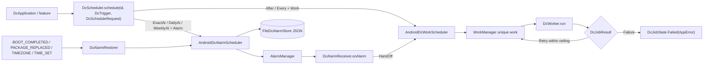

# MODULE: :runtime:scheduling — WorkManager and AlarmManager orchestration
Status: DRAFT
Verified commit: UNKNOWN (source read at working-tree HEAD 2c0ae05; page not yet reviewed)
Last source audit: NOT_RUN
Test status: NOT_RUN (evidence: reports/baseline-verification.md; Part B1/B3 blocked Gradle)

Legends for `Status:` / `Test status:` and per-fact tags: [`TEMPLATE.md`](TEMPLATE.md). Tags used below: CONFIRMED_IN_CODE (read in source at 2c0ae05), PROPOSED (backlog, not implemented).

## 1. Identity and responsibility
- Owns: one facade `DcScheduler` over two independent paths: deferrable work (WorkManager: `DcJobSpec`, `DcWorkScheduler`, `DcWorker`) and time-specific alarms (AlarmManager: `DcAlarm`, `AndroidDcAlarmScheduler`, `FileDcAlarmStore`, `DcAlarmReceiver`, `DcAlarmRestorer`, `DcExactAlarmPermission`); plus wall-clock math (`nextDaily`, `nextWeekly`). CONFIRMED_IN_CODE
- Does not own: API endpoints or `articles` repository logic (`ArticlesSyncWorker` is in `:app`, needs `@HiltWorker`), Hilt/Room/DataStore (default store is a JSON file), permission UX, `RetryPolicy` of `:runtime:concurrency`.
- Public package/API: `com.dc.android.foundation.runtime.scheduling` (`DcScheduler`, `AndroidDcScheduler`, `DcTrigger`, `DcScheduleRequest`, `DcScheduleOutcome`, `DcScheduledItem`, `nextDaily`, `nextWeekly`), `.work` (`DcJobSpec`, `DcConstraints`, `DcRetryPolicy`, `DcJobState`, `DcJobResult`, `DcWorker`, `DcWorkScheduler`, `AndroidDcWorkScheduler`), `.alarm` (`DcAlarm`, `DcExactness`, `DcMissedPolicy`, `DcAlarmStore`, `AndroidDcAlarmScheduler`, `DcAlarmReceiver`, `DcAlarmOutcome`, `DcExactAlarmPermission`, `DcBatteryOptimization`). `DcAlarmCodec` is `internal`.
- Consumer(s): `:app` (`DcApplication` schedules `articles-sync`; `ArticlesSyncWorker : DcWorker<Unit>`), `:testing` (`FakeScheduler`).

## 2. Context and discovery
- Read first: [`00-index.md`](../00-index.md), [`14-background-work.md`](../14-background-work.md) (BG-01, BG-02), [`11-error-and-result-model.md`](../11-error-and-result-model.md), [`dependency-rules.md`](../dependency-rules.md).
- Main code: `runtime/scheduling/src/main/java/com/dc/android/foundation/runtime/scheduling/` (`DcScheduler.kt`, `NextOccurrence.kt`, `work/`, `alarm/`); manifest `runtime/scheduling/src/main/AndroidManifest.xml`.
- Tests: `src/test/java/.../scheduling/` - `NextOccurrenceTest`, `NextOccurrenceContractTest`, `DcSchedulerContractTest`; `.../alarm/` - `DcAlarmCodecTest`, `DcAlarmContractTest` (+ `TestReceivers.kt` helper); `.../work/` - `DcWorkPolicyTest`, `DcWorkContractTest`.
- Build config: `runtime/scheduling/build.gradle.kts` (`dc.android.library`, kotlin-serialization; `api(project(":foundation"))` (since lane A3, `bb5ce19`; `AppError` is in public types), `implementation(project(":runtime:concurrency"))`, work-runtime-ktx, coroutines, serialization-json).
- CodeGraph entry symbols: `DcScheduler`, `AndroidDcScheduler`, `DcWorkScheduler`, `DcWorker`, `DcJobSpec`, `DcScheduleOutcome`; callers: `DcApplication.kt:56-75`, `ArticlesSyncWorker.kt`, `FakeScheduler.kt`.

## 3. Dependencies and boundaries
- Allowed: `:foundation` (`api`), `:runtime:concurrency` (`implementation`) (current table in [`dependency-rules.md`](../dependency-rules.md); edge set unchanged by A3, only the configuration); inbound from `:app`, `:testing` (api).
- Forbidden: edge to `:app` (DEP-01) - hence worker subclasses live in `:app`; production edge to `:testing` (BLD-03); PROPOSED (no rule ID): `:data:*`, `:security`, `:ui:*`.
- Exceptions (DEC/KD): none for this module; KD-02 (Open, partially mitigated: static `tools/check_architecture.py --boundaries-only`; CI run NOT_RUN). `AppError` appears in public types (`DcJobState.Failed`, `DcJobResult.Failure`), hence `api(project(":foundation"))` (PROPOSED DEC-A3-7; HANDOVER F2 resolved). Same class of leak NOT fixed: this module still exposes `DispatcherProvider` (`AndroidDcScheduler`, `FileDcAlarmStore`), `Flow`, `KSerializer`, `ListenableWorker` through `implementation` dependencies.

## 4. Data/control flow

Refs: `DcScheduler.kt:107-146` (routing, mismatched trigger/request -> `Rejected`), `DcWorkScheduler.kt:47-115`, `AndroidDcAlarmScheduler.kt:24-104`, `DcAlarmReceiver.kt:34-55`, `DcAlarmRestorer.kt`.

## 5. Contracts
- `DcScheduler.schedule/cancel/scheduled/observe`: `schedule` returns `Scheduled`, `NeedsExactAlarmPermission` (alarm path, non-`Inexact`, `canScheduleExactAlarms()` false on API 31+), or `Rejected(reason)` (wrong trigger/request pair, invalid periodic interval, scheduling exception). `scheduled()` returns persisted alarms only, not work. `observe(id)` maps WorkInfo to `DcJobState` (work path).
- Identity (PROPOSED DEC-A3-3): for work, `id` must equal `DcJobSpec.name`; `DcScheduler` returns `Rejected` otherwise (`internal identityMismatch`), because `cancel(id)`/`observe(id)` address the unique work by name (previously `id` was silently ignored).
- Idempotency (PROPOSED DEC-A3-4): `After` while unfinished is KEEP - first request wins, later call is a no-op that still returns `Scheduled`; `Every` is KEEP - a changed interval/constraints is NOT applied (UPDATE is unreachable through the facade; follow-up); alarm `schedule` is an upsert by id (same request code + data URI replaces the PendingIntent).
- Work: unique work named by `DcJobSpec.name`; `After` -> `enqueueOnce` (KEEP existing), `Every` -> `enqueueUniquePeriodicWork` (KEEP); periodic interval >= 15 min, flex 5 min..< interval (`validatePeriodicInterval`); `DcRetryPolicy` backoff >= 10 s and `maxAttempts` ceiling enforced in `DcWorker.toWorkResult` (default 5).
- `DcWorker.doWork` (final): rethrows `CancellationException`, maps `SerializationException` -> `AppError.Serialization`, other `Throwable` -> `AppError.Unknown`; only a kind string crosses WorkManager output (`workKind`/`errorFromKind`, same wire strings as before A3; lossy: `Http` code 0, no cause). Pure parts are `internal` and JVM-testable: `DcWorkVerdict`/`toVerdict`, `existingWorkPolicy`, `existingPeriodicWorkPolicy`, `backoffPolicy`, `toNetworkType`, `allTags`, `dcJobState`. Retry: `DcRetryPolicy` is WorkManager-driven and survives process death (backoff >= 10 s, no jitter); do not nest the in-process `RetryPolicy` (`:runtime:concurrency`) around a `DcJobResult.Retry` path (PROPOSED DEC-A3-6).
- Alarms: `DcAlarm.id` non-blank; `DcExactness` {AlarmClock, Exact, Inexact}; `DcMissedPolicy` default `FireOnce` for `ExactAt`, `Skip` for repeating; `DcMissedPolicy` only affects `ExactAt` (`DailyAt`/`WeeklyAt` always re-arm the next occurrence on restore, so `FireOnce` has no effect there); a work trigger with an alarm request throws `IllegalStateException` for the default policy (default evaluated before `require`), not `IllegalArgumentException`. Restore decisions live in the pure `DcAlarm.restoreDecision` (`DcRestoreDecision`), used by `AndroidDcAlarmScheduler.restore()` (behaviour identical to before). `restore()` skips non-`Inexact` alarms when the exact permission is missing; a past `ExactAt` alarm fires at once under `FireOnce` or is removed under `Skip`; repeating alarms are rescheduled to their next occurrence. `DcAlarmReceiver` reschedules the next occurrence, runs `onAlarm` under a 9 s budget with `goAsync()`, and may hand off to WorkManager.
- Threading: alarm store I/O on `DispatcherProvider.io` under a process-wide per-path `Mutex`; receivers run on module-owned scopes (`SupervisorJob + default`).

## 6. DI, configuration and ownership
- No Hilt binding for `DcScheduler` in `app/.../di/` (6 modules: Concurrency, DataStore, Database, Network, Observability, Security). `DcApplication.onCreate` constructs `AndroidDcScheduler(context, dispatcherProvider)` directly inside `applicationScope.launch`.
- `DcApplication` implements `Configuration.Provider` with `HiltWorkerFactory`; `app/AndroidManifest.xml` removes the default `WorkManagerInitializer` (BG-01). `AndroidDcWorkScheduler` calls `WorkManager.getInstance`.
- Library manifest merges `DcAlarmRestorer` (non-exported). `:app` manifest currently declares only `POST_NOTIFICATIONS`; apps must add exact-alarm and boot permissions themselves. No `DcAlarmReceiver` subclass exists in production code, so the alarm path is unused in `:app` today.

## 7. Edge cases, security and performance
- Alarm payload JSON and the alarm list are stored unencrypted in `filesDir/dc_scheduled_alarms.json`; do not put secrets or PII in payloads (SEC-01 intent).
- Persisted alarm list decoding is per entry (PROPOSED DEC-A3-5): one entry with a removed receiver class / unknown zone / bad enum is dropped, the others survive; previously `decodeList` returned `[]` and the next `FileDcAlarmStore.put` overwrote every stored alarm (reproduced pre-A3 defect). A wholly corrupt file still decodes to empty.
- Open defects (need device/Robolectric, not fixed): `restore()` aborts the remaining alarms if one `scheduleAt` throws (wrap per alarm); no restore trigger when exact-alarm permission is granted later (MP:SCH-04); changing the receiver class under one id leaves the old PendingIntent (cancel first); orphan platform alarm if the store file is lost; `Every` ignores `initialDelay`/`expedited` and its UPDATE path is unreachable.
- DST: gap moves forward, overlap takes earlier offset (covered by `NextOccurrenceTest`, NOT_RUN). `Every` ignores `spec.initialDelay`/`expedited` (only `enqueueOnce` applies them). Exact alarms are not guaranteed under Doze/permission revocation; `setAlarmClock`/`setExactAndAllowWhileIdle`/`setAndAllowWhileIdle` are used per exactness. Request code is a CRC32 of the id plus intent data URI to avoid collisions.
- Receiver and restorer must finish inside the ~9 s budget; long work must use `DcAlarmOutcome.HandOff`.

## 8. Tests and evidence
- Unit (79 `@Test` after lane A3, commit `bb5ce19`): pre-existing `NextOccurrenceTest` (6), `DcAlarmCodecTest` (5), `DcWorkPolicyTest` (4); added by A3: `NextOccurrenceContractTest` (17), `DcAlarmContractTest` (21), `DcWorkContractTest` (19), `DcSchedulerContractTest` (7). Pure mappers, verdicts, kind strings, per-entry codec, identity rejection and `restoreDecision` are covered. Not covered by any test: `AndroidDcScheduler` end-to-end routing, real WorkManager/AlarmManager, receivers, `AndroidDcAlarmScheduler.restore()` itself, boot restore (MP:SCH-05 instrumentation), `DcAlarmCodec` against the real `android.jar`.
- Integration / Instrumented: none in this module.
- Commands: `./gradlew :runtime:scheduling:testDebugUnitTest`.
- Test status: NOT_RUN (evidence: reports/baseline-verification.md, Part B: Gradle blocked at daemon-toolchain provisioning)
- Scratch evidence only, NOT a Gradle gate (`reports/wp/A3.md` section C): out-of-repo JUnitCore run with hand-written `android.*`/`androidx.work` stubs, scheduling 79/79; whole `src/main` compiled against the stubs. Also NOT_RUN: `:app` tests / Hilt graph with the new `api(...)` edge.
- Last verified result: none for the current HEAD (no Gradle run).

## 9. Known debt / decisions
- KD-02. Backlog (MP 4.3): MP:SCH-01, MP:SCH-02, MP:SCH-03 and MP:SCH-06 closed for pure logic/documentation by lane A3 (`bb5ce19`; Gradle NOT_RUN; decisions DEC-A3-3..6 PROPOSED pending Opus review). Still open: MP:SCH-04 exact-alarm denied/revoked/unsupported contract incl. restore on grant (P1); MP:SCH-05 instrumentation for broadcast/Worker/boot restore (P1; log `NOT_RUN` without device).
- Design note: [`plan/SCHEDULING_MODULE_PLAN.md`](../../plan/SCHEDULING_MODULE_PLAN.md) exists; it is not an accepted DEC.

## 10. Safe extension guide
- New job: subclass `DcWorker<I>` in the owning module/`:app` (with `@HiltWorker` if it needs Hilt), declare `DcJobSpec`, schedule through `DcScheduler`; sample consumer: `ArticlesSyncWorker` + `DcApplication`. Test ViewModels with `FakeScheduler` from `:testing`.
- New alarm use: subclass `DcAlarmReceiver
`, register it in the app manifest, add permissions, handle `NeedsExactAlarmPermission` in UI. Do not mix paths: a work trigger with an alarm request is rejected.
- A Room-backed `DcAlarmStore` may replace the file store without a new module dependency.

## 11. AI task playbook
- Read -> Graph -> Propose -> Edit -> Test -> Update docs -> Handover.
- Read: this page, `14-background-work.md`, the touched file and its test.
- Graph: `codegraph_explore "DcScheduler AndroidDcScheduler DcWorker DcAlarmReceiver DcJobSpec"`; check `DcApplication`, `ArticlesSyncWorker`, `FakeScheduler` blast radius.
- Recipe (MP:SCH-02): extend `NextOccurrenceTest` with fixed `ZoneId`/`Instant`, no real clock; run `./gradlew :runtime:scheduling:testDebugUnitTest`.
- Done: tests with evidence under `reports/logs/`, public-API/manifest changes reflected here and in `14-background-work.md`.

## 12. Change log and links
- 2026-10-27 - R1.1a - first DRAFT from source at 2c0ae05 ([`reports/wp/R1.1a.md`](../../reports/wp/R1.1a.md)).
- 2026-10-27 - DOC-A - merged lane A3 delta (`bb5ce19`, [`reports/wp/A3.md`](../../reports/wp/A3.md), [`A3-design.md`](../../reports/wp/A3-design.md)); doc stays DRAFT, tests NOT_RUN.
- Links: [`context-map.yaml`](../context-map.yaml) entry `runtime-scheduling`; rules BG-01, BG-02; [`module-map.md`](../module-map.md).
- Rule glosses (text lives in the named doc; gloss only, the rule doc is authoritative): `DEP-01` (02-layers-and-dependencies.md): core/base modules do not depend on feature implementation (or on :app); `SEC-01` (12-security-and-session.md): no secret/token/PII in a log call; `BG-01` (14-background-work.md): select the engine from the required delivery guarantee; `BG-02` (14-background-work.md): exact alarms are opt-in and restoreable; `BLD-03` (18-build-logic-and-dependencies.md): test utilities never enter production runtime graphs.
