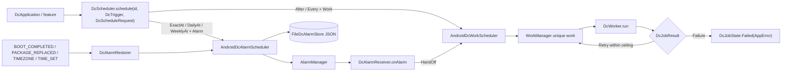

# MODULE: :runtime:scheduling — WorkManager and AlarmManager orchestration
Status: DRAFT
Verified commit: UNKNOWN (source read at working-tree HEAD 2c0ae05; page not yet reviewed)
Last source audit: NOT_RUN
Test status: NOT_RUN (evidence: reports/baseline-verification.md; Part B1/B3 blocked Gradle)

Legends for `Status:` / `Test status:` and per-fact tags: [`TEMPLATE.md`](TEMPLATE.md). Tags used below: CONFIRMED_IN_CODE (read in source at 2c0ae05), PROPOSED (backlog, not implemented).

## 1. Identity and responsibility
- Owns: one facade `DcScheduler` over two independent paths: deferrable work (WorkManager: `DcJobSpec`, `DcWorkScheduler`, `DcWorker`) and time-specific alarms (AlarmManager: `DcAlarm`, `AndroidDcAlarmScheduler`, `FileDcAlarmStore`, `DcAlarmReceiver`, `DcAlarmRestorer`, `DcExactAlarmPermission`); plus wall-clock math (`nextDaily`, `nextWeekly`). CONFIRMED_IN_CODE
- Does not own: API endpoints or `articles` repository logic (`ArticlesSyncWorker` is in `:app`, needs `@HiltWorker`), Hilt/Room/DataStore (default store is a JSON file), permission UX, `RetryPolicy` of `:runtime:concurrency`.
- Public package/API: `com.dc.android.foundation.runtime.scheduling` (`DcScheduler`, `AndroidDcScheduler`, `DcTrigger`, `DcScheduleRequest`, `DcScheduleOutcome`, `DcScheduledItem`, `nextDaily`, `nextWeekly`), `.work` (`DcJobSpec`, `DcConstraints`, `DcRetryPolicy`, `DcJobState`, `DcJobResult`, `DcWorker`, `DcWorkScheduler`, `AndroidDcWorkScheduler`), `.alarm` (`DcAlarm`, `DcExactness`, `DcMissedPolicy`, `DcAlarmStore`, `AndroidDcAlarmScheduler`, `DcAlarmReceiver`, `DcAlarmOutcome`, `DcExactAlarmPermission`, `DcBatteryOptimization`). `DcAlarmCodec` is `internal`.
- Consumer(s): `:app` (`DcApplication` schedules `articles-sync`; `ArticlesSyncWorker : DcWorker<Unit>`), `:testing` (`FakeScheduler`).

## 2. Context and discovery
- Read first: [`00-index.md`](../00-index.md), [`14-background-work.md`](../14-background-work.md) (BG-01, BG-02), [`11-error-and-result-model.md`](../11-error-and-result-model.md), [`dependency-rules.md`](../dependency-rules.md).
- Main code: `runtime/scheduling/src/main/java/com/dc/android/foundation/runtime/scheduling/` (`DcScheduler.kt`, `NextOccurrence.kt`, `work/`, `alarm/`); manifest `runtime/scheduling/src/main/AndroidManifest.xml`.
- Tests: `src/test/java/.../scheduling/NextOccurrenceTest.kt`, `.../alarm/DcAlarmCodecTest.kt`, `.../work/DcWorkPolicyTest.kt`.
- Build config: `runtime/scheduling/build.gradle.kts` (`dc.android.library`, kotlin-serialization; `implementation` of `:foundation`, `:runtime:concurrency`, work-runtime-ktx, coroutines, serialization-json).
- CodeGraph entry symbols: `DcScheduler`, `AndroidDcScheduler`, `DcWorkScheduler`, `DcWorker`, `DcJobSpec`, `DcScheduleOutcome`; callers: `DcApplication.kt:56-75`, `ArticlesSyncWorker.kt`, `FakeScheduler.kt`.

## 3. Dependencies and boundaries
- Allowed: `:foundation`, `:runtime:concurrency` (current table in [`dependency-rules.md`](../dependency-rules.md)); inbound from `:app`, `:testing` (api).
- Forbidden: edge to `:app` (DEP-01) - hence worker subclasses live in `:app`; production edge to `:testing` (BLD-03); PROPOSED (no rule ID): `:data:*`, `:security`, `:ui:*`.
- Exceptions (DEC/KD): none for this module; KD-02 (edges unenforced). Note: `AppError` appears in public types (`DcJobState.Failed`, `DcJobResult.Failure`) while `:foundation` is `implementation`, so consumers must declare it themselves (see report D).

## 4. Data/control flow

Refs: `DcScheduler.kt:107-146` (routing, mismatched trigger/request -> `Rejected`), `DcWorkScheduler.kt:47-115`, `AndroidDcAlarmScheduler.kt:24-104`, `DcAlarmReceiver.kt:34-55`, `DcAlarmRestorer.kt`.

## 5. Contracts
- `DcScheduler.schedule/cancel/scheduled/observe`: `schedule` returns `Scheduled`, `NeedsExactAlarmPermission` (alarm path, non-`Inexact`, `canScheduleExactAlarms()` false on API 31+), or `Rejected(reason)` (wrong trigger/request pair, invalid periodic interval, scheduling exception). `scheduled()` returns persisted alarms only, not work. `observe(id)` maps WorkInfo to `DcJobState` (work path).
- Work: unique work named by `DcJobSpec.name`; `After` -> `enqueueOnce` (KEEP existing), `Every` -> `enqueueUniquePeriodicWork` (KEEP); periodic interval >= 15 min, flex 5 min..< interval (`validatePeriodicInterval`); `DcRetryPolicy` backoff >= 10 s and `maxAttempts` ceiling enforced in `DcWorker.toWorkResult` (default 5).
- `DcWorker.doWork` (final): rethrows `CancellationException`, maps `SerializationException` -> `AppError.Serialization`, other `Throwable` -> `AppError.Unknown`; only a kind string crosses WorkManager output (`appErrorFrom` is lossy: `Http` code 0, no cause).
- Alarms: `DcAlarm.id` non-blank; `DcExactness` {AlarmClock, Exact, Inexact}; `DcMissedPolicy` default `FireOnce` for `ExactAt`, `Skip` for repeating. `restore()` skips non-`Inexact` alarms when the exact permission is missing; a past `ExactAt` alarm fires at once under `FireOnce` or is removed under `Skip`; repeating alarms are rescheduled to their next occurrence. `DcAlarmReceiver` reschedules the next occurrence, runs `onAlarm` under a 9 s budget with `goAsync()`, and may hand off to WorkManager.
- Threading: alarm store I/O on `DispatcherProvider.io` under a process-wide per-path `Mutex`; receivers run on module-owned scopes (`SupervisorJob + default`).

## 6. DI, configuration and ownership
- No Hilt binding for `DcScheduler` in `app/.../di/` (6 modules: Concurrency, DataStore, Database, Network, Observability, Security). `DcApplication.onCreate` constructs `AndroidDcScheduler(context, dispatcherProvider)` directly inside `applicationScope.launch`.
- `DcApplication` implements `Configuration.Provider` with `HiltWorkerFactory`; `app/AndroidManifest.xml` removes the default `WorkManagerInitializer` (BG-01). `AndroidDcWorkScheduler` calls `WorkManager.getInstance`.
- Library manifest merges `DcAlarmRestorer` (non-exported). `:app` manifest currently declares only `POST_NOTIFICATIONS`; apps must add exact-alarm and boot permissions themselves. No `DcAlarmReceiver` subclass exists in production code, so the alarm path is unused in `:app` today.

## 7. Edge cases, security and performance
- Alarm payload JSON and the alarm list are stored unencrypted in `filesDir/dc_scheduled_alarms.json`; do not put secrets or PII in payloads (SEC-01 intent).
- Corrupt store or JSON decodes to empty/skipped (`runCatching`), silently dropping alarms (tested for the codec/file store).
- DST: gap moves forward, overlap takes earlier offset (covered by `NextOccurrenceTest`, NOT_RUN). `Every` ignores `spec.initialDelay`/`expedited` (only `enqueueOnce` applies them). Exact alarms are not guaranteed under Doze/permission revocation; `setAlarmClock`/`setExactAndAllowWhileIdle`/`setAndAllowWhileIdle` are used per exactness. Request code is a CRC32 of the id plus intent data URI to avoid collisions.
- Receiver and restorer must finish inside the ~9 s budget; long work must use `DcAlarmOutcome.HandOff`.

## 8. Tests and evidence
- Unit: `NextOccurrenceTest` (6: same-day, midnight, spring gap, autumn overlap, weekly, zone change), `DcAlarmCodecTest` (round trip, corrupt JSON, request codes, file store recovery, concurrent store instances), `DcWorkPolicyTest` (retry ceiling, periodic interval/flex, backoff minimum). Not covered by any test: `AndroidDcScheduler` routing, `AndroidDcWorkScheduler`/`AndroidDcAlarmScheduler`, `DcWorker.doWork`, receivers, `restore()`.
- Integration / Instrumented: none in this module.
- Commands: `./gradlew :runtime:scheduling:testDebugUnitTest`.
- Test status: NOT_RUN (evidence: reports/baseline-verification.md, Part B: Gradle blocked at daemon-toolchain provisioning)
- Last verified result: none for the current HEAD.

## 9. Known debt / decisions
- KD-02. Backlog, all PROPOSED (MP 4.3): SCH-01 `DcJobSpec`/unique-work/backoff/state audit with idempotency tests (P0); SCH-02 DST/timezone/clock-shift tests (P0); SCH-03 codec/store corruption/boot restore/request identity (P0); SCH-04 exact-alarm denied/revoked/unsupported contract (P1); SCH-05 instrumentation for broadcast/Worker (P1; log `NOT_RUN` without device); SCH-06 document `DcRetryPolicy` vs concurrency `RetryPolicy` distinction (P0).
- Design note: [`plan/SCHEDULING_MODULE_PLAN.md`](../../plan/SCHEDULING_MODULE_PLAN.md) exists; it is not an accepted DEC.

## 10. Safe extension guide
- New job: subclass `DcWorker<I>` in the owning module/`:app` (with `@HiltWorker` if it needs Hilt), declare `DcJobSpec`, schedule through `DcScheduler`; sample consumer: `ArticlesSyncWorker` + `DcApplication`. Test ViewModels with `FakeScheduler` from `:testing`.
- New alarm use: subclass `DcAlarmReceiver
`, register it in the app manifest, add permissions, handle `NeedsExactAlarmPermission` in UI. Do not mix paths: a work trigger with an alarm request is rejected.
- A Room-backed `DcAlarmStore` may replace the file store without a new module dependency.

## 11. AI task playbook
- Read -> Graph -> Propose -> Edit -> Test -> Update docs -> Handover.
- Read: this page, `14-background-work.md`, the touched file and its test.
- Graph: `codegraph_explore "DcScheduler AndroidDcScheduler DcWorker DcAlarmReceiver DcJobSpec"`; check `DcApplication`, `ArticlesSyncWorker`, `FakeScheduler` blast radius.
- Recipe (SCH-02): extend `NextOccurrenceTest` with fixed `ZoneId`/`Instant`, no real clock; run `./gradlew :runtime:scheduling:testDebugUnitTest`.
- Done: tests with evidence under `reports/logs/`, public-API/manifest changes reflected here and in `14-background-work.md`.

## 12. Change log and links
- 2026-10-27 - R1.1a - first DRAFT from source at 2c0ae05 ([`reports/wp/R1.1a.md`](../../reports/wp/R1.1a.md)).
- Links: [`context-map.yaml`](../context-map.yaml) entry `runtime-scheduling`; rules BG-01, BG-02; [`module-map.md`](../module-map.md).
