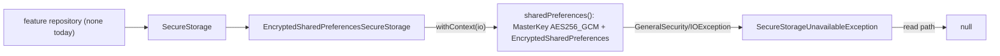

# MODULE: :security — Secure key/value storage
Status: DRAFT
Verified commit: UNKNOWN (source read at base 2c0ae05; not VERIFIED)
Last source audit: 2026-10-27 (CodeGraph + file read; no Gradle build)
Test status: NOT_RUN (evidence: reports/baseline-verification.md)

> Doc status and test status are separate fields; legend in [`TEMPLATE.md`](TEMPLATE.md). Unproven in production path: KD-04 (no real credential flows through this module).

## 1. Identity and responsibility
- Owns: business-neutral encrypted string key/value contract `SecureStorage`, its Android implementation `EncryptedSharedPreferencesSecureStorage`, and the failure signal `SecureStorageUnavailableException`.
- Does not own: authentication, login, session or token lifecycle (none exists, KD-04); non-sensitive preferences (`:data:preferences`, SEC-02); key backup/migration plans; threat model (not written, see §9).
- Public package/API: `com.dc.android.foundation.security` (2 main files).
- Consumer(s): none in code. Only `:app` `di/SecurityModule.kt` binds it; no class injects `SecureStorage` (grep over `app/src`, `testing/src`). No fake exists in `:testing`.

## 2. Context and discovery
- Read first: `architecture/00-index.md`, `12-security-and-session.md` (SEC-01, SEC-02), `11-error-and-result-model.md`, `22-known-deviations.md` KD-04, `09-concurrency-and-threading.md` (THR-02).
- Main code: `security/src/main/java/com/dc/android/foundation/security/SecureStorage.kt:12`, `EncryptedSharedPreferencesSecureStorage.kt:26,73`.
- Tests: `security/src/test/.../SecureStorageUnavailableExceptionTest.kt` (3 tests, the exception only). No instrumented tests.
- Build config: `security/build.gradle.kts` (`dc.android.library`, `dc.testing`; `implementation(:runtime:concurrency)`, `androidx.security:security-crypto` 1.1.0 via `gradle/libs.versions.toml`, javax-inject, coroutines-core).
- CodeGraph entry symbols/callers/callees: `SecureStorage` (1 caller: `SecurityModule`), `EncryptedSharedPreferencesSecureStorage` (2 refs in `SecurityModule`), `SecureStorageUnavailableException` (4 refs inside the implementation file).

## 3. Dependencies and boundaries
- Allowed: `:runtime:concurrency` (`DispatcherProvider`). `androidx.security.crypto` stays behind `SecureStorage` (DEP-04, INV-07).
- Forbidden: `:app` (DEP-01); `:testing` in production (BLD-03); any module reaching `EncryptedSharedPreferences`/`MasterKey` directly; `:ui:designsystem -> :security` (DEP-03). PROPOSED only: `:security -> :foundation` allowed, `:observability -> :security` banned.
- Exceptions (DEC/KD): KD-04 (Open; exit when a real auth/session feature stores a credential through it). MP 12.1 D-04 (provider/lifecycle decision) is pending; R5.0 plans an ADR.

## 4. Data/control flow

Refs: `putString` `:31`, `getString` `:37`, `remove` `:46`, `sharedPreferences` `:52`.

## 5. Contracts
- `SecureStorage`: `suspend putString(key, value)`, `suspend getString(key): String?`, `suspend remove(key)`. No `clear()`/enumerate API.
- Implementation: every call runs in `withContext(dispatcherProvider.io)` (main-safe, THR-02). Prefs file `dc_foundation_secure_prefs`; `MasterKey` scheme `AES256_GCM`; key encryption `AES256_SIV`, value encryption `AES256_GCM`. A new `MasterKey`/`EncryptedSharedPreferences` is built on every call (no caching).
- Errors (ERR-01): `GeneralSecurityException` and `IOException` during construction are wrapped as `SecureStorageUnavailableException`. Read path converts it to `null` (indistinguishable from "no value"). Write paths (`putString`, `remove`) let the exception propagate to the caller. Other exceptions propagate. Writes use `apply()` (asynchronous disk commit, no completion signal).
- Cancellation: standard coroutine cancellation around `withContext`; no custom handling. Lifecycle: stateless wrapper; the app `@Singleton` owns the instance.

## 6. DI, configuration and ownership
- `:app` `di/SecurityModule.kt` (`@InstallIn(SingletonComponent)`): `provideSecureStorage(@ApplicationContext, DispatcherProvider): SecureStorage` (`@Singleton`) returns `EncryptedSharedPreferencesSecureStorage`. No Hilt in `:security`. Key alias is the library default master-key alias (not set explicitly); prefs file name is a private constant.

## 7. Edge cases, security and performance
- SEC-01: the implementation does not log. Redaction/no-leak tests do not exist (MP:SEC-04 PROPOSED).
- Failure modes seen in code: Keystore/key failure or corrupt prefs file -> reads return `null`, writes throw. No recovery, reset or key-invalidation handling exists (UNKNOWN behavior on key invalidation; not tested).
- Backup/restore: `android:allowBackup="true"` in `app/src/main/AndroidManifest.xml`; `backup_rules.xml` / `data_extraction_rules.xml` are Android template files. Effective inclusion of `dc_foundation_secure_prefs` in backups is `UNKNOWN`; restoring an encrypted file without its Keystore key is a known Android caveat, not handled here.
- No claim of protection on rooted/compromised devices (MP 4.9). Cost: key-store/prefs construction per call on the io dispatcher.
- `security-crypto` 1.1.0 maintenance status is not assessed here (MP:SEC-02 PROPOSED ADR).

## 8. Tests and evidence
- Unit: `SecureStorageUnavailableExceptionTest` — wraps `GeneralSecurityException`; wraps `IOException`; message not lost. These test the exception class only, not storage behavior.
- Integration: none. Instrumented: none (Android Keystore needs device/emulator; none in this environment).
- Commands: `./gradlew :security:testDebugUnitTest`; Keystore behavior would need `:security:connectedDebugAndroidTest` (no such tests exist).
- Test status: NOT_RUN (evidence: reports/baseline-verification.md)
- Last verified result: none (Gradle not executed).
- Not covered: put/get/remove round trip, read-failure -> null, write-failure propagation, no-secret-in-logs.

## 9. Known debt / decisions
- KD-04 (Open): storage implemented without a real credential flow; see [`22-known-deviations.md`](../22-known-deviations.md). Related pending decision D-04 (MP 12.1).
- Backlog (PROPOSED, MP 4.9): MP:SEC-01 audit of lifecycle/failure modes with read/write/remove/clear/failure tests (P0); MP:SEC-02 dependency/SDK maintenance assessment and ADR with version evidence (P1); MP:SEC-03 optional auth/session contract only when a real feature uses it (P2); MP:SEC-04 tests that no secret reaches logs/crash/analytics (P0). Bare `SEC-01`/`SEC-02` are the rules in `12-security-and-session.md`; backlog items are written `MP:<ID>` (convention in `context-protocol.md`).
- Constraint (MP 4.9): do not swap the crypto provider or rotate keys without a migration/backup plan.

## 10. Safe extension guide
- A future credential store should depend on `SecureStorage` only, inside a feature repository in `:app` (not Composables/ViewModels); there is no real sample consumer yet (KD-04).
- Do not add a fake auth flow to exercise this module. A test fake for `SecureStorage` would belong in `:testing` (none today).
- Adding `clear()` or a distinct "unavailable" read result is a contract change: update the `:app` binding and any consumers in the same change and decide the ERR-01 mapping first.

## 11. AI task playbook
- Read → Graph → Propose → Edit → Test → Update docs → Handover.
- Query: `codegraph_explore "SecureStorage EncryptedSharedPreferencesSecureStorage SecureStorageUnavailableException SecurityModule"`.
- Recipe: read KD-04 and `12-security-and-session.md` first; never log values/keys; keep calls on `dispatcherProvider.io`. Done = unit tests (+ instrumented if Keystore touched), this page and KD-04 status line updated.

## 12. Change log and links
- 2026-10-27 R1.1b: first DRAFT from source (base 2c0ae05). Report: [`reports/wp/R1.1b.md`](../../reports/wp/R1.1b.md).
- Links: context-map id `security`; rules SEC-01, SEC-02, ERR-01, THR-02; KD-04; [`dependency-rules.md`](../dependency-rules.md).
- Rule glosses (text lives in the named doc; gloss only, the rule doc is authoritative): `INV-07` (01-overview-and-invariants.md): infrastructure exceptions and vendor types do not leak into presentation/public contracts; `DEP-01` (02-layers-and-dependencies.md): core/base modules do not depend on feature implementation (or on :app); `DEP-03` (02-layers-and-dependencies.md): presentation does not import infrastructure implementations; `DEP-04` (02-layers-and-dependencies.md): infrastructure-specific types stay behind the owning module boundary; `THR-02` (09-concurrency-and-threading.md): dispatcher access goes through DispatcherProvider; `ERR-01` (11-error-and-result-model.md): infrastructure exceptions are caught at the data-source boundary, not in the ViewModel; `SEC-01` (12-security-and-session.md): no secret/token/PII in a log call; `SEC-02` (12-security-and-session.md): credentials/tokens are stored only through SecureStorage, never PreferencesDataSource; `BLD-03` (18-build-logic-and-dependencies.md): test utilities never enter production runtime graphs.
