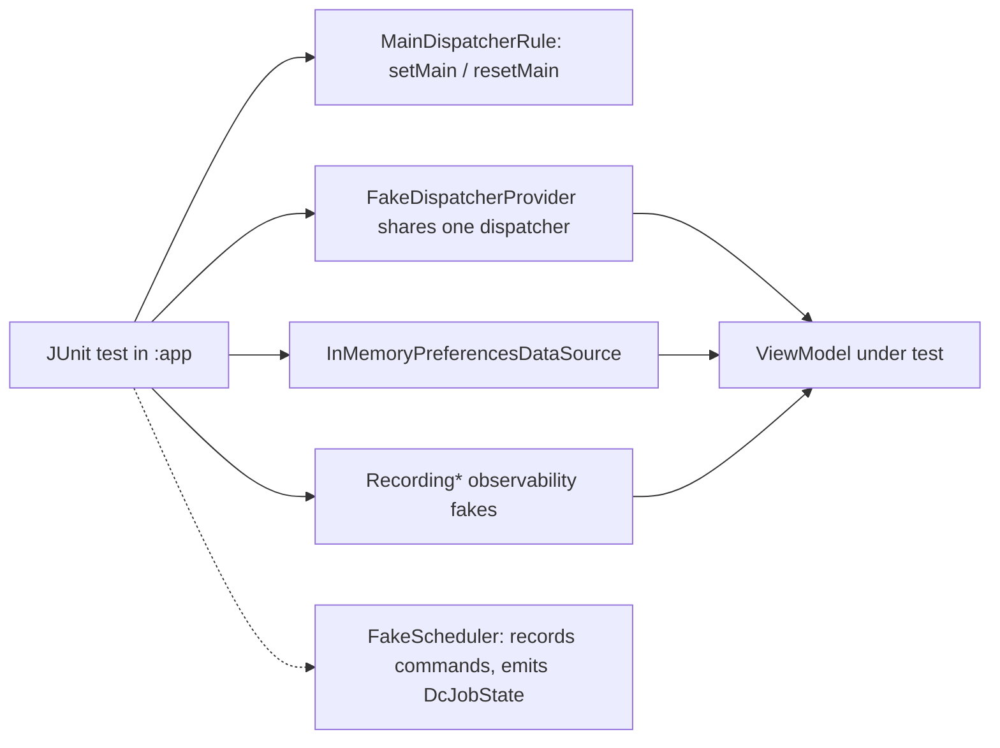

# MODULE: :testing — cross-module testing kit
Status: DRAFT
Verified commit: UNKNOWN (source read at working-tree HEAD 2c0ae05; page not yet reviewed)
Last source audit: NOT_RUN
Test status: NOT_RUN (evidence: reports/baseline-verification.md; Part B1/B3 blocked Gradle)

Legends for `Status:` / `Test status:` and per-fact tags: [`TEMPLATE.md`](TEMPLATE.md). Tags used below: CONFIRMED_IN_CODE (read in source at 2c0ae05), PROPOSED (backlog, not implemented).

## 1. Identity and responsibility
- Owns: JVM-only reusable test doubles and rules: `MainDispatcherRule`, `FakeDispatcherProvider`, `InMemoryPreferencesDataSource`, `FakeScheduler`, and observability doubles (`NoOpLogger`, `RecordingLogger`/`LogRecord`, `NoOpAnalyticsTracker`, `RecordingAnalyticsTracker`/`AnalyticsEvent`, `NoOpCrashReporter`, `RecordingCrashReporter`) in `ObservabilityFakes.kt`. CONFIRMED_IN_CODE
- Does not own: production code (BLD-03), Compose semantics robots or androidTest fixtures (none exist), fakes for modules without an interface (no navigation/permission/network/clock fake), test conventions (`dc.testing` plugin in `build-logic`).
- Public package/API: `com.dc.android.foundation.testing`.
- Consumer(s): `:app` unit tests (`GreetingViewModelTest`, `ArticlesViewModelTest`, `AppConfigurationRepositoryTest`), this module's own tests, and the feature generator template (`build-logic/.../FeatureScaffoldGenerator.kt` emits a `MainDispatcherRule` test). No other module depends on it. `FakeScheduler` has no consumer yet.

## 2. Context and discovery
- Read first: [`00-index.md`](../00-index.md), [`17-testing.md`](../17-testing.md) (TST-01, TST-02), BLD-03 in [`18-build-logic-and-dependencies.md`](../18-build-logic-and-dependencies.md), [`dependency-rules.md`](../dependency-rules.md).
- Main code: `testing/src/main/java/com/dc/android/foundation/testing/` (5 files).
- Tests: `testing/src/test/java/com/dc/android/foundation/testing/TestingKitTest.kt`, `InMemoryPreferencesDataSourceTest.kt`, `FakeSchedulerTest.kt` (added by lane A3, `bb5ce19`).
- Build config: `testing/build.gradle.kts` (`dc.android.library`, `dc.testing`; `api` of `:runtime:concurrency`, `:data:preferences`, `:observability`, `:runtime:scheduling`, coroutines-core, coroutines-test, junit). `dc.testing` additionally adds `testImplementation` junit, coroutines-test and turbine to each module (`DcTestingConventionPlugin.kt`).
- CodeGraph entry symbols: `MainDispatcherRule`, `FakeDispatcherProvider`, `InMemoryPreferencesDataSource`, `FakeScheduler`, `RecordingLogger`; callers: the three `:app` tests above.

## 3. Dependencies and boundaries
- Allowed: `:runtime:concurrency`, `:runtime:scheduling`, `:data:preferences`, `:observability` as `api` (current table in [`dependency-rules.md`](../dependency-rules.md)); consumers: `testImplementation(project(":testing"))` in `:app` only.
- Forbidden: appearing in any `implementation`/`api` of production code (BLD-03); edge to `:app` (DEP-01). PROPOSED (not current rule): `:testing -> :foundation`.
- Exceptions (DEC/KD): none for this module; KD-02 (Open, partially mitigated: static `tools/check_architecture.py --boundaries-only`; CI run NOT_RUN); BLD-03 is only statically checked in [`22-known-deviations.md`](../22-known-deviations.md).

## 4. Data/control flow

Refs: `MainDispatcherRule.kt`, `FakeDispatcherProvider.kt`, `GreetingViewModelTest.kt:23-30` (rule + `FakeDispatcherProvider` + in-memory prefs), `ArticlesViewModelTest.kt:33-41`.

## 5. Contracts
- `MainDispatcherRule(testDispatcher = StandardTestDispatcher())`: `TestWatcher`; sets `Dispatchers.Main` on start and resets on finish; does not own a test scope (tests use `runTest`).
- `FakeDispatcherProvider(dispatcher)`: implements `DispatcherProvider` with all four slots set to one dispatcher; intended to be passed the dispatcher installed by the rule.
- `InMemoryPreferencesDataSource`: implements `PreferencesDataSource` (`observe`, `get`, `set`, `remove`, `clear`, `edit`); `Mutex`-guarded writes, backed by `MutableStateFlow<Map>`; missing key returns `key.default`.
- `FakeScheduler`: implements `DcScheduler`; public `scheduleCommands`, `cancelledIds`, `nextOutcome` (default `Scheduled`), `emitState(id, state)`; `scheduled()` always returns an empty list; touches no Android API.
- Observability doubles: `Recording*` keep `synchronized` lists and return snapshot copies; `clear()` resets.
- Errors/cancellation: none thrown by the fakes. Threading: deterministic via the injected test dispatcher. Lifecycle: per test (JUnit rule).

## 6. DI, configuration and ownership
Not bound in Hilt and not used in `:app/.../di/`; tests construct subjects by hand with constructor injection (INV-04). No variants. Dependencies are exposed through `api` so test consumers see the types that the fakes' signatures use.

## 7. Edge cases, security and performance
- Android-library packaging but no Android code; keep JVM-only (no Robolectric/instrumentation helpers here).
- Reverse-direction limit: `:testing` exposes `:observability` as `api`, so `ObservabilityFakes` (`RecordingLogger`) cannot be used from `:observability`'s own tests (would be a cycle); those tests use a local `FakeLogger` (lane A2).
- Drift risk: fakes re-implement production behavior by hand (`InMemoryPreferencesDataSource` vs DataStore implementation in `:data:preferences`; `FakeScheduler.scheduled()` vs `AndroidDcScheduler.scheduled()`); no shared contract test enforces parity (MP:TST-01, MP:TST-05, PROPOSED).
- `FakeScheduler` does not enforce `id == DcJobSpec.name` (the real `DcScheduler` returns `Rejected` on mismatch, PROPOSED DEC-A3-3) nor idempotency/KEEP semantics, so a ViewModel test can pass against the fake and fail against the facade (MP:TST-01 parity gap).
- `FakeScheduler` keeps plain mutable lists/maps (no locking, unlike `InMemoryPreferencesDataSource`'s `Mutex` and the `Recording*` locks); fine for single-test-thread use only.
- `RecordingLogger` stores messages and throwables in memory: test data only, never real secrets (SEC-01).
- Pulls `junit` and `kotlinx-coroutines-test` transitively (api); must never reach a release classpath.

## 8. Tests and evidence
- Unit: `TestingKitTest` (2 tests: observability fakes capture calls without exposing mutable storage; `FakeDispatcherProvider` shares one dispatcher), `InMemoryPreferencesDataSourceTest` (1 test: defaults and atomic `edit`), `FakeSchedulerTest` (2 tests, A3: recorded commands / emitted state; it only uses the alarm request because work-runtime is not on this module's compile classpath). Not tested here: `MainDispatcherRule`, `NoOp*` objects, `clear()` paths. `FakeScheduler` still has no consumer outside its own test.
- Integration: indirect, through the three `:app` unit tests listed in section 1.
- Instrumented: none (`:app` androidTest does not use `:testing`; `app/build.gradle.kts` has only `testImplementation(project(":testing"))`).
- Commands: `./gradlew :testing:testDebugUnitTest`; consumers `./gradlew :app:testDebugUnitTest`.
- Test status: NOT_RUN (evidence: reports/baseline-verification.md, Part B: Gradle blocked at daemon-toolchain provisioning)
- Scratch evidence only, NOT a Gradle gate (`reports/wp/A3.md` section C): `FakeSchedulerTest` 2/2 on an out-of-repo run; the `:testing` classpath for it is NOT_RUN.
- Last verified result: none for the current HEAD (no Gradle run).

## 9. Known debt / decisions
- KD-02. Backlog, all PROPOSED (MP 4.11): MP:TST-01 fake parity with production contracts (P0); MP:TST-02 `FakeClock`, fake permission/navigation/network only once an interface exists (P1); MP:TST-03 Flow/state helpers and controlled scheduler, demo in `greeting`/`articles` (P1); MP:TST-04 Compose semantics robot/fixtures, instrumentation-specific artifact if needed, `GreetingScreenTest` must execute (P1); MP:TST-05 shared contract-test suites for storage/network/observability (P1).
- Note: turbine is already provided by `dc.testing`; no `:testing` helper uses it today.

## 10. Safe extension guide
- Add a fake only for an existing production interface, next to its siblings, with a test proving parity; expose the interface's module as `api` only if the fake's signature needs it. Prefer reuse over per-module duplicate fakes.
- Never add `:testing` to production configurations (BLD-03). Sample consumer: `GreetingViewModelTest` (rule + dispatcher fake + in-memory prefs).
- Adding a `project(...)` edge needs `dependency-rules.md`, `context-map.yaml` and `module-map.md` updated together.

## 11. AI task playbook
- Read -> Graph -> Propose -> Edit -> Test -> Update docs -> Handover.
- Read: this page, `17-testing.md`, the production interface a fake mirrors.
- Graph: `codegraph_explore "MainDispatcherRule FakeDispatcherProvider InMemoryPreferencesDataSource FakeScheduler Recording*"` for callers/tests.
- Recipe (MP:TST-01): write a parity test running the same assertions against the fake and the real implementation where feasible; run `./gradlew :testing:testDebugUnitTest :app:testDebugUnitTest`.
- Done: tests with evidence under `reports/logs/`, no production config references `:testing`.

## 12. Change log and links
- 2026-10-27 - R1.1a - first DRAFT from source at 2c0ae05 ([`reports/wp/R1.1a.md`](../../reports/wp/R1.1a.md)).
- 2026-10-27 - DOC-A - merged lane A3 delta (`bb5ce19`): `FakeSchedulerTest`, FakeScheduler parity gap.
- Links: [`context-map.yaml`](../context-map.yaml) entry `testing`; rules TST-01, TST-02, BLD-03; [`module-map.md`](../module-map.md).
- Rule glosses (text lives in the named doc; gloss only, the rule doc is authoritative): `DEP-01` (02-layers-and-dependencies.md): core/base modules do not depend on feature implementation (or on :app); `SEC-01` (12-security-and-session.md): no secret/token/PII in a log call; `BLD-03` (18-build-logic-and-dependencies.md): test utilities never enter production runtime graphs; `TST-01` (17-testing.md): every *ViewModel gets a unit test using MainDispatcherRule; `TST-02` (17-testing.md): stateless screens get a Compose UI test, not a mock-heavy one.
