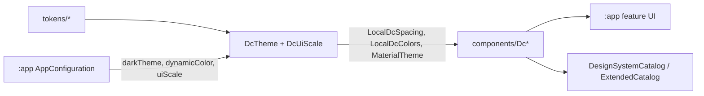

# MODULE: :ui:designsystem — DC design system
Status: DRAFT
Verified commit: UNKNOWN
Last source audit: NOT_RUN
Test status: NOT_RUN (evidence: reports/baseline-verification.md)

> **Two separate vocabularies**
> - **Doc status** (`Status:`): `DRAFT` = written/unreviewed; `VERIFIED` = checked against current source and build files (needs commit SHA + audit date); `NEEDS_REFRESH` = source moved on or docs disagree.
> - **Test status** (`Test status:`): `NOT_RUN` | `TESTED` | `FAILED` | `BLOCKED`; `TESTED`/`FAILED` require an evidence path under `reports/`. Never derived from reading code.
> - Fact tags used below: `CONFIRMED_IN_CODE`, `DOCUMENTED_ONLY`, `PROPOSED`, `UNKNOWN`.

## 1. Identity and responsibility
- Owns: primitive tokens, semantic `DcTheme` + `DcUiScale`, reusable stateless/state-hoisted `Dc*` Compose components, preview annotations, the manual `DesignSystemCatalog`, default `dc_*` string resources (DEC-08). `CONFIRMED_IN_CODE` (`ui/designsystem/build.gradle.kts`, `ui/designsystem/STRUCTURE.md`)
- Does not own: feature/domain screens or models (DEC-06), app configuration persistence and locale (`:app` config, DEC-07), navigation engine (`:platform:navigation`; `DcNavigationSuite` is only a UI shell), image-loader choice beyond the Coil wrapper.
- Public package/API: `com.dc.android.foundation.designsystem.{tokens,theme,components,catalog,preview}` (namespace `com.dc.android.foundation.designsystem`). Entry symbols: `DcTheme`, `DcContentState`, `DesignSystemCatalog`, `DcSpacing`, `DcColors`.
- Consumer(s): `:app` only (`implementation(project(":ui:designsystem"))`): `MainActivity`, `greeting/*`, `articles/*`, `config/*`, `showcase/trip/*`.

## 2. Context and discovery
- Read first: `architecture/00-index.md`, `architecture/07-design-system/README.md` (DS-01..04), then the one sub-doc for the concern (`tokens.md`, `semantic-theme.md`, `components.md`, `previews-and-catalog.md`, `component-roadmap.md`). DECs: DEC-05..08 in `architecture/23-decision-log.md`.
- Main code (`ui/designsystem/src/main/java/.../designsystem/`):
  - `tokens/` (7 files): `ColorTokens`, `SpacingTokens`, `DcSpacing` (+ `LocalDcSpacing`), `ShapeTokens`, `MotionTokens`, `SurfaceTokens.kt` (declares `ElevationTokens` and `StrokeTokens`, not a `SurfaceTokens` object), `AccessibilityTokens` (`MinTouchTarget`).
  - `theme/` (5 files): `DcTheme` (+ `DcThemeDefaults`), `DcColors` (extended success/warning/info/offline roles, `LocalDcColors`), `DcTypography`, `DcShapes`, `DcUiScale`.
  - `components/` (26 files, grouped below), `catalog/` (`DesignSystemCatalog.kt`, `ExtendedCatalog.kt`), `preview/DcPreviews.kt`, `res/values/strings.xml`.
- Tests: `src/test` (5 files), `src/androidTest` (2 files); see section 8.
- Registry: [`ui/designsystem/COMPONENTS.md`](../../ui/designsystem/COMPONENTS.md) (A4, commit `17b4703`): every public symbol (133), exclusions, overlaps, findings F/C/G/H, usage/preview/test guide. Status DRAFT, everything NOT_RUN.
- Build config: `ui/designsystem/build.gradle.kts` — plugins `dc.android.library`, `dc.compose`, `dc.testing`; external deps: Material icons core, Material3 adaptive navigation-suite, Coil compose + okhttp, Compose UI test (androidTest).
- CodeGraph entry symbols: `DcTheme`, `DcUiScale` (callers: `AppConfiguration*`, `MainActivity`), `DcContentState` (caller: `articles/ArticlesScreen.kt`), `DesignSystemCatalog` (caller: `MainActivity` debug route), `DcNavigationSuite` (caller: `MainActivity`).

## 3. Dependencies and boundaries
- Allowed: no `project(...)` dependencies today (`architecture/dependency-rules.md`: `:ui:designsystem -> (none)`); third-party Compose/Material3/Coil only. Direction: tokens -> theme -> components -> feature UI (INV-08, DS-01).
- Forbidden: any edge to `:app`/feature packages (DEP-01); to `:data:*`, `:security` (DEP-03/INV-02); PROPOSED extension: also `:runtime:*`, `:platform:*`. Business/domain types in public APIs (DEC-06). Feature code importing Coil or Material adaptive types (STRUCTURE.md; Coil confined to `components/DcAsyncImage.kt`, `CONFIRMED_IN_CODE`).
- Exceptions (DEC/KD): none recorded. Edge enforcement: KD-02 (Open, partially mitigated: static `tools/check_architecture.py --boundaries-only`; CI run NOT_RUN).

## 4. Data/control flow

`DcTheme(darkTheme, dynamicColor=false, colorScheme, typography, shapes, extendedColors, spacing, uiScale, content)` provides `LocalDcSpacing = uiScale.applyTo(spacing)` and `LocalDcColors`, then wraps `MaterialTheme` with `uiScale.applyTo(typography)` (`theme/DcTheme.kt:98-121`). Dynamic color is opt-in and gated on API >= S (`DcThemeDefaults.colorScheme`).

## 5. Contracts
- Layers: components read semantics from `MaterialTheme.*`, `LocalDcSpacing`, `LocalDcColors`; feature code must not import `tokens.ColorTokens`/`DcTypography` (DS-01) or use raw `.dp`/`RoundedCornerShape` literals (DS-03).
- `DcUiScale` (DEC-07): enum `Compact` 0.90 / `Standard` 1.00 / `Comfortable` 1.10. `applyTo(DcSpacing)` scales xSmall..xxLarge and `component`; `applyTo(Typography)` scales fontSize and lineHeight of all 15 styles. The 48dp touch floor (`AccessibilityTokens.MinTouchTarget`, DS-02) and system font scale are not changed. Apply once at the app-level `DcTheme`, never per screen. `applyTo` is `internal`.
- Component groups by file (names only; the full registry is [`ui/designsystem/COMPONENTS.md`](../../ui/designsystem/COMPONENTS.md), MP:UI-01, created by lane A4 as a DRAFT):

| File(s) | Group (sample symbols) |
|---|---|
| `DcText`, `DcTextLink`, `DcButton`, `DcActionComponents` | text; `DcButton` + `DcButtonVariant`; icon buttons, FABs |
| `DcInputComponents`, `DcSearchBar`, `DcFormComponents`, `DcDropdownField` | `DcTextField`, `DcPasswordTextField`, search, `DcTextArea`, stepper/slider/OTP/date field |
| `DcSelectionComponents`, `DcToggleRow`, `DcModels` | segmented, radio/checkbox/chip groups, `DcToggleRow`; `DcOption<T>`, `DcMenuItem` |
| `DcListComponents`, `DcListRow`, `DcMenuComponents` | `DcCard`, `DcKeyValueRow`, `DcStatusChip`, `DcListRow`; menus, tooltip |
| `DcFeedbackComponents`, `DcStateComponents`, `DcMessageComponents`, `DcBadgeComponents` | `DcContentState<T>`; loading/empty/error/offline states; `DcInlineMessage`, progress, `DcSnackbarHost`; badges |
| `DcOverlayComponents`, `DcSheetComponents` | dialogs, `DcModalBottomSheet`, skeletons; action/selection sheets |
| `DcScreenComponents`, `DcLayoutComponents`, `DcPullToRefreshBox` | `DcScaffold`, `DcTopAppBar`; content container, adaptive grid, tabs, expandable section; pull-to-refresh |
| `DcNavigationSuite`, `DcNavigationDrawer`, `DcAsyncImage` | adaptive nav shell (`DcNavigationItem`); drawer; Coil-backed image/avatar |

- `DcContentState<T>` is a presentation helper (Loading/Empty/Error/Content branch via `resolveDcContentStateBranch`), not a cache policy. Dialog/sheet visibility is caller-owned (DEC-05). Errors arrive as caller-mapped messages, not exceptions. No suspend or blocking work in the module; all composables run on the main thread.
- Catalog/preview: `DesignSystemCatalog()` (scrollable, light/dark) + `ExtendedCatalogSections()`; `DcThemePreviews`, `DcFontScalePreviews`, `DcWindowPreviews`. Manual catalog, no screenshot tooling (DEC-08: undecided; recommendation PROPOSED as DEC-A4-1). After A4 every public composable has a catalog example except `DcDatePickerDialog` (exercised only through `DcDateField`); A4 added `DcButton` slot, `DcListRow` slot and `DcMultiSegmentedButton`. DS-04 coverage is now checkable against the registry but is not machine-checked.
- Public surface (A4 scan, 133 symbols): components 113 (81 composable declarations / 75 names, 16 enums, 6 data classes, 5 `*Defaults` objects, 4 pure helpers, `DcSnackbarHostState`), theme 7, tokens 9, catalog 1, preview 3. Status proposals (PROPOSED, Opus to confirm): STABLE 55 / EXPERIMENTAL 77 / DEPRECATED 1. 22 private `@Preview` functions. `:app` references 29 symbols; 100 of 133 have no `:app` reference.
- A4 contract changes (additive, source-compatible, Compose code uncompiled): legacy `DcSnackbarEffect(String?, SnackbarHostState, ...)` is `@Deprecated(level = WARNING)`; `DcToggleRow` role follows `DcToggleControl` (Checkbox/Switch/RadioButton); `DcSearchBar` clear action uses `DcButton(Text)` (48dp floor, DS-02); `DcContentState` stale-content progress indicator has a `contentDescription`; OTP border uses `StrokeTokens.Hairline`.

## 6. DI, configuration and ownership
- No Hilt, no `@Module`, no singletons in this module (DS is pure Compose). Consumers construct nothing; they call composables.
- Configuration enters only as `DcTheme` parameters. `:app` `MainActivity.DcAppRoot` maps `AppConfiguration` (theme mode, dynamic color, `DcUiScale`) to them; persistence belongs to `app/config` (see `app.md`).
- Strings (DEC-08): `src/main/res/values/strings.xml` holds 23 `dc_*` defaults (e.g. `dc_retry`, `dc_cancel`, `dc_loading`); components take overridable label parameters. Only an English default exists (no `values-vi`), `CONFIRMED_IN_CODE`.

## 7. Edge cases, security and performance
- No secrets/PII handled; `DcPasswordTextField` masks input only (no storage).
- Accessibility floor enforced inside components (DS-02); large-font and UI-scale stress verified only by previews/unit tests of scale math, not by device runs (`NOT_RUN`).
- Recomposition cost of `DcUiScale.applyTo(Typography)` (copies 15 styles per theme call) is not measured. `UNKNOWN`: no benchmark exists (MP:UI-09).
- `DcNavigationSuite` enforces supported item count (`requireSupportedNavigationItemCount`, unit-tested).

## 8. Tests and evidence
- Unit (`src/test`, 30 `@Test` after lane A4, never executed): `DcContentStatePolicyTest` (8, was 5), `DcNavigationSuiteTest`, `DcWidgetPolicyTest` (components); `DcThemeTokensTest`, `DcUiScaleTest` (theme).
- Integration: none.
- Instrumented (`src/androidTest`, 21 `@Test` after A4 (+2: `typedSnackbarAcknowledgesOneMessageOnce`, `switchToggleRowExposesSwitchRole`), never executed; no device): `DcComponentsTest`, `DcWidgetsTest`.
- Commands: `./gradlew :ui:designsystem:testDebugUnitTest`, `./gradlew :ui:designsystem:compileDebugKotlin` (previews/catalog compile), `./gradlew :ui:designsystem:connectedDebugAndroidTest` (needs emulator).
- Test status: NOT_RUN (evidence: reports/baseline-verification.md; Gradle blocked at toolchain 25 and AGP plugin resolution, Part B)
- Last verified result: none. No screenshot/golden tests exist.

## 9. Known debt / decisions
- DEC-05 (delta over existing DS, `Dc` prefix kept), DEC-06 (promote primitives, not domain screens), DEC-07 (UI scale at root theme), DEC-08 (widget set + module string defaults).
- Legacy Material-typed API kept for source compatibility alongside DEC-08 typed models (the first `DcSnackbarEffect` below is `@Deprecated` since A4; `GreetingRoute`/`ArticlesRoute` still call it, so `:app` shows two deprecation warnings until migrated; no `allWarningsAsErrors` found): `DcSnackbarEffect(message: String?, SnackbarHostState, ...)` in `DcFeedbackComponents.kt` vs `DcSnackbarEffect(DcSnackbarMessage?, DcSnackbarHostState, ...)` in `DcMessageComponents.kt`; two `DcDropdownField` overloads in `DcDropdownField.kt` and `DcSelectionComponents.kt`. `CONFIRMED_IN_CODE`.
- Backlog (master-plan 4.12), status after lane A4 (`17b4703`, all NOT_RUN): MP:UI-01 component registry `COMPONENTS.md` done (DRAFT); MP:UI-02..05, MP:UI-09, MP:UI-10 audited, findings recorded in COMPONENTS.md section 6 (`DcContentState` branches now pinned by 8 policy tests, MP:UI-05 partial); the rest PROPOSED and not started. Unfixed on purpose (visual/owner decision or needs a compiler): colour contrast F-01..F-03 (outline vs surface 1.47:1 light / 1.74:1 dark, light `onSuccess` on `success` 3.30:1, light `onSurfaceVariant` on `surfaceVariant` 4.35:1; measured offline with a WCAG script, not a test), `DcAlertDialog` vs `DcInfoDialog`, typed `DcDropdownField` keyed by label, sheet swipe guard, `DcSnackbarHostState.current` single-slot race, stale-banner retry. Also: `DcColors.offline/onOffline` unused by any component; `SpacingTokens` is an unscaled duplicate of `DcSpacing`; 7 of 23 `dc_*` strings unreferenced. Original list: MP:UI-02 semantic token contract + `DcUiScale` accessibility snapshots; MP:UI-03 normalize buttons/inputs/forms/selection/lists/menus; MP:UI-04 feedback/overlay ownership tests; MP:UI-05 `DcContentState` state permutations incl. offline/refreshing; MP:UI-06 adaptive/insets demo; MP:UI-07 expandable card, date range, timeline, data table (only if consumer proves need); MP:UI-08 diagnostics widgets as optional extension; MP:UI-09 screenshot/semantics/recomposition tests; MP:UI-10 per-component usage docs.
- No KD currently scoped to this module.

## 10. Safe extension guide
- Add a component: put it in the matching `components/Dc*Components.kt` group (or a new focused file), take `modifier`, state-hoisted `value`/`onChange`, `enabled`, semantic variant enum; use `LocalDcSpacing`/`MaterialTheme`; default labels via `dc_*` string resources; add a catalog section and a preview (DS-04); add a policy test for non-trivial logic. Update `07-design-system/components.md` and `ui/designsystem/COMPONENTS.md`.
- Add a token: `tokens/` first, then expose through `DcTheme` defaults; do not let feature code read the token file.
- Do not add `project(...)` deps, domain models, Retrofit/Room/DataStore, or expose Coil/Material adaptive types.
- Sample consumers: `articles/ArticlesScreen.kt` (`DcContentState`, `DcCard`, `DcButton`), `MainActivity.kt` (`DcTheme`, `DcNavigationSuite`), `showcase/trip/*` (DEC-06 composition).

## 11. AI task playbook
- Read → Graph → Propose → Edit → Test → Update docs → Handover.
- Read: `07-design-system/README.md` and the concern sub-doc; `ui/designsystem/STRUCTURE.md`; DEC-05..08.
- Graph: `codegraph_explore "DcTheme DcUiScale DcContentState DesignSystemCatalog <component>"` with `projectPath` = repo root; check consumers in `:app` before changing a public signature (additive changes only).
- Recipe: smallest additive change; keep old overloads (DEC-08); then catalog + preview + test.
- Done when: `:ui:designsystem:compileDebugKotlin` and unit tests pass (currently cannot run: Gradle blocked, see section 8), `07-design-system` docs updated, no new project edge, report to `reports/wp/<WP>.md`.

## 12. Change log and links
- 2026-10-27 — R1.1d — first DRAFT from source; report `reports/wp/R1.1d.md`.
- 2026-10-27 — DOC-A — merged lane A4 delta (`17b4703`, `reports/wp/A4.md`): registry pointer, token file names, test counts, deprecation, findings. Doc stays DRAFT; tests NOT_RUN.
- Links: `architecture/context-map.yaml` (`ui-designsystem`), `architecture/dependency-rules.md`, `architecture/07-design-system/`, `architecture/modules/app.md`, `ui/designsystem/COMPONENTS.md` (A4 registry, DRAFT).
- Rule glosses (text lives in the named doc; gloss only, the rule doc is authoritative): `INV-08` (01-overview-and-invariants.md): design-system consumers use semantic tokens/components, not duplicated brand constants; `DEP-01` (02-layers-and-dependencies.md): core/base modules do not depend on feature implementation (or on :app); `DEP-02` (02-layers-and-dependencies.md): a feature does not import another feature's private implementation; `DEP-03` (02-layers-and-dependencies.md): presentation does not import infrastructure implementations; `UI-01` (05-presentation-udf.md): state flows down, actions flow up; `DS-01` (07-design-system/README.md): feature UI themes through DcTheme, not raw tokens; `DS-02` (07-design-system/README.md): interactive components enforce the accessibility floor centrally; `DS-03` (07-design-system/README.md): no raw spacing/shape literals in feature UI.
