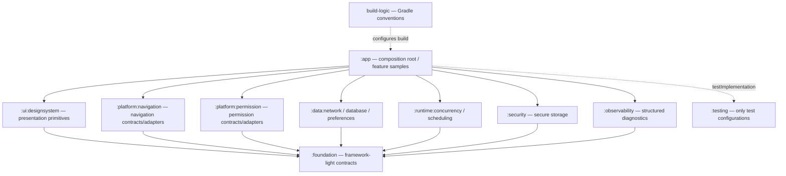
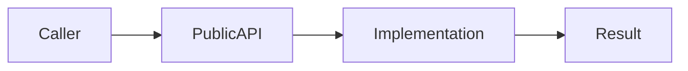
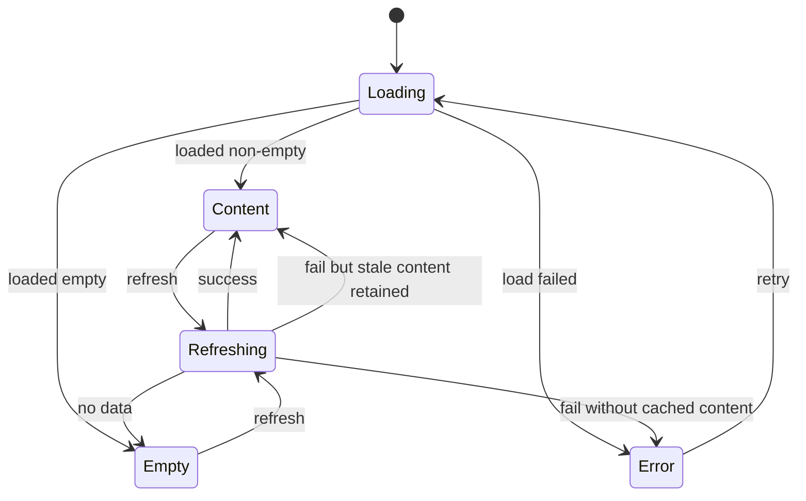
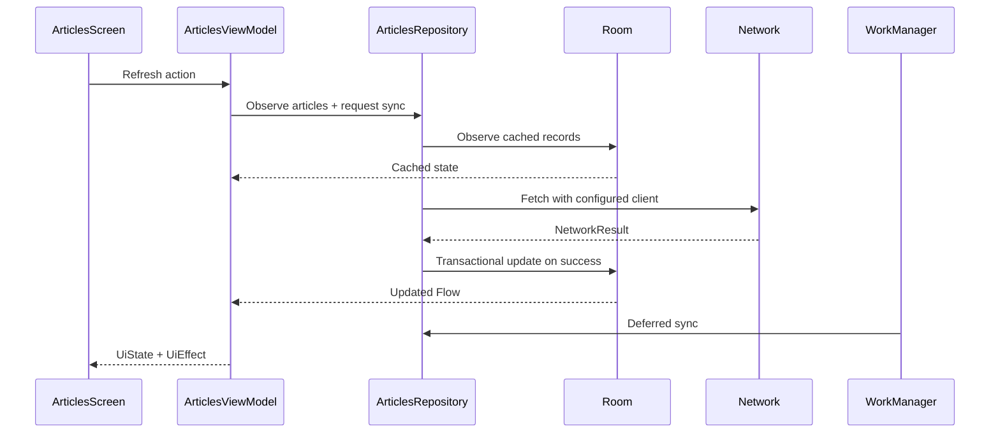
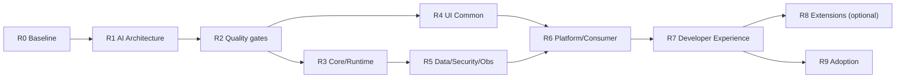

# DC Android Foundation — Master Implementation & AI Architecture Plan

> **Trạng thái:** ĐỀ XUẤT TRIỂN KHAI, chưa phải báo cáo code đã hoàn thành.  
> **Phạm vi:** Phát triển tiếp từ codebase **13 Gradle module + `build-logic`**, không khởi tạo dự án mới và không viết lại các pha A–L.  
> **Namespace hiện tại:** `com.dc.android.foundation`.  
> **Đối tượng:** Android engineers, tech leads, Codex/Claude/AI agents, reviewer và CI.  
> **Nguồn đầu vào:** Bản kiểm kê và trạng thái triển khai do người dùng cung cấp (`settings.gradle.kts`, cây mã nguồn, `HANDOVER.md`, `CodeGraph`, `architecture/`). **Không truy cập/đối chiếu trực tiếp repository, chưa chạy build hoặc test khi soạn tài liệu này.**  
> **Quy tắc nguồn sự thật:** Mã nguồn và `architecture/` đang có hiệu lực ưu tiên hơn mọi kế hoạch này; mọi điểm không khớp phải được kiểm chứng và lập ADR/decision, không tự ý sửa theo giả định.

---

## 0. Mục tiêu và kết quả cuối cùng

Xây dựng **Android Foundation có thể tiêu thụ bởi nhiều app**, gồm các phần core, runtime, data, UI design system, platform, security, observability, testing, build tooling, sample app và extension tùy chọn. **Mỗi phần bắt buộc có tài liệu kiến trúc đủ ngữ cảnh để AI agent khám phá đúng nguồn, hiểu boundary, đọc code cần thiết, đề xuất thay đổi, test và cập nhật tài liệu mà không làm lệch kiến trúc.**

### 0.1. Năm đầu ra bắt buộc

1. **Foundation API ổn định:** public contract rõ ràng; module độc lập, không mang business logic của `:app`.
2. **UI Common đồng nhất:** semantic theme/tokens, component catalog, state screens, form, feedback, navigation surfaces; có baseline accessibility và performance.
3. **AI-readable Architecture:** global map + module architecture + feature architecture + decision/deviation log + context manifests + discovery protocol.
4. **Quality gates thực thi được:** unit test, lint, build, instrumentation nơi có thiết bị/emulator, API/dependency checks, documentation drift checks.
5. **Adoption thực tế:** `greeting`, `articles`, `showcase` chứng minh luồng tích hợp; thêm consumer thật mới chứng minh API đủ phổ quát.

### 0.2. Nguyên tắc phạm vi

- **Giữ và nâng cấp** module đang có; **không tạo wrapper chỉ vì muốn đủ danh sách**.
- Những tên class trong bản kiểm kê là **đã báo cáo có**; không có nghĩa đã được chạy test hoặc đã production-ready.
- **Không đưa `ArticleEntity`/`ArticleDao` hay nghiệp vụ `greeting` vào public foundation API** chỉ vì các mẫu đang nằm trong repository.
- Tùy chọn như BLE/QR/Camera/Automotive là **extension**, không phải dependency bắt buộc của mọi app.
- Cấu hình minSdk, compileSdk, AGP, Kotlin/KSP, Compose BOM, Hilt, Room, WorkManager phải **đọc từ `build-logic`, `libs.versions.toml`, Gradle** trước mọi thay đổi. Không mặc định minSdk cụ thể khi chưa xem code.
- Không cam kết chỉ số CPU/RAM từ thiết kế; mỗi tối ưu chỉ được coi đạt khi có benchmark/evidence.

---

## 1. Baseline hiện tại và mức độ tin cậy

### 1.1. Module inventory từ nguồn người dùng

| Module | Kotlin / test | Baseline chức năng | Đánh giá cần làm tiếp |
|---|---:|---|---|
| `:foundation` | 3 / 1 | `AppError`, `Retryable`, core contracts | Rà lỗi, public API, serialization/error boundary |
| `:ui:designsystem` | 48 / 7 | Token → theme → component, catalog, preview | Audit API/component, coverage, accessibility, UI tests |
| `:runtime:concurrency` | 12 / 4 | Dispatchers, app scope, registry, single-flight, retry, Flow | Race/cancellation semantics, fake clock/test proof |
| `:runtime:scheduling` | 18 / 3 | Scheduler, WorkManager, AlarmManager, restore | OS constraints, exact-alarm/reboot tests, idempotency |
| `:data:preferences` | 5 / 1 | Typed key, DataStore source, migration | Scope/lifecycle, corruption/migration tests |
| `:data:database` | 7 / 1 | Room factory, transaction, staleness, article sample | Tách general-purpose khỏi sample; migration/test |
| `:data:network` | 7 / 2 | Client factory/config, result, headers/error parser | Error mapping, retry/auth opt-in, integration tests |
| `:platform:navigation` | 1 / 0 | `Destination.kt` | Chưa đủ navigation stack; thiết kế tối thiểu + tests |
| `:platform:permission` | 2 / 0 | Permission state, notification | Permission orchestration và test OS-specific |
| `:security` | 3 / 1 | SecureStorage, encrypted prefs implementation | Lifecycle, security assumptions, migration/evaluation |
| `:observability` | 6 / 0 | Logger, analytics/crash contracts + logging implementations | Fakes, redaction, privacy, provider adapters, tests |
| `:testing` | 7 / 2 | Fake dispatchers/scheduler/prefs, test rule, obs fakes | Contract-testing kit, reuse, instrumentation helpers |
| `:app` | 45 / 6 | Config, DI, greeting, articles, showcase/trip | Làm consumer và acceptance proving ground |
| `build-logic` | 12 / 2 | Android/JVM/Compose/Hilt/Room/testing conventions + generator | Dependency rules, generated templates, publishing/CI |

**Các số liệu trên là ảnh chụp tại thời điểm được cung cấp, không phải kết quả kiểm tra trực tiếp.** CodeGraph từng lập chỉ mục 202 tệp, trong đó 193 Kotlin; 3.098 node và 5.163 cạnh. Phải làm mới chỉ mục khi code thay đổi.

### 1.2. Trạng thái xác minh — cấm diễn giải thành đã PASS

| Mục | Bằng chứng hiện có | Trạng thái triển khai kế tiếp |
|---|---|---|
| Pha A–L | `HANDOVER.md` báo đã hoàn thành | **Reported complete**, cần đối soát với repo hiện tại |
| `./gradlew test lint assembleDebug` | PASS khi mới 4 module; 7/7 tests; 0 lint error | **Stale** với 13 module, chạy lại toàn bộ |
| `GreetingScreenTest` | Chỉ compile | **Not executed** trên emulator/device |
| GitHub Actions | Có `.github/workflows/ci.yml` | **Not externally verified** |
| Navigation/Permission/Observability tests | Chưa có | **Coverage gap** |
| Lint warnings | 12 cảnh báo đã ghi nhận trước đây | **Untriaged**, phải lấy lại report mới |
| `HANDOVER.md` | Còn nói 4 module | **Outdated**, cập nhật sau inventory |
| KD-02 | Chưa enforce boundary tự động | **Open** |
| KD-03 | `android.disallowKotlinSourceSets=false` trên AGP 9 | **Known workaround**, không tháo khi chưa verify tương thích |
| KD-04 | SecureStorage chưa có auth flow thật | **Unproven in production path** |
| KD-05 | Analytics/crash logging only | **No provider SDK selected** |
| Graphify | Hook trỏ Windows path, không chạy Linux | **Tooling gap**, cần portability check |

### 1.3. Trình tự xử lý baseline trước feature mới

- [ ] `git status`, branch/commit SHA, versions, full module list, test inventory, lint reports.
- [ ] Đọc `CLAUDE.md`, `SKILLS.md`, `architecture/00-index.md`, `architecture/01-*` đến `24-*` có liên quan, `architecture/22-known-deviations.md`, `architecture/23-decision-log.md`.
- [ ] Reindex CodeGraph trên commit thực tế; lưu index metadata/commit trong báo cáo (không commit `.codegraph/`).
- [ ] Chạy lệnh Gradle **theo task thực tế repo**: unit test toàn module, lint, assemble; tách lỗi hạ tầng khỏi lỗi source.
- [ ] Chạy `connectedAndroidTest` trên emulator/device phù hợp khi có môi trường; nếu chưa có, ghi `NOT_RUN`, không ghi `PASS`.
- [ ] Phân loại 12 cảnh báo lint cũ bằng report mới: false positive / fix / accepted debt + rationale.
- [ ] Rewrite `HANDOVER.md`: 13 modules, bảng verified/not-run, commit, known deviations, next actions.

**Exit gate B0:** Có `BASELINE_VERIFICATION_REPORT.md` ghi lệnh, môi trường, commit, kết quả và log/artifact path; các failure/skip không bị che giấu.

---

## 2. Kiến trúc mục tiêu và dependency boundaries

### 2.1. Layer map



> Sơ đồ là **target conceptual graph**, không khẳng định Gradle graph đang đúng như hình. Tooling phải trích xuất graph thật, đối chiếu, lập exception chính thức nếu cần.

### 2.2. Quy tắc ranh giới bắt buộc

| ID | Rule | Cách kiểm chứng |
|---|---|---|
| AR-01 | `:foundation` không phụ thuộc feature, UI, Android service hay DI | Gradle graph + import scanning |
| AR-02 | Foundation modules không phụ thuộc `:app` | Dependency direction check |
| AR-03 | Hilt wiring nằm ở consumer/composition root; pure Kotlin concurrency không gắn DI framework | Import check + code review |
| AR-04 | UI composable không trực tiếp gọi API/DAO hoặc ôm ViewModel của consumer | Architectural test + grep imports |
| AR-05 | Các module data trả kết quả qua contract/error mapping thống nhất, không phụ thuộc UI | Contract tests |
| AR-06 | Không dùng `GlobalScope`, không hard-code dispatcher ở code testable; giữ THR-01/02 | Static checks + UT |
| AR-07 | Optional capabilities không tự khởi tạo ở app startup nếu chưa sử dụng | Manifest/initialization audit + benchmark |
| AR-08 | Cùng một state owner; one-time effects có ownership rõ | State restoration/cancellation tests |
| AR-09 | Mọi public component/contract phải có sample, KDoc và test phù hợp | API/doc/test check |
| AR-10 | Không thêm Gradle module mới nếu chưa chứng minh boundary độc lập, consumer, build impact | ADR + module creation checklist |
| AR-11 | `Article*`, `Greeting*` chỉ là sample/domain code trừ phần được review để trích reusable primitive | API surface review |
| AR-12 | Không nâng cấp dependency/kỹ thuật workaround trong feature PR nếu không có scope và evidence | Version diff + ADR |

### 2.3. Core patterns

- **Presentation:** UDF (Route → ViewModel/state holder → immutable `UiState` → Screen; `UiAction`, `UiEffect`). `:app/greeting` là reference cho feature đơn giản; `articles` cho network + Room + Worker.
- **Runtime:** structured concurrency; async scope có owner; cancellation là hành vi bình thường; `SingleFlight` phải định nghĩa rõ join/cancel/error semantic.
- **Data:** repository thuộc consumer/domain; foundation sở hữu factories, primitives, transaction and cache helpers.
- **UI:** Primitive tokens → semantic tokens → DC components → feature UI, bảo toàn system font scale và minimum touch target (DEC-08 liên quan strings).
- **DI:** từng consumer module có Hilt binding của chính mình, tránh `AppModule` tập trung.
- **Observability:** structured event/log có redaction; no-op/logging backend hợp lệ; SDK vendor là adapter opt-in.
- **Configuration:** tách UI options khỏi locale; hệ điều hành quản lý locale qua `AppCompatDelegate` như DEC-07.

---

## 3. Hệ thống Architecture để AI khám phá context

> **Đây là deliverable cốt lõi, áp dụng trước khi mở rộng chức năng.** Mục đích: khi AI nhận task ở module bất kỳ, AI biết phải đọc tài liệu nào, mã nào, graph nào, test nào, quy tắc nào; không đoán từ class name.

### 3.1. Cây tài liệu kiến trúc mục tiêu

```text
architecture/
├── 00-index.md                     # existing: master architecture entry
├── 01-...md ... 24-...md           # existing principles, rules and AI guide
├── module-map.md                   # NEW: module ownership, status, direct dependencies
├── context-map.yaml                # NEW: machine-readable pointers, không chép lại code
├── context-protocol.md             # NEW: mandatory AI investigation/review sequence
├── dependency-rules.md             # NEW: allowed/forbidden graph edges + exceptions
├── quality-gates.md                # NEW: status, commands, evidence rules
├── modules/                        # NEW: one architecture page per module
│   ├── foundation.md
│   ├── ui-designsystem.md
│   ├── runtime-concurrency.md
│   ├── runtime-scheduling.md
│   ├── data-preferences.md
│   ├── data-database.md
│   ├── data-network.md
│   ├── platform-navigation.md
│   ├── platform-permission.md
│   ├── security.md
│   ├── observability.md
│   ├── testing.md
│   ├── app.md
│   └── build-logic.md
├── features/                       # NEW: reference and future feature context
│   ├── greeting.md
│   ├── articles.md
│   ├── showcase.md
│   └── TEMPLATE.md
└── decisions/                      # OPTIONAL: ADR details, linked from DEC-xx index
    └── README.md

plan/
├── FOUNDATION_MASTER_PLAN.md       # THIS document when checked into repository
├── implementation-backlog.md       # ordered work items, DoD and evidence
└── task-templates/
    ├── MODULE_AUDIT.md
    ├── FEATURE_IMPLEMENTATION.md
    └── REVIEW_CHECKLIST.md

reports/                             # proposal: evidence reports, not raw huge build files
├── baseline-verification.md
├── architecture-audit.md
└── phase-acceptance.md
```

**Tích hợp với hiện trạng:** không xoá/ghi đè 25 tài liệu `architecture/00..24`. `00-index.md` chỉ thêm liên kết tới các bản đồ trên. `CLAUDE.md` và `SKILLS.md` tham chiếu `context-protocol.md`; vẫn giữ quy tắc CodeGraph mỗi phiên hiện có.

### 3.2. Hợp đồng tài liệu mỗi module — `architecture/modules/<module>.md`

Mỗi module phải có 13 mục theo cùng thứ tự. Nội dung cần trích từ code thật, không viết lý thuyết chung chung.

| Mục | Bắt buộc mô tả | Minh chứng |
|---|---|---|
| 01. Identity | Gradle path, package, module type, owner, stability | `settings.gradle.kts`, build file |
| 02. Purpose/Non-goals | Trách nhiệm / tuyệt đối không phụ trách | Existing rules + code |
| 03. Source of truth | Entry paths, public API, dependencies, tests, docs | Path + symbol thực |
| 04. Dependency boundary | Allowed and forbidden imports, dependency graph | Gradle graph/CodeGraph |
| 05. Runtime/data flow | Sequence khởi tạo và luồng call/state/event | Mermaid + source refs |
| 06. Contract/API | Input/output, failures, cancellation, threading, lifecycle | Signatures + tests |
| 07. Config/DI | Construction, ownership, injection, variants, defaults | Bindings/build logic |
| 08. State & concurrency | Thread safety, cache, shared scopes, restore/retry | Real implementation |
| 09. Errors & security | Error mapping, secret handling, privacy, recovery | Tests/security rules |
| 10. Testing matrix | Unit/instrumentation/integration/perf; command; status | Reports/CI |
| 11. Extension points | Cách module khác tái dùng/mở rộng an toàn | Sample consumer |
| 12. Known limitations | KD/DEC liên quan, debt, compatibility | Decision log/deviations |
| 13. AI change playbook | Files to read, symbols to query, task recipe, DoD | CodeGraph commands/paths |

**Mỗi thông tin trạng thái** dùng một trong `CONFIRMED_IN_CODE`, `TESTED`, `DOCUMENTED_ONLY`, `REPORTED`, `PROPOSED`, `UNKNOWN`, `BLOCKED` và kèm commit/evidence khi cần. Không tự gắn `TESTED` từ việc đọc code.

### 3.3. Module architecture template (dùng nguyên mẫu để sinh file)

````md
# MODULE: <gradle-path> — <name>
Status: DRAFT | VERIFIED | NEEDS_REFRESH
Verified commit: <SHA or UNKNOWN>
Last source audit: <date or NOT_RUN>

## 1. Identity and responsibility
- Owns:
- Does not own:
- Public package/API:
- Consumer(s):

## 2. Context and discovery
- Read first: `architecture/00-index.md`, `architecture/<relevant-rules>.md`
- Main code:
- Tests:
- Build config:
- CodeGraph entry symbols/callers/callees:

## 3. Dependencies and boundaries
- Allowed:
- Forbidden:
- Exceptions (DEC/KD):

## 4. Data/control flow


## 5. Contracts
- API, inputs/outputs, errors, cancellation, threading, lifecycle:

## 6. DI, configuration and ownership
## 7. Edge cases, security and performance
## 8. Tests and evidence
- Unit:
- Integration:
- Instrumented:
- Commands:
- Last verified result:

## 9. Known debt / decisions
## 10. Safe extension guide
## 11. AI task playbook
- Read → Graph → Propose → Edit → Test → Update docs → Handover.
## 12. Change log and links
````

> Mẫu trên thể hiện cấu trúc nội dung cho các module architecture; khi triển khai phải bổ sung paths, symbols, tests và evidence lấy từ source thực.

### 3.4. `context-map.yaml`: bản đồ máy đọc (không dùng làm nguồn sự thật độc lập)

```yaml
schema_version: 1
root_architecture: architecture/00-index.md
rules:
  - architecture/22-known-deviations.md
  - architecture/23-decision-log.md
  - architecture/24-ai-reading-guide.md # verify exact filename in repo
modules:
  - gradle_path: ":runtime:concurrency"
    architecture: architecture/modules/runtime-concurrency.md
    source_roots: [runtime/concurrency/src/main]
    test_roots: [runtime/concurrency/src/test]
    entry_symbols: [DispatcherProvider, SingleFlight, JobRegistry]
    consumers: [":app"]
    baseline_status: REPORTED
  - gradle_path: ":ui:designsystem"
    architecture: architecture/modules/ui-designsystem.md
    source_roots: [ui/designsystem/src/main]
    test_roots: [ui/designsystem/src/test, ui/designsystem/src/androidTest]
    entry_symbols: [DcTheme, DesignSystemCatalog, DcContentState]
    consumers: [":app"]
    baseline_status: REPORTED
features:
  - name: greeting
    architecture: architecture/features/greeting.md
  - name: articles
    architecture: architecture/features/articles.md
```

`context-map.yaml` **phải được hoàn thiện đủ mọi module** sau khi audit. Đường dẫn `architecture/24-ai-reading-guide.md` là minh họa: phải lấy **tên file thực tế** (nguồn chỉ cho biết có mục 24, chưa cho basename). Tương tự, `source_roots` phải đối chiếu folder thực tế trước khi commit.

### 3.5. AI discovery protocol bắt buộc

```text
A. Identify task
   └─ classify: bug / feature / refactor / API change / test / docs
B. Load context
   ├─ CLAUDE.md, SKILLS.md, architecture/00-index.md
   ├─ context-map.yaml → module docs / feature docs
   └─ relevant existing architecture/<NN-...>.md + DEC/KD
C. Discover source
   ├─ check current git SHA / git status
   ├─ use CodeGraph per repo rule; check index freshness
   ├─ locate API definitions, callers, callees, implementations, tests
   └─ inspect Gradle dependency direction
D. Plan change
   ├─ as-is → target → affected modules → risks
   ├─ preserve API/behavior or explicitly propose migration
   └─ test strategy + rollback
E. Implement smallest coherent vertical slice
F. Verify with executable evidence
G. Update architecture + context-map if public boundary changed
H. Handover: changed files, tests/commands/results, open risks
```

**CodeGraph:** Không invent tên MCP command. Trước truy vấn, AI phải tra công cụ hiện có trong session, theo `CLAUDE.md`/`SKILLS.md`, rồi sử dụng query tương đương *symbol lookup → callers → callees → dependency impact*. CodeGraph là index để điều hướng, **source thực là cơ sở quyết định**. Nếu index lỗi/chưa cập nhật, ghi rõ và fallback `rg`, `find`, Gradle tasks; không tự cho rằng đã tra graph.

### 3.6. Điều kiện chấp nhận Architecture-as-Context

- [ ] Mỗi 13 module + build-logic có một doc riêng, link được từ `00-index.md` và `module-map.md`.
- [ ] Mỗi feature mẫu có route/state/events/data flow + source refs + tests + DI mapping.
- [ ] Mọi symbol/đường dẫn được xác thực trên git commit tại thời điểm audit; không còn placeholder ngoài mục `UNKNOWN` có giải thích.
- [ ] Trình tự khám phá, checklist và report thực thi thử trên **hai task khác loại**: 1 UI, 1 runtime/data.
- [ ] Có cơ chế check dead links, missing module doc và wrong Gradle paths trong CI (script nhẹ; không bắt CodeGraph server phải chạy trên CI).
- [ ] `context-map.yaml` là chỉ mục điều hướng, không nhân đôi toàn bộ implementation trong docs.

---
## 4. Kế hoạch kiến trúc và backlog theo từng module

Quy ước ưu tiên: **P0** = đóng khoảng trống chất lượng/kiến trúc và foundational capability có consumer; **P1** = hoàn thiện common capabilities mang giá trị cao; **P2** = tùy chọn, chỉ triển khai khi có nhu cầu xác thực. Trạng thái từng việc mới là `PROPOSED`, không làm thay đổi baseline đã được báo cáo.

### 4.1. `:foundation` — Core contracts

**As-is:** `AppError` (`Connectivity`, `Http`, `Serialization`, `Storage`, `Unknown`), `Retryable`, `AppErrorTest`.

**Kiến trúc cần ghi vào `modules/foundation.md`:** taxonomy của lỗi; invariant `AppError` không chứa Android UI/HTTP-library types; điểm tạo lỗi và điểm consumer unwrap/map; policy exception cause (giới hạn leak thông tin) và versioning contract. Tra CodeGraph từ `AppError`, `Retryable` đến tất cả nơi `when`/mapping.

| ID | Việc cần triển khai | Ưu tiên / acceptance |
|---|---|---|
| CORE-01 | Audit exhaustiveness của `AppError` trên app/network/storage/Worker | P0: mapping nhất quán và tests |
| CORE-02 | Chuẩn hóa contract `Outcome`/`Result` **chỉ nếu** chứng minh `NetworkResult` và domain result trùng lặp bất hợp lý | P1: không tạo lớp kết quả thứ ba không cần thiết |
| CORE-03 | Error presentation mapping thuộc presentation (không đưa string resource vào core) | P0: test raw error → semantic UI message ở consumer |
| CORE-04 | Public API policy, binary/source compatibility và KDoc | P1: API report + migration notes |

**Tests:** test mọi biến thể lỗi, `cause` handling, `Retryable`, contract test từ consumer. **Không đưa** locale strings, navigation event, DTO hoặc HTTP engine vào đây.

### 4.2. `:runtime:concurrency` — Coroutine/Flow primitives

**As-is:** `DispatcherProvider`, `DefaultDispatcherProvider`, `DispatcherShortcuts`, `AppCoroutineScope`, `JobRegistry`, `SingleFlight<K,V>`, `RetryPolicy`, `FlowSharing`; 4 test classes.

**Architecture:** tạo bảng owner scope / threading / cancellation / error / timeout cho từng public API. Diagram flows: `Caller → SingleFlight (key) → shared Deferred → subscribers`; xử lý cancel caller, cancel job owner, exception propagation. Tra graph từng symbol tới `GreetingViewModel`, `ArticlesRepository`, Worker.

| ID | Việc cần triển khai | Ưu tiên / acceptance |
|---|---|---|
| CON-01 | Audit `SingleFlight` shared cancellation, key lifetime, failed-result cleanup, concurrent race | P0: deterministic UT 100+ interleavings hoặc test tương đương |
| CON-02 | Audit `JobRegistry` registration/cancel/remove; no orphan job | P0: lifecycle UT |
| CON-03 | `RetryPolicy` retryable/non-retryable, exception, cancellation, jitter injectable | P0: test với virtual clock, no real sleep |
| CON-04 | `FlowSharing` subscription/replay/start-stop semantics; không giữ ViewModel sau destroy | P0: Turbine/Flow test nếu stack hiện có hỗ trợ |
| CON-05 | Debounce/throttle/single-click guard **chỉ thêm nếu chưa có tương đương** | P1: clear leading/trailing behavior, virtual-time test |
| CON-06 | Optional `ClockProvider`/`TimeSource` nếu nhiều module cần deterministic time | P1: tránh duplicate fake-time patterns |
| CON-07 | Document `AppCoroutineScope` ownership và shutdown contract | P0: no `GlobalScope`, DI at app |

**Tests:** concurrency races, cancellation, backoff, failure, scope teardown, multiple keys, no hard-coded real-time delays. **Không nhúng** WorkManager/Hilt/Android UI.

### 4.3. `:runtime:scheduling` — WorkManager/Alarm orchestration

**As-is:** `DcScheduler`, `NextOccurrence`; WorkManager (`DcJobSpec`, `DcJobState`, `DcConstraints`, `DcRetryPolicy`, `DcWorkScheduler`, `DcWorker`); AlarmManager (`DcAlarm`, `AndroidDcAlarmScheduler`, `DcAlarmCodec`, `DcAlarmReceiver`, `DcAlarmRestorer`, `DcAlarmStore`, `DcExactAlarmPermission`); 3 tests.

**Architecture:** hai execution paths phải độc lập: *deferrable work* qua WorkManager và *time-specific events* qua AlarmManager. Ghi flow schedule → persistence → OS executor → callback → retry/result; reboot restore; exact alarm availability; duplicate scheduling; doze/battery; permission revoke. Không dùng AlarmManager để giả định bảo đảm thực thi chính xác khi OS không cho phép.

| ID | Việc cần triển khai | Ưu tiên / acceptance |
|---|---|---|
| SCH-01 | Audit mapping `DcJobSpec`/constraints/unique work/backoff/state | P0: repeat enqueue/idempotency/cancel tests |
| SCH-02 | Test `NextOccurrence` trên DST/timezone/clock shift/invalid recurrence | P0: deterministic date-time tests |
| SCH-03 | Test `DcAlarmCodec`, store corruption, restore on boot, request identity | P0: codec + fake store tests |
| SCH-04 | Kiểm định behavior khi exact alarm không được cấp, bị thu hồi, hoặc không hỗ trợ | P1: explicit state/fallback contract |
| SCH-05 | Instrumentation cho broadcast/Worker orchestration nơi JVM UT không đủ | P1: test matrix theo API, log `NOT_RUN` nếu thiếu device |
| SCH-06 | Giảm trùng lặp `DcRetryPolicy` với `runtime/concurrency/RetryPolicy` bằng documented distinction | P0: không gộp cơ học hai loại semantics |

**Dependencies:** concurrency/core, OS APIs. **Không** chứa API endpoint hoặc repository của `articles`.

### 4.4. `:data:preferences` — Typed DataStore

**As-is:** `PreferencesDataSource`, `DataStorePreferencesDataSource`, `PreferenceKey`, `PreferencesMigration`; 1 test.

**Architecture:** key type/namespace, instance ownership, one datastore per file, stream consistency, migration and corruption policy, threading, IO cost. Link tới `AppConfigurationRepository`, `GreetingPreferencesRepository` và `SavedStateHandle` precedence.

| ID | Việc cần triển khai | Ưu tiên / acceptance |
|---|---|---|
| PREF-01 | Contract typed get/set/remove/observe, defaults, consistency | P0: flow/restart/concurrent write UT |
| PREF-02 | Migration tests từ dữ liệu cũ + recovery policy | P1: migration idempotent, không mất data âm thầm |
| PREF-03 | Config vs secret separation; không lưu token/secret vào ordinary DataStore | P0: security review |
| PREF-04 | Sample app wiring và lifecycle ownership | P0: config/greeting actual consumer test |

**Không** chứa setting name cố định của mọi app hay theme preference logic trong module generic.

### 4.5. `:data:database` — Room infra

**As-is:** `DcDatabase`, `RoomDatabaseFactory`, `ArticleEntity`, `ArticleDao`, `RoomTransactionRunner`, `StalenessPolicy`; 1 test.

**Architecture:** phân tách **generic API** (factory, transaction, freshness) và **sample database** (`Article*`). Làm rõ việc `DcDatabase` có chứa schema mẫu hay được kỳ vọng là database chung, tránh ép mọi consumer import sample schema. Ghi database creation/config/migration/thread/transaction/cache flow.

| ID | Việc cần triển khai | Ưu tiên / acceptance |
|---|---|---|
| DB-01 | Audit packaging `ArticleEntity`/`ArticleDao`/`DcDatabase`; xác nhận ownership | P0: decision rõ: giữ sample có chú thích hoặc chuyển `Article*` vào `:app` bằng migration an toàn |
| DB-02 | `RoomTransactionRunner` commit/rollback/exception/cancellation semantics | P0: transaction integration tests |
| DB-03 | `StalenessPolicy` time-source, TTL boundary, negative skew | P1: fake clock tests |
| DB-04 | Room migration/invalid schema/corruption strategy theo consumer | P1: migration acceptance test (nếu có migration thật) |
| DB-05 | Không chèn global singleton DAO hoặc tự động open DB ở module initialization | P0: DI and startup check |

**Chú ý:** nếu chuyển sample entities sang `:app`, phải bảo đảm không phá database version/schema đang dùng; đây là quyết định refactor riêng, không làm lẫn với UI work.

### 4.6. `:data:network` — Configurable network client

**As-is:** `NetworkClientFactory`, `NetworkClientConfig`, `NetworkHeadersInterceptor`, `NetworkResult`, `HttpErrorBodyParser`; 2 tests.

**Architecture:** sequence request → headers → transport → response/error parser → typed result → repository; các loại timeout/error/body; retry ownership; header redaction; không tự giả định app đều có JWT/refresh token. Tra graph từ `ArticlesApiService`/`ArticlesNetworkDataSource` đến factory/result.

| ID | Việc cần triển khai | Ưu tiên / acceptance |
|---|---|---|
| NET-01 | Exhaustive mapping transport/HTTP/serialization/cancellation → `NetworkResult`/`AppError` | P0: unit + mock HTTP integration tests |
| NET-02 | Timeouts, request ID, optional headers, redaction interceptor | P1: log không lộ token/body nhạy cảm |
| NET-03 | Retry only safe/idempotent operations by policy; backoff/cancellation | P1: không retry POST mặc định |
| NET-04 | Auth provider/refresh coordination dưới dạng optional adapter, chỉ khi có consumer thật | P2: concurrency và token rotation tests |
| NET-05 | API contract/KDoc/sample cho error response và client config | P0: `articles` sample chứng minh integration |

**Không** chứa base URL cố định, business endpoints hoặc model DTO của `articles`.

### 4.7. `:platform:navigation` — Navigation contract to implementation

**As-is:** chỉ `Destination.kt`; 0 tests. **Đây là gap chức năng rõ ràng**, không coi là navigation framework đã hoàn tất.

**Architecture:** nêu rõ ownership giữa route, destinations, back stack và navigation implementation; chọn một adapter phù hợp stack dự án sau source audit. Destination contract không ôm mutable UI state. Không tạo wrapper phủ toàn bộ Navigation library trừ khi có behavior trùng nhiều app.

| ID | Việc cần triển khai | Ưu tiên / acceptance |
|---|---|---|
| NAV-01 | Contract destination/argument type, encoding/decoding, stable route | P0: route round-trip + invalid argument tests |
| NAV-02 | `Navigator`/navigation effect adapter minimal, testable ở ViewModel/Route boundary | P1: fake navigator / route tests |
| NAV-03 | Back/deep link/state restoration rules, nested graph example | P1: instrumented integration test khi có emulator |
| NAV-04 | Tích hợp `greeting` ↔ `articles`/`showcase` trong sample | P1: end-to-end navigation demo |

**DoD:** feature không tự hard-code điều hướng rải rác; không kéo Navigation implementation vào `:foundation`.

### 4.8. `:platform:permission` — Permissions as lifecycle-managed state

**As-is:** `PermissionState`, `NotificationPermission`; 0 tests.

**Architecture:** check → rationale → launch request → observe result → settings/recheck; API-level capability; denied vs denied-with-rationale vs permanently unavailable phải mô tả chính xác theo platform semantics. UI quyết định thông điệp/CTA; module chỉ cung cấp state và policy.

| ID | Việc cần triển khai | Ưu tiên / acceptance |
|---|---|---|
| PERM-01 | Permission state machine và notification permission contract | P0: test từng transition và behavior OS-level |
| PERM-02 | Lifecycle-safe permission requester/observer interface, fake driver | P1: rotation/double request tests |
| PERM-03 | Android-version capability matrix: notifications, Bluetooth, camera, media, exact alarms | P1: API guard documented; không request permission không tồn tại trên OS |
| PERM-04 | `DcPermissionRationale` là UI ở design system/sample, không chuyển UI vào platform | P1: reusable UI demo |

**DoD:** không auto-prompt permission khi app startup nếu feature chưa cần; mỗi permission được yêu cầu trong user-initiated context phù hợp.

### 4.9. `:security` — Secret storage, secrets lifecycle

**As-is:** `SecureStorage`, `EncryptedSharedPreferencesSecureStorage`; 1 test. KD-04: chưa có auth flow thật.

**Architecture:** threat model tối thiểu, phạm vi bảo mật, keys/alias ownership, encryption and key invalidation, logout/clear/migration, backup/restore caveats, secret redaction, exception fallback. Không tuyên bố bảo vệ tuyệt đối khỏi thiết bị root/compromised.

| ID | Việc cần triển khai | Ưu tiên / acceptance |
|---|---|---|
| SEC-01 | Audit lifecycle và failure modes của SecureStorage hiện có | P0: read/write/remove/clear/failure tests |
| SEC-02 | Đánh giá API/SDK dependency và khả năng duy trì implementation hiện tại; đề xuất adapter/migration nếu cần | P1: ADR với version & compatibility evidence |
| SEC-03 | Optional auth/session integration contract **khi có feature thực sử dụng** | P2: token lifecycle + logout tests |
| SEC-04 | Tests không rò secret vào logs, crash reports, analytics | P0: redaction test |

**Không** thay cryptography provider hoặc xoay key âm thầm khi không có migration/backup plan.

### 4.10. `:observability` — Logging, events, crashes

**As-is:** `Logger`/`AndroidLogger`, `AnalyticsTracker`/`LoggingAnalyticsTracker`, `CrashReporter`/`LoggingCrashReporter`; 0 tests, backend chỉ local logging (KD-05).

**Architecture:** log schema `timestamp / level / tag / event / correlationId / sanitized properties`; sampling/rate limit; sensitive-data policy; no-op/fake/default backend; provider adapter opt-in; context propagation across Worker/coroutine. Phân biệt log để debug, analytics (business event) và crash diagnostics.

| ID | Việc cần triển khai | Ưu tiên / acceptance |
|---|---|---|
| OBS-01 | Logger contract + fake/sink tests: levels, metadata, throwable, redaction | P0: tests không cần Android Logcat |
| OBS-02 | Analytics and crash reporter contract tests, no-op behavior, error isolation | P0: SDK failure không làm crash app |
| OBS-03 | Correlation ID for network/work tasks + bounded log buffering (optional) | P1: trace liên kết event without secrets |
| OBS-04 | Optional adapters cho SDK vendor, chỉ sau privacy/consent requirements | P2: không mặc định bật telemetry |
| OBS-05 | Structured diagnostic export cho debug builds, không auto-scan process UI tree | P1: size/retention/privacy documented |

**Tests:** event schema, missing/null fields, concurrent writes, redaction, SDK exceptions, no-op. Tránh sampling có polling quá dày ảnh hưởng CPU app.

### 4.11. `:testing` — Cross-module testing kit

**As-is:** `FakeDispatcherProvider`, `FakeScheduler`, `InMemoryPreferencesDataSource`, `MainDispatcherRule`, `ObservabilityFakes`; 2 tests.

**Architecture:** phân loại test util thuần JVM vs instrumentation; dependency scope phải là `testImplementation`/`androidTestImplementation` theo use case. API testkit phải được chính các module khác sử dụng, không nhân đôi fakes.

| ID | Việc cần triển khai | Ưu tiên / acceptance |
|---|---|---|
| TST-01 | Audit existing fakes bám đúng contract production | P0: test fake parity |
| TST-02 | `FakeClock`, fake permission/navigation/network only khi module đó có interface | P1: không thiết kế fake trước interface |
| TST-03 | Flow/state test helpers, controlled scheduler, assertions for effects | P1: demo `greeting`/`articles` |
| TST-04 | Compose semantics robot/test fixtures (instrumentation-specific artifact nếu cần) | P1: `GreetingScreenTest` executes |
| TST-05 | Shared contract-test suites for storage/network/observability | P1: consumer can implement same contract tests |

### 4.12. `:ui:designsystem` — UI Common, central reusable layer

**As-is:** token/theme/UI scale, nhiều DC widgets, screens/sheets/overlays, catalog, preview, strings `dc_*`, 7 tests. **Không triển khai lại các component hiện hữu nếu chưa audit.**

**Architecture:** `tokens → semantic theme → DC composables → feature`; note composition locals, state hoisting, styling variants, accessibility semantics, system font scale, touch target, dark/dynamic color, localization, screenshot test golden strategy, preview and catalog coverage, recomposition/perf risk. Tra graph `DcTheme`, `DcContentState`, `DcButton` (tên file/symbol thực kiểm tra), `DesignSystemCatalog`, all sample consumers.

| ID | Việc cần triển khai | Ưu tiên / acceptance |
|---|---|---|
| UI-01 | Complete component inventory: Existing/Partial/Missing/Deprecated, API/preview/test/consumer | P0: single source registry, no duplicate implementation |
| UI-02 | Semantic token contract, light/dark/dynamic/large font/touch, `DcUiScale` tests | P0: theme accessibility snapshots |
| UI-03 | Buttons, inputs, forms, selection, list, menu, badges: normalize state/variants | P0: uniform signatures + component catalog |
| UI-04 | Feedback: snackbars, alert/confirmation dialogs, sheets, loading/progress, overlay ownership | P1: back press/dismiss/single event/lifecycle tests |
| UI-05 | Screen states: `DcContentState`, empty/error/offline/loading/refreshing | P1: full state permutations and retry callback |
| UI-06 | Layout/nav drawer/adaptive screen container, edge-to-edge/insets | P1: mobile/tablet/automotive-safe demo |
| UI-07 | `DcExpandableCard`, date/date-range field, status timeline, data table only if consumer proves need | P1/P2: each in catalog + tests |
| UI-08 | `DcLogViewer`, `DcMetricCard`, debug panels as optional **UI extensions or showcase**, not minimum DS | P2: isolate diagnostics dependency |
| UI-09 | Screenshot/semantics tests, recomposition/basic macrobenchmarks | P1: automated UI regression evidence |
| UI-10 | Documentation: API usage, anti-pattern, accessibility & catalog links for each component | P0: AI can locate & use common component |

Detailed UI feature specification and acceptance matrix appears in **Section 5**.

### 4.13. `:app` — Composition root and reference journeys

**As-is:** `DcApplication`, `MainActivity`, per-area DI; `config`, `greeting`, `articles`, `showcase/trip`. 6 tests reported.

**Architecture:** end-to-end startup, app state ownership, DI module graph, navigation root, AppConfiguration flow, locale/theme/scale handling, reference feature boundaries. Detail maps:

- **`greeting`:** Route → VM (`UiState`, `UiAction`, `UiEffect`) → DataStore repository → state restore; DispatcherProvider + Logger.
- **`articles`:** Route/VM → repository → API + Room → sync Worker → UI; error/staleness/refresh semantics.
- **`showcase`:** Design system Catalog/Trip showcase host; only actual reusable primitives become DS after evidence.
- **`config`:** app theme/scale/dynamic color stored; locale via AppCompatDelegate (DEC-07).

| ID | Việc cần triển khai | Ưu tiên / acceptance |
|---|---|---|
| APP-01 | Verify `greeting`/`articles`/`config` state and DI tests | P0: all JVM tests pass |
| APP-02 | Execute `GreetingScreenTest` via emulator/device | P0: test actually runs, not compile-only |
| APP-03 | Integrate navigation and permission flows when corresponding modules ready | P1: 2 screen journeys |
| APP-04 | Add missing error/offline/loading/retry/empty flows to reference features | P1: test state transitions |
| APP-05 | Showcase full UI catalog + sample consumer for complex components | P1: visual examples and accessibility |
| APP-06 | Startup/screen benchmark baselines with reproducible environment | P1: evidence, no universal magic target |

**Non-goal:** app does not become a production product/domain in its own right; reference code should showcase reliable contracts without bloating foundation.

### 4.14. `build-logic` — Gradle conventions and feature generation

**As-is:** `DcAndroidApplication`, `DcAndroidLibrary`, `DcKotlinJvm`, `DcCompose`, `DcHilt`, `DcRoom`, `DcTesting`, helpers, generator (`DcFeatureGeneratorPlugin`, `CreateFeatureTask`, `FeatureScaffoldGenerator`), 2 tests.

**Architecture:** convention plugin compatibility, build type/min/compile SDK ownership, module dependency rule enforcement, feature generation templates, version catalog, test/lint tasks, publishing/versioning. Read active build scripts first; enforce build constraints progressively to avoid false positives.

| ID | Việc cần triển khai | Ưu tiên / acceptance |
|---|---|---|
| BLD-01 | Automate dependency boundary checks (KD-02), allowed edges and exemptions | P0: fail CI on new forbidden dependency |
| BLD-02 | Verify generator outputs correct feature skeleton + architecture doc stub + tests | P1: generated feature compiles/tests |
| BLD-03 | Check AGP 9/KSP workaround KD-03 against actual resolved versions, no speculative removal | P0: link to version evidence |
| BLD-04 | Configure test/lint/assemble tasks and report export for all modules | P0: repeatable local/CI commands |
| BLD-05 | Define release publishing strategy and API compatibility check only when shipping artifacts | P1: semver, BOM/artifact policy documented |
| BLD-06 | Make Graphify hooks portable or explicitly optional; preserve CodeGraph workflow | P1: Linux/Windows checks, graceful fallback |

---

## 5. Deep-dive UI Common — danh mục chức năng và contract

**Mục tiêu:** `:ui:designsystem` cung cấp composable **stateless hoặc state-hoisted**, không phụ thuộc VM/Repo/API. Catalog là executable documentation. Tình trạng dưới đây chỉ xác định **nhóm đã được báo cáo**; mức coverage từng component phải audit UI-01.

### 5.1. UI registry yêu cầu

Tạo `ui/designsystem/COMPONENTS.md` (hoặc vị trí phù hợp conventions) với các trường:

`Component | File/Symbol | API stability | Variants | States | Accessibility | Previews | Unit/UI Tests | Catalog | Consumers | Owner | Status`

Trạng thái: `Existing`, `Partial`, `Missing`, `Deprecated`, `Candidate`.

### 5.2. Nhóm UI cần bảo đảm đủ capability

| Nhóm | Thành phần / capability | Baseline | Việc chi tiết |
|---|---|---|---|
| Theme | Color/spacing/shapes/motion/surface/a11y tokens | Reported existing | Tài liệu semantic usage; light/dark/dynamic; font/UI scale stress |
| Text | `DcText`, `DcTextLink`, typography/ellipsis | Reported existing | Max-lines, selection, contrast, TalkBack semantics |
| Actions | Buttons, icon/tonal/text/destructive/loading | Reported existing group | single action while loading, sizes, disabled, async ownership |
| Input | TextField, search, form, validation | Reported existing group | controlled value/error/help, IME, focus, accessibility labels |
| Selection | Checkbox/radio/switch/dropdown/toggle row | Reported existing group | selected/disabled/rationale, semantics, keyboard |
| Collections | List/list-row/menu | Reported existing group | item keys, lazy content, paging boundary, trailing actions |
| Feedback | Badge, message, snackbar, loading, error | Reported existing group | state variants, visible duration/queue, a11y announcement |
| Containers | Layout, screen, sheet, overlay | Reported existing group | insets, nested modal ownership, restore/dismiss behavior |
| Navigation UI | Drawer/navigation suite | Reported existing group | UI shell only; actual navigation owned by adapter/app |
| Media | AsyncImage | Reported existing | placeholder/error/crossfade/memory behavior; no hard-coded loader in core |
| Refresh | PullToRefreshBox | Reported existing | refreshing state controlled, cancel/error UX |
| Empty/Error | `DcContentState` | Reported existing | full Loading/Empty/Error/Content and Retry sample |
| Disclosure | Expandable card/accordion | Candidate | stable expansion state, log/detail reveal, restoration |
| Date/Time | Date picker/range/calendar | Candidate | locale/timezone/first-day, no domain assumption |
| Status | Timeline, progress with elapsed duration | Candidate | driven from external state/time, no hidden infinite timers |
| Data | Data table, filtering, sorting | Candidate | performance with large items; keep paged data external |
| Diagnostics | Log viewer, metrics, device status | Optional extension | separate domain-neutral render models from collector |

### 5.3. Contract chuẩn cho mỗi component

- **State hoisting:** `value`, `onValueChange`, `enabled`, `modifier`, semantic `variant` (đặt khi có ý nghĩa). Không giữ shadow copy state gây drift.
- **Lifecycle:** overlay/dialog do caller sở hữu visibility; composition dispose dọn listeners/resources. Không tạo global singleton modal tự do.
- **Error:** UI nhận model lỗi đã được consumer map; không parse HTTP/network exceptions bên trong composable.
- **Accessibility:** semantics/testTags có mục đích, TalkBack descriptions, contrast, touch target, focus traversal, font scaling; screenshot dark/light và layout dài.
- **Performance:** tránh allocation trên recomposition, remember đúng scope, stable keys, lazy lists; không tạo timer/polling trong từng item.
- **Customization:** semantic colors/styles/localized `dc_*` resources, override bằng slots/parameters thay vì hard-code app brand.
- **Behavior:** ưu tiên M3 primitives; thêm wrapper chỉ khi xử lý policy thực sự chung (nếu chỉ đổi màu rất nhẹ, dùng theming).
- **Documentation:** API signature, example preview, do/don't, state matrix, screenshot/test link, comparison vs Material3 native.

### 5.4. UI state machine mẫu



Thực tế có thể lưu stale-data/error message đồng thời; không ép mọi màn hình vào `sealed class` duy nhất gây mất state. `DcContentState` là UI presentation helper, **không quyết định chiến lược cache**.

### 5.5. Tests / acceptance UI

- **UI unit:** mapping state → đúng component/semantics/callback; disabled không chạy action; loading không double-submit.
- **Compose UI/instrumentation:** focus/keyboard, TalkBack semantics, dialog dismissal, UI scale/font scale, landscape và restoration; screenshot dark/light.
- **Catalog:** mỗi public component có ít nhất một working example; `ExtendedCatalog` kiểm tra group consistency.
- **Benchmark:** mở/đóng dialog nhiều lần, màn hình list, recomposition stress; đo heap/native/PSS theo phương pháp lặp lại, **không coi tăng PSS đồng nghĩa leak nếu chưa kiểm tra GC/native allocation lifecycle**.
- **Không dùng test tooling đọc accessibility tree liên tục trong phiên đo CPU app**, vì phép đo có thể làm tăng CPU ở process đích.

---
## 6. Capability mở rộng — không nhồi vào core

Những capability sau chỉ được tách thêm module Gradle **sau khi có hai consumer hoặc một boundary khó kiểm soát rõ ràng**, trừ trường hợp platform SDK cần tách để không lây dependency đến app khác. Có thể bắt đầu dưới `:app` sample, chuyển sang `extensions` sau ADR.

| Capability | Proposed module (chưa tồn tại) | Minimum contract | Exit criteria để tách module |
|---|---|---|---|
| Device/Connectivity | `:platform:connectivity` | Observe online/offline, capability; không khẳng định backend reachability | Dùng ở >= 2 feature, permission/lifecycle tests |
| Notifications | `:platform:notifications` | Channel config, action/pending intent creation, version guards | Cần nhiều consumer + SDK behavior tests |
| Files/Import-Export | `:platform:files` | SAF URI, streaming read/write, checksum, error handling | Import/export flow thật + URI permission tests |
| Background service helpers | `:platform:background` | Service lifetime, foreground notification/state | Consumer thật và Android-version tests |
| Bluetooth | `:extensions:bluetooth` | Scan/advertise/GATT states, timeout, disconnect/cleanup | Android-specific integration + pure protocol UT |
| Camera/QR | `:extensions:camera`, `:extensions:qr` | CameraX adapter, encode/decode, buffer ownership | QR codec pure Kotlin; camera instrumented tests |
| Diagnostics UI | `:ui:diagnostics` | `LogRow`, `MetricPoint`, `StatusEvent` → Compose views | Dữ liệu UI thuần, không tự polling app process |
| Performance | `:diagnostics:performance` | Benchmark markers/report models, optional collectors | Measured collection overhead và replayability |
| Authentication/session | `:security:session` hoặc consumer layer | Session lifetime, auth state, logout | Auth consumer thực; không áp đặt giao thức |

**Thứ tự đề xuất:** `connectivity`/`files` khi `articles`/sample có use case; `notifications`/`background` nếu Worker/Alarm cần; BLE/Camera/QR tách sau vì dependency và permissions đặc thù. Việc cần làm trước là **kiểm tra có implementation trùng trong 13 module hiện tại hay không**.

### 6.1. Reference flows để chứng minh tái sử dụng

**Flow A — Offline-first articles:**



Phải xác minh graph thực trước khi coi đây là flow đã triển khai. Test đủ lỗi mạng, có cache/stale, retry, worker overlap, transaction exception.

**Flow B — Configuration/theme:** `AppConfigurationScreen → AppConfigurationViewModel → AppConfigurationRepository → PreferencesDataSource → DcTheme`. Locale là nhánh khác dùng AppCompatDelegate (DEC-07). Test theme persist/restore, font scale, dynamic color, config process recreation.

**Flow C — Permission gated capability:** `Feature action → PermissionState/check → rationale UI → request adapter → result/recheck → start capability`; denied không kích hoạt scanner/service. Tests của platform + screenshot/demo ở app.

**Flow D — UI common action:** `DcButton(onClick) → UiAction → ViewModel → SingleFlight → Repository → UiState → DcContentState`. UI không ôm `SingleFlight` của nghiệp vụ; runtime guard đặt đúng tầng (UI chặn nhấn trùng có thể kết hợp với single-flight at data boundary).

---

## 7. Roadmap triển khai mới — R0 đến R9 (sau A–L)

Không sửa nhãn A–L trong `HANDOVER.md`. Roadmap này là **phần kế tiếp**, có thể triển khai thành các PR nhỏ. **Thứ tự dựa trên dependency; cho phép song song khi không trùng module/API.** Không đưa ra ước lượng ngày khi chưa biết team capacity và baseline thực.

### R0 — Baseline & risk closure (P0)

**Dependencies:** none.  
**Output:** `reports/baseline-verification.md`, cập nhật `HANDOVER.md`.

- [ ] Snapshot versions, git SHA, Gradle module graph, module/test inventories.
- [ ] Reindex CodeGraph, xác minh Linux hooks/Graphify portability.
- [ ] Run all JVM unit tests, lint, assemble; record exact Gradle commands and outcomes.
- [ ] Run `GreetingScreenTest` on emulator/device hoặc ghi NOT_RUN + blocker.
- [ ] Triage lint warnings; mark KD-02..05 as open/verified/resolved only with evidence.
- [ ] Kiểm tra CI workflow trong PR hoặc temporary branch, lưu run URL/job logs; nếu chưa có access thì ghi chưa xác minh.

**Gate R0:** Không còn thông tin `PASS` sai lệch; mọi chỗ chưa đo ghi rõ `NOT_RUN`.

### R1 — Architecture-as-Context & dependency guard (P0)

**Dependencies:** R0 module inventory.  
**Output:** `architecture/module-map.md`, `context-map.yaml`, `context-protocol.md`, 14 module docs, 3 feature docs, dependency rule checker.

- [ ] Generate module skeleton docs from verified paths/API names, không copy số liệu cũ vô điều kiện.
- [ ] Populate ownership/boundary/flows/contracts/rules/tests cho 14 module docs.
- [ ] Build 3 reference feature architecture docs (`greeting`, `articles`, `showcase`); config tích hợp trong `app.md` hoặc tạo `features/config.md` nếu đủ phức tạp.
- [ ] Add AI context path in `CLAUDE.md`/`SKILLS.md`; link index.
- [ ] Build lightweight validator: link targets, tracked Gradle modules, required headings, YAML schema, forbidden edges.
- [ ] Validate two mock tasks by AI: locate affected files/dependencies/tests within documented path, record feedback.

**Gate R1:** AI có thể giải thích chính xác `Ai owns what`, `which files`, `how to change`, `how to test` cho một module bất kỳ mà không cần đọc toàn bộ repo.

### R2 — Quality and safety net (P0)

**Dependencies:** R0–R1.  
**Output:** verified CI baseline and test matrix, protected architectural boundaries.

- [ ] Enforce KD-02 dependency direction via Gradle task/static graph checker.
- [ ] Add missing contract tests in navigation/permission/observability.
- [ ] Add instrumentation job/emulator path hoặc manual evidence gate, rõ điều kiện thực hiện.
- [ ] Add sample-app smoke flow and upload test reports; không phụ thuộc host-specific SDK path.
- [ ] Validate test utility dependencies/test runner isolation.
- [ ] Set failure policy (unit/lint/build/dependency/doc checks blocking; instrumentation blocking khi job có runner ổn định).

**Gate R2:** local CI-equivalent commands chạy được; CI thật đã có bằng chứng nếu GitHub Actions access.

### R3 — Core/Runtime contracts hardening (P0)

**Dependencies:** R1–R2.  
**Output:** stable error/concurrency/scheduling semantics, unit + contract tests.

- [ ] Close CORE-01, CON-01..04, CON-07.
- [ ] Close SCH-01..03/SCH-06; review `AppCoroutineScope`, Worker/Alarm ownership.
- [ ] Establish cancellation/retry behavior and virtual-time test approach.
- [ ] Update architecture with flows + contract edge cases, especially key lifetimes and reboot.

**Gate R3:** no unowned coroutine job in samples, documented retry policy differences, tests reproduce cancellation/concurrency behavior.

### R4 — UI Design System stabilization (P0/P1)

**Dependencies:** R1, testing harness R2.  
**Output:** `COMPONENTS.md`, updated catalog and baseline accessibility.

- [ ] UI-01 inventory, classify components and duplicates.
- [ ] UI-02 semantic theme/light-dark/scale audit.
- [ ] UI-03 core button/field/selection/list/menu contract alignment.
- [ ] UI-10 examples/preview/testing docs.
- [ ] UI-04/UI-05 feedback and screen states; UI-06 navigation UI/adaptive layout if consumer requires.
- [ ] UI-09 screenshot/instrumented validation; annotate unrun tests.

**Gate R4:** 100% public UI components registered with code path, catalog entry or explicit exclusion, state matrix and test status. Đây là **coverage tài liệu**, không phải cam kết 100% line coverage.

### R5 — Data, security & observability hardening (P0/P1)

**Dependencies:** R3 contracts; R2 test harness.  
**Output:** robust API/storage contracts and redaction.

- [ ] NET-01, NET-05; PREF-01/PREF-03; DB-01/DB-02.
- [ ] SEC-01/SEC-04; OBS-01/OBS-02.
- [ ] Network error mapping, Room transactions, DataStore persistence verified via app consumer.
- [ ] Decide ownership of `Article*` and DB migration plan if needed.
- [ ] Update security threat model and `known-deviations` for KD-04/KD-05.

**Gate R5:** every major failure path demonstrated by tests; no secret in log fixtures, client/network/database contracts consistent.

### R6 — Navigation, permission & reference app integration (P0/P1)

**Dependencies:** R4–R5.  
**Output:** testable navigation/permission flow and integrated samples.

- [ ] NAV-01..04; PERM-01..04 according to consumer need.
- [ ] Connect feature flows `greeting`, `articles`, `showcase` without importing feature code into foundation.
- [ ] Execute Compose UI tests; check denied/rotation/back/deep-link error behavior.
- [ ] Verify app configuration and localization still comply with DEC-07/08.

**Gate R6:** sample provides at least 2 complete, user-visible cross-module journeys (one data flow, one platform interaction); executable instrumented evidence or explicit blocker.

### R7 — Developer experience & release discipline (P1)

**Dependencies:** R1–R6 stable contracts.  
**Output:** template/generator/public API release process.

- [ ] BLD-02 feature generator emits code + architecture skeleton + test skeleton.
- [ ] README Quickstart for consuming existing artifacts; JDK/SDK setup, convention plugin usage.
- [ ] Publishing strategy: internal Maven/composite build depending on actual team need, version catalog and changelog.
- [ ] API compatibility and deprecation policy; migration examples for renamed public components.
- [ ] Verify generated feature compiles, AI discovers it through context map.

**Gate R7:** from empty feature name → generated feature → compile/test → architecture discoverability without copy-paste from other features.

### R8 — Optional capability pilots (P2)

**Dependencies:** proof of consumer, ADR.  
**Output:** one or two high-value extension pilots (not all at once).

- [ ] Select a real consumer: connectivity/files/notifications before introducing all optional modules.
- [ ] For BLE, camera, QR: separate pure Kotlin protocol from platform adapter, test error/release lifecycle.
- [ ] For diagnostics: log viewer/status timeline consume external models, never collect CPU via UI component.
- [ ] Compare startup APK/dependency count before and after; auto-init disabled unless justified.

**Gate R8:** opt-in integration, API compatibility, tests and measured dependency/startup impact; no unused capability shipped to every app.

### R9 — Adoption audit & maintenance cycle (P1)

**Dependencies:** first non-sample consumer.  
**Output:** adoption feedback + stable roadmap.

- [ ] Integrate Foundation into a second project or independently created feature.
- [ ] Track duplicated code removed, actual public API friction, dependency bloat.
- [ ] Triage common patterns back into Foundation only after stable consumer proof.
- [ ] Review architecture docs, CodeGraph index, known deviations every substantial release.

**Gate R9:** at least one consumer outside reference showcase validates design; release notes and migration docs complete.

### 7.1. Dependency/parallelization view



**Workstream song song:** R3 và R4 có thể chạy song song sau R2, nếu không đụng chung core API; trong R5 có thể song song network/preferences, security/observability và database với owner rõ ràng.

---

## 8. Task breakdown — Sprint-ready backlog

Bảng này dùng để tạo issues/PR, không đại diện code đã hoàn thành. `R#` là phase đề xuất, `ID` có thể tra sang mục chi tiết Section 4–5.

| Thứ tự | Epic / Task | Module(s) | Phase | Evidence bắt buộc |
|---:|---|---|---|---|
| 01 | Re-verify 13-module build/test/lint/CI | all | R0 | baseline report |
| 02 | Update `HANDOVER.md` & lint triage | docs/CI | R0 | report + decisions |
| 03 | 14 module architecture pages | all/build-logic | R1 | verified source maps |
| 04 | 3 feature architecture pages | app | R1 | route/data/DI flow |
| 05 | `context-map.yaml` & doc validator | build-logic/docs | R1 | scripted checks |
| 06 | Dependency boundary enforcement KD-02 | build-logic | R2 | forbidden edge test |
| 07 | Navigation/permission/obs missing unit tests | 3 modules | R2 | test report |
| 08 | Emulator `GreetingScreenTest` execution | app | R2 | instrumented report |
| 09 | Concurrency/scheduling cancellation race tests | runtime | R3 | deterministic tests |
| 10 | Error taxonomy & contract audit | foundation | R3 | mapping tests |
| 11 | UI component inventory/catalog | designsystem | R4 | component registry |
| 12 | Theme/a11y/scale validation | designsystem | R4 | screenshot/semantics |
| 13 | Feedback/dialog/screen-state completion | designsystem | R4 | state tests/catalog |
| 14 | Network Result ↔ AppError and HTTP tests | data:network | R5 | mock transport tests |
| 15 | DataStore migrations & Room transaction | data | R5 | persistence/rollback tests |
| 16 | Security storage failure/redaction | security | R5 | security tests |
| 17 | Logger/Analytics/Crash contract tests | observability | R5 | fake sink tests |
| 18 | Navigation adapter and permission request flow | platform | R6 | UI+unit evidence |
| 19 | 2 end-to-end journeys in reference app | app | R6 | integration evidence |
| 20 | Feature generator adds AI context docs | build-logic | R7 | generated fixture build |
| 21 | Public release/API/publishing convention | build-logic/docs | R7 | sample consumption |
| 22 | Pick opt-in extension from real consumer | extensions | R8 | ADR + dependency/perf |
| 23 | Second project adoption check | all | R9 | adoption report |

### 8.1. Work item contract

Mỗi issue phải có:

1. **Problem / as-is evidence:** current symbols, affected behavior, commit; ghi `UNKNOWN` nếu chưa kiểm.
2. **Target behavior:** input/output, state transitions, failures, threading/lifecycle.
3. **Boundary and dependencies:** module owner, public API delta, allowed deps, DEC/KD refs.
4. **Implementation slices:** mã, tests, docs, migration và rollback.
5. **Acceptance:** happy/negative/cancellation/version-specific path.
6. **Verification:** exact commands/result, coverage limitations, artifacts.
7. **AI context:** module architecture links + CodeGraph entry symbols/callers/callees.
8. **Handover:** changes, known issues, follow-up tasks, date/commit.

Ví dụ task ngắn:

```yaml
id: PERM-01
title: Implement and verify permission state transitions
scope: [":platform:permission", ":app"]
priority: P0
read_first:
  - architecture/modules/platform-permission.md
  - architecture/modules/app.md
  - architecture/13-permissions.md # resolve actual repo filename
entry_symbols: [PermissionState, NotificationPermission]
non_goals: ["Automatically request all permissions on startup"]
acceptance:
  - "Correct grant/deny/rationale transition on supported OS versions"
  - "No request path for permission unavailable on current API level"
  - "No permission UI coupled to platform module"
verification:
  - "Unit tests for state machine"
  - "Instrumented check on API variants when runner available"
  - "Update module architecture and test evidence"
status: PROPOSED
```

Các basename như `architecture/13-permissions.md` là **đường dẫn ví dụ**; agent phải tìm đúng file mục số 13 trước khi thực thi.

---

## 9. Validation strategy — nhiều tầng, không đánh đồng kết quả

### 9.1. Quality matrix

| Level | Kiểm gì | Trường hợp bắt buộc | Evidence |
|---|---|---|---|
| Compile | Gradle module/build-logic | All changed modules | build log |
| JVM unit | Pure Kotlin contracts/state/race/error | Every PR affecting logic | JUnit/XML report |
| Android unit/Robolectric (nếu có) | Logic cần Android classes | Android platform adapters | unit report |
| Integration | Network mock server, DataStore/Room transactions, WorkManager test | Relevant data/runtime changes | fixtures and test results |
| Instrumentation | Compose UI, permission/activity/OS lifecycle | UI/platform changes | connectedAndroidTest report |
| Visual/semantics | Contrast, focus, touch target, dark/light/font scale | Public DS components | screenshots + UI tests |
| Performance | Startup, list/dialog/render, memory and background workload | Performance-sensitive changes | reproducible benchmark report |
| Security | Secret redaction, storage handling, permission policy | Security/network/logging changes | threat model + security tests |
| Architectural | No forbidden imports/edges, no duplicated ownership | Every PR | module boundary check |
| Documentation | Valid map, links, paths, ADR refs, AI playbook | Every public API/module change | docs-check report |

### 9.2. Suggested CI pipeline (check exact Gradle tasks in repo)

```text
PR
 ├─ verify-version-catalog + Gradle sync
 ├─ architecture-docs-check
 ├─ forbidden-dependency-check
 ├─ :build-logic:test
 ├─ unit-tests-all-modules
 ├─ lint-all-modules
 ├─ assemble-reference-app
 ├─ public-api-compatibility-check [after publishing is enabled]
 └─ instrumentation-UI [separate emulator job, not falsely reported as passed]

main / release
 ├─ full PR checks
 ├─ selected benchmarks / device matrix
 ├─ sample consumption test
 └─ publish only after evidence + version/changelog
```

`testDebugUnitTest`, `lintDebug`, `assembleDebug` đang là **task mong đợi theo mô tả CI**, không nhất thiết bao phủ hết các Kotlin JVM module/build-logic. `./gradlew test lint assembleDebug` có thể là một lựa chọn tổng hợp **nếu** Gradle xác nhận các task tương ứng tồn tại; script thực thi phải enumerate module tasks đúng cấu hình.

### 9.3. Instrumentation/OS matrix

- **Emulator/device API nền**: phải hỗ trợ `minSdk` thực từ conventions.
- **Mốc behavior**: Android 9 (API 28) nếu ứng dụng đích hỗ trợ; Android 12 permission Bluetooth; Android 13 notifications; mới hơn theo target SDK thực tế.
- **Compose state**: activity recreate, configuration change, keyboard focus, dark mode, font scale lớn, screen resizing.
- **Service/alarm**: app force-stop khác reboot; reboot restore test cần máy/emulator hỗ trợ; exact alarm permission variant.
- **Kết quả test:** `PASS`, `FAIL`, `NOT_RUN`, `SKIPPED_WITH_REASON`, `BLOCKED`; tuyệt đối không chuyển compile success thành runtime PASS.

### 9.4. Performance rules và đo lường

- Benchmark run tách khỏi crawler/UiAutomator polling khi mục tiêu là đo app CPU/RAM ổn định.
- CPU đo bằng CPU-time/wall-time theo process identity và window; PSS đo bằng thống kê hệ thống, ghi overhead đo.
- Đo baseline → thay đổi → cùng hardware/build/scenario → so sánh; startup warm/cold tách biệt.
- Dialog open/close stress: theo dõi Java heap/native/PSS/GC và allocation evidence; không kết luận leak chỉ từ một con số PSS.
- Optional extensions đo dependency footprint, initialization time và retained memory; opt-in only.
- KPI cụ thể phải đặt ở từng consumer theo scenario; không áp chung mục tiêu Taximeter vào mọi library.

### 9.5. Security and privacy gate

- Không log access token, session secret, personal identifiers, raw QR payload hoặc BLE sensitive payload trong bản phát hành.
- Nếu metadata nhạy cảm bắt buộc cho debug, dùng redaction/hashing rõ policy, retention và build-type gates.
- Permission chỉ theo tính năng, có explanatory UX; không bypass Android security restrictions.
- File import/export: validate MIME/content/size, tránh path traversal khi giải nén; SAF URI permission ownership.
- Network: log level, timeout/retry policies, TLS handling phải kiểm tra qua source; không tạo trust-all bypass.

---
## 10. AI agent operating model — không để mất context giữa các phiên

### 10.1. Phân vai (một agent vẫn có thể thực hiện tuần tự)

| Role | Đọc trước | Output | Không được làm |
|---|---|---|---|
| Discovery Agent | `00-index`, module docs, CodeGraph | As-is map, public API, consumers, tests | Sửa code trước khi hiểu dependency |
| Architect Agent | Discovery output, DEC/KD, boundaries | Design delta, sequence/data flow, ADR nếu cần | Phá ranh giới vì shortcut |
| Implementation Agent | Approved plan, module docs, relevant source | Small source changes + unit tests | Refactor ngoài scope, thêm framework không cần thiết |
| Verification Agent | Diff, test matrix, build commands | Reproducible pass/fail evidence | Ghi PASS khi chỉ compile/không chạy |
| Documentation Agent | Verified diff + architecture inventory | Updated docs/context-map/handover | Viết tài liệu ngược với source |
| Reviewer Agent | All outputs | API/architecture/security/perf risk review | Tự cấp approval cho giả định chưa xác minh |

### 10.2. Input context tối thiểu theo task type

| Task type | Mandatory docs | Source/graph exploration | Tests |
|---|---|---|---|
| New UI component | modules/ui-designsystem + UI rules + DS registry | Tokens/theme/current similar components, catalog consumers | Compose tests, previews, semantics |
| Feature screen | modules/app + feature/greeting + relevant design system | Route/VM/UDF/DI/navigation | VM tests + instrumented UI |
| Coroutine bug | modules/runtime-concurrency + threading rule | Callers, scope owners, shared jobs | cancellation/race/virtual time |
| Database/network | modules/data-* + data/error rules + feature/articles | DTO/DAO/factory/repository mappings | mock server/Room + failure tests |
| Worker/Alarm | modules/runtime-scheduling + background-work rules | Scheduler call graph, OS receivers/Worker registration | policy, reboot/OS tests |
| Permission/Navigation | corresponding platform docs + app integration | State transitions/OS API/route graph | fake + instrumented |
| Security/logging | security + observability + threat/privacy rules | All sinks/sources/callers, where secrets travel | leak/redaction/error handling |
| Build/system refactor | build-logic + dependency-rules + versions | Gradle tasks and plugin consumers | generated fixture + CI |

### 10.3. Prompt mẫu cho AI khi nhận task

```text
You are modifying the existing DC Android Foundation repository.
DO NOT create a new architecture from scratch.

TASK: <specific work item ID and expected behavior>
SCOPE: <module paths>

MANDATORY DISCOVERY:
1. Read CLAUDE.md, SKILLS.md, architecture/00-index.md and the relevant
   architecture/modules/*.md and architecture/features/*.md.
2. Read context-map.yaml; check source paths against the current commit.
3. Use the available CodeGraph tools as required by the repository; verify
   index freshness; inspect definitions, callers, callees and impacted tests.
4. Compare source reality with docs and recorded DEC/KD; report drift.
5. Inspect real Gradle tasks and dependency graph before edits.

IMPLEMENTATION RULES:
- Preserve module boundaries and existing public APIs unless migration is explicit.
- Do not insert app/domain code into Foundation.
- Use structured concurrency/UDF and semantic Design System APIs.
- Produce the smallest coherent change, tests and documentation delta.
- No speculative wrappers, broad rewrites, placeholder implementations,
  hard-coded versions or uncontrolled background polling.

DELIVERABLE:
A. As-is evidence (file/symbol, git commit, graph impact)
B. Proposed change and risks / module dependencies
C. Changed files & behavior / API delta
D. Tests actually run (command + result); mark NOT_RUN as such
E. Architecture/context-map/decision log updates, if applicable
F. Remaining risks and follow-up issues
```

### 10.4. Quy trình refresh context sau mỗi PR

- Thay đổi public API, dependency, state machine, lifecycle, DI hoặc system behavior → **bắt buộc** sửa module architecture + `module-map.md`/`context-map.yaml` nếu pointer/ownership thay đổi.
- Thay đổi feature flow → sửa `architecture/features/<feature>.md`.
- Thay đổi quyết định nguyên tắc → ADR/`architecture/23-decision-log.md`, ghi alternatives/tradeoffs/migration.
- Mở/đóng known deviation → sửa `architecture/22-known-deviations.md` kèm evidence.
- Thay đổi UI component → sửa component registry, preview/catalog, tests và usage guide.
- Generated files/feature skeleton → generator phải tự sinh tài liệu khung; AI **điền nội dung theo source**, không để template trống được coi là verified.
- AI kết thúc task phải cho biết **đã truy vấn CodeGraph hay chưa** và commit index khớp hay không.

### 10.5. Cơ chế chống documentation drift

Đề xuất script `tools/check_architecture.py` hoặc Gradle task tương đương, chạy nhanh và không phụ thuộc online service:

1. Parse `settings.gradle.kts` lấy module list (hoặc machine-readable Gradle model nếu parser string không an toàn).
2. Mỗi Gradle module có entry `context-map.yaml` và `architecture/modules/*.md` (trừ documented exceptional modules).
3. Kiểm tra các đường dẫn file/doc link tồn tại và headings bắt buộc có mặt.
4. Kiểm tra `entry_symbols` tìm thấy trong source (index text only; báo warning nếu ambiguous).
5. Kiểm tra module dependency forbidden edges dựa trên Gradle graph, không chỉ regex import.
6. Kiểm tra `context-map.yaml` không gán `TESTED` nếu không có evidence reference.
7. Produce JSON + Markdown report. Không cần commit raw CodeGraph index.
8. Không bao giờ tự động sửa source do docs-check; report drift cho developer/AI quyết định.

**Không làm:** chạy CodeGraph MCP server trong mỗi CI job chỉ để xác minh docs; dùng lightweight static check, CodeGraph cho developer/agent session.

---

## 11. API governance, compatibility và release

### 11.1. Maturity levels

| Level | Ý nghĩa | Cam kết |
|---|---|---|
| `experimental` | API đang thử với sample | Có thể đổi, migration note |
| `beta` | Đã có test và ít nhất một consumer | Deprecation/behavior documentation |
| `stable` | Public contract rõ, multi-consumer evidence, quality gates | Breaking change qua versioning/migration |
| `internal` | Implementation detail | Không publish public API |

**Không tự gán toàn bộ 13 modules stable** chỉ vì pha A–L ghi completed.

### 11.2. API review checklist

- API public có đơn giản hơn việc dùng trực tiếp AndroidX/Material3 không?
- State, failures, cancellation, timeout và thread behavior có được document không?
- Dependency có kéo platform/UI stack không cần thiết tới app chỉ dùng Kotlin core không?
- Có callback/interface để test và thay implementation không?
- Có sample consumer phù hợp và migration strategy không?
- Có version compatibility list: SDK, Kotlin, Compose, Hilt/Room/AGP/KSP nếu có liên quan không?
- Có đo overhead cho các wrapper/layer hot path hoặc auto-init không?

### 11.3. Change policy

- **Patch:** bug fix không đổi contract.
- **Minor:** add compatible public capability.
- **Major:** breaking API/behavior change kèm migration.
- **Exception:** build tool/plugin versions có thể cần chiến lược release riêng, do Gradle/AGP compatibility.
- `:app` reference sample không nhất thiết publish artifact; `build-logic` phát hành theo cơ chế nội bộ đã chọn.
- Không ban hành phiên bản chính thức cho module chưa vượt quality gate.

---

## 12. Risk register và quyết định cần chốt

| Risk / Decision | Tác động | Phương án kiểm soát |
|---|---|---|
| RK-01: Source khác bản kiểm kê | Plan sai mục tiêu | R0 verified inventory, update before edit |
| RK-02: Tài liệu 25 rules vs module docs mâu thuẫn | AI đưa hướng sai | Source + rules ưu tiên; docs delta/ADR, docs-check |
| RK-03: `DcDatabase` chứa Article schema mẫu | Foundation dính domain | DB-01 ownership ADR, migration riêng |
| RK-04: DS quá nhiều wrapper nông | API phình to, khó nâng Compose | UI-01 registry/audit and remove duplication judiciously |
| RK-05: Mỗi module thêm DI framework | Dependency coupling | Consumer owns wiring; check pure Kotlin boundaries |
| RK-06: Retry/single-flight sai cancellation | Unbounded work, double jobs | CON tests + contract docs |
| RK-07: Alarm/permission khác Android version | Missed work/security exceptions | OS matrix + fallback docs |
| RK-08: KD-03 AGP/KSP workaround không còn cần hoặc bị gỡ sớm | Build broken | Verify exact versions; separate upgrade ADR |
| RK-09: SecureStorage provider compatibility/migration | Auth data loss | SEC-02 ADR, migration tests, no blind switch |
| RK-10: Observability leak secrets | Security/privacy incident | Redaction baseline + safe defaults |
| RK-11: CI thiếu emulator | UI false confidence | Execution status `NOT_RUN`, separate emulator gate |
| RK-12: AI dùng CodeGraph index cũ | Missed callers, wrong change impact | Compare index commit, reindex/fallback |
| RK-13: Project-specific components trở thành common | Foundation bloated | Consumer proof + DS maturity rubric |
| RK-14: Excessive diagnostics/polling | CPU/RAM bị nhiễu | Diagnostics opt-in + measured observer overhead |
| RK-15: Graphify hard-coded Windows path | Agent hook fail trên Linux | Portable env config or explicitly optional tool |
| RK-16: Migrate Gradle/project structure một lần lớn | Regression khó cô lập | Small PRs per module; compatibility smoke suite |

### 12.1. Open design decisions

**D-01: `DcDatabase` and Article schema ownership.** Audit implementation → ADR trước refactor.  
**D-02: Navigation abstraction depth.** Prefer minimal route/effect contract unless second consumer needs more.  
**D-03: UI screenshot testing stack.** Choose tooling matching build infrastructure after R0; do not add a new large framework prematurely.  
**D-04: SecureStorage implementation lifecycle.** Validate dependency and migration before choosing provider.  
**D-05: Publishing model.** Internal Maven vs composite build, version strategy; determine after an independent consumer.  
**D-06: Module split of optional capabilities.** Decide by consumer/dependency evidence, not architecture aesthetics.  
**D-07: `context-map.yaml` generation ownership.** Script can bootstrap pointers; humans/AI maintain semantic context with verification.  
**D-08: Minimum OS/device test matrix.** Derive from actual minSdk/targetSdk and intended Automotive/mobile consumers.

---

## 13. Definition of Done toàn dự án

Một phase không được gọi là hoàn thành nếu chỉ có source compile. DoD cần:

- [ ] **Source:** functionality đúng acceptance, không có placeholder/dead API, không phá module boundaries.
- [ ] **Architecture:** module doc/feature doc, source map, data-flow, API/error/lifecycle contracts đã cập nhật.
- [ ] **Discovery:** CodeGraph/call-site impact đã được xác minh hoặc có fallback/báo cáo.
- [ ] **Tests:** unit/integration/UI/OS phù hợp, phân biệt thực chạy với chưa chạy.
- [ ] **CI:** lint, build, dependencies, docs-check trạng thái rõ ràng; lỗi có issue owner.
- [ ] **Accessibility:** UI công khai có semantics, touch/focus/font scale và dark/light handling phù hợp.
- [ ] **Security:** không log secret, không tự ý mở permission/enable telemetry.
- [ ] **Performance:** hot path/resources có benchmark nếu thay đổi đáng kể; không thêm auto-init ngoài ý muốn.
- [ ] **Samples:** một sample consumer minh họa đường đi chuẩn và negative case.
- [ ] **Handover:** commit, changed files, exact command results, follow-ups, ADR/KD updates.

### 13.1. Bản báo cáo kết thúc phase (template)

```md
# DC Foundation Phase <R#> — Acceptance Report
- Commit/branch:
- Environment (OS/JDK/SDK/AGP):
- Modules changed:
- Architecture docs changed:
- Features delivered (IDs):
- APIs changed/deprecated:
- Unit tests (exact commands, count, pass/fail):
- Instrumentation (commands, PASS/FAIL/NOT_RUN + reason):
- Lint/build/CI (run link or local evidence):
- API/dependency check:
- Performance/security evidence:
- Known issues/new KD or DEC:
- Recommendation: ACCEPT / ACCEPT_WITH_DEBT / BLOCKED
```

### 13.2. First execution batch (làm ngay, theo thứ tự)

1. **R0.1:** Audit commit, full module graph, Gradle toolchain, test list; sinh baseline report.
2. **R0.2:** Run build/unit/lint + run `GreetingScreenTest` nếu có emulator; phân loại lint và CI blockers.
3. **R1.1:** Sinh 14 module architecture docs từ source và index, **bắt đầu `foundation`, `concurrency`, `designsystem`**; không chỉ copy bản này.
4. **R1.2:** Sinh `greeting`/`articles`/`showcase` feature docs và `context-map.yaml`.
5. **R1.3:** Tạo dependency boundary checker (KD-02) và docs-check; đánh giá bằng hai work item giả lập.
6. **R2.1:** Viết test cho navigation, permission, observability; chạy CI equivalent.
7. **R3/R4:** Hardening concurrency + audit Design System song song nếu hai task không trùng API.

> **Thành công của Foundation không đo bằng số module hoặc số component.** Tiêu chí chính là: một feature mới tạo từ template có thể khám phá kiến trúc, sử dụng đúng common API, test được độc lập, và một dự án thứ hai tích hợp mà không phải copy/sửa implementation core.

---

## 14. Quick reference cho AI: từ task đến nguồn phải đọc

| Có nhu cầu | Điểm vào | Liên kết tiếp theo | Kết quả cần trả |
|---|---|---|---|
| Thêm/đổi UI common | `modules/ui-designsystem.md` | tokens/theme/catalog + UI rules | API, preview, tests, component registry |
| Tạo feature | `features/greeting.md` | app/DI/UDF + generator | feature scaffold + arch doc + tests |
| Bảo vệ coroutine | `modules/runtime-concurrency.md` | threading rules + call graph | cancellation/thread proof |
| Sync background | `modules/runtime-scheduling.md` | work/alarm + articles sample | scheduling semantics/restore tests |
| Preferences | `modules/data-preferences.md` | app/config + greeting sample | migration/flow tests |
| Room/cache | `modules/data-database.md` | articles + DB ownership decision | schema/transaction evidence |
| HTTP | `modules/data-network.md` | articles + AppError | transport/error tests |
| Navigation | `modules/platform-navigation.md` | Destination + app routes | route/back/state tests |
| Permissions | `modules/platform-permission.md` | notification + app UX | OS matrix/state tests |
| Secure storage | `modules/security.md` | security/session rules + KD-04 | threat model/migration tests |
| Logger/analytics | `modules/observability.md` | error/security rules + KD-05 | redaction/fake tests |
| Test infrastructure | `modules/testing.md` | target module test APIs | deterministic fakes |
| Gradle/CI | `modules/build-logic.md` | ci.yml/version catalog/KD-02/03 | build+boundary evidence |
| App integration | `modules/app.md` | features + DI + config | cross-module journey |

## 15. Nguồn tham chiếu nội bộ để rà soát khi triển khai

**Các file được nêu theo mô tả người dùng và có thể thay đổi trong repository:**

- `settings.gradle.kts` — Gradle module registry.
- `build-logic/` — convention plugins + generator.
- `architecture/00-index.md`, tập tài liệu 01–24 — existing invariants/architecture/coding rules.
- `architecture/22-known-deviations.md`, `architecture/23-decision-log.md` — debt and decisions.
- `CLAUDE.md`, `SKILLS.md`, `.mcp.json`, `.claude/settings.json` — AI tooling/CodeGraph.
- `PLAN_REPORT.md`, `HANDOVER.md`, `BASE_PROJECT_ROADMAP.md`, `plan/` — execution history.
- `.github/workflows/ci.yml` — CI definition (execution remains to be verified).
- `:app/greeting`, `:app/articles`, `:app/showcase`, `:app/config` — sample integration evidence.

**Quy tắc cập nhật cuối:** Trước khi merge bất kỳ PR triển khai master plan, agent/developer xác nhận `architecture` phản ánh source và `HANDOVER` phản ánh các lệnh test đã thật sự chạy. Không đồng bộ bằng cách sửa ghi chép cho đẹp kết quả.
